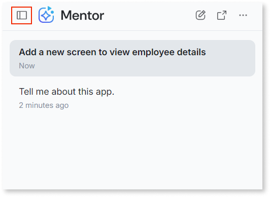

# Find and resume past conversations in Mentor Studio

Mentor Studio saves your past conversations. In ODC Studio, you open a past conversation, search your history, and continue from where you left off. When you resume a conversation, you don't have to restate the constraints, naming conventions, and architectural decisions you already gave in it.

Each conversation is independent. Mentor doesn't carry context from one conversation to another, so a new conversation starts without the context of your earlier ones.

Conversation history is available in ODC Studio only. It's scoped to the app you have open.

## Open a past conversation {#access}

To open a past conversation, follow these steps:

1. Open the app in ODC Studio.
1. Open the Mentor panel.
1. Click the icon at the top left of the Mentor panel.
1. Select the conversation you want to open.
Mentor Studio displays the messages from that conversation.

The following image shows the list of past conversations in the Mentor panel.

## Resume a conversation {#resume}

To resume a conversation, open it and send a new prompt.

A resumed conversation keeps its full context. When you send a new prompt, Mentor uses all earlier prompts and responses in that conversation to interpret it. You don't need to restate earlier constraints, naming conventions, or decisions.

Some actions depend on the state of the app at the time of the conversation and aren't available after the app changes. For example, you can't use **Review changes** on a set of changes from a past conversation once the app context has moved on.

Write your new prompt the same way you write any Mentor Studio prompt. For more information about writing prompts, refer to [Prompts for Mentor Studio](prompts.md).

## What happens when your access to an app changes {#access-changes}

Your conversation history follows your permissions on the app. Mentor Studio hides your conversations for an app when you lose access to that app, and it shows them again if you regain access. Hidden conversations don't appear in the history panel or in search results.

If the app is deleted, Mentor Studio deletes your conversations for it permanently.

## Security and compliance {#security-compliance}

Mentor Studio stores your conversation history under the same security, privacy, and compliance safeguards that apply to agentic development in ODC. For more information, refer to [Security and safeguards](../security-safeguards.md) and to the [data platform](../../manage-platform-app-lifecycle/platform-architecture/intro.md#data-platform) in the ODC architecture.

## Related resources {#related-resources}

The following resources cover how Mentor Studio works and its limitations.

* For the Mentor Studio workflow, refer to [AI development in Mentor Studio](how-it-works.md).
* For the limitations that apply to Mentor Studio, refer to [Known limitations](../ai-limitations.md).
