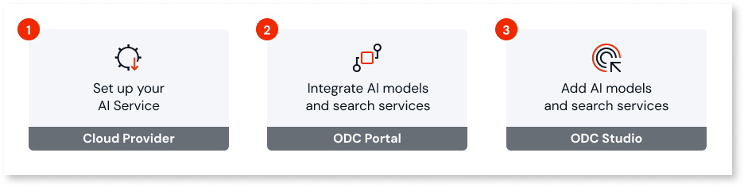
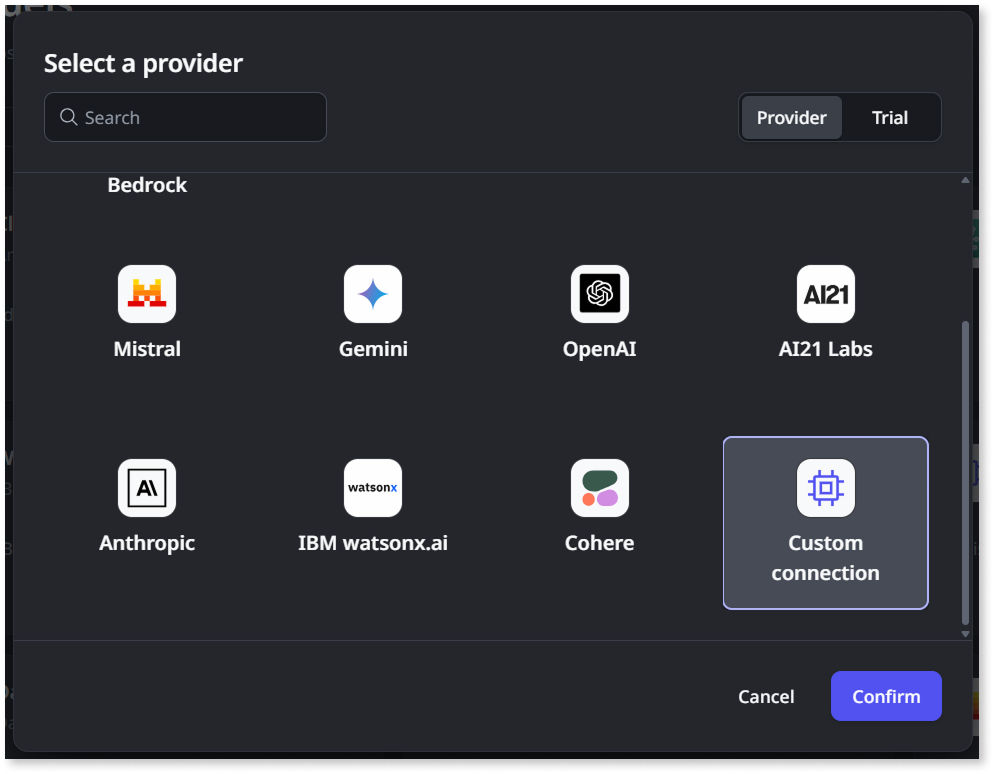

# AI models and search services in ODC

OutSystems Developer Cloud (ODC) lets you connect your OutSystems apps to large language models (LLMs). This enables you to power up apps with AI capabilities using models from various providers. ODC natively supports multiple providers, including Amazon Bedrock, Azure OpenAI, and models you deploy and manage on Databricks. Refer to [Adding AI models](add-ai-models.md) for the complete list of natively supported providers. ODC also supports other providers or private models through a custom API contract. All connections utilize your API keys (BYOK) to interact with the model services.

You manage your AI model connections within ODC. This includes adding new connections for supported providers or custom models. For each connection, you can configure multiple endpoints. Set daily usage limits on AI model connections to manage token consumption.

Once an AI model connection is configured, you can create logic in ODC Studio to call the model. These calls can range from text prompts to complex input parameter interactions. This includes using features like tools associated with the LLM or specific parameters defined in the contract for custom model connections.

To ground the answers of an AI model in your content, your app retrieves relevant passages and passes them to the model as context. This pattern is called retrieval-augmented generation (RAG). For content stored in ODC, such as app data, app files, and documents in knowledge bases, use [semantic search](semantic-search/semantic-search-overview.md). For content indexed in an external search service, such as Azure AI Search or Amazon Kendra, [add a search service connection](add-ai-search-services.md) and call the search action that ODC provides.

## Use trial models { #trial }

To help you quickly experiment with AI features without immediately setting up your model connection, ODC offers pre-configured trial models (provided via Azure OpenAI and Amazon Bedrock). You can add these models directly within ODC and call them from your apps running in the Development stage. Note that trial models via Azure OpenAI are limited to 100 calls per ODC tenant and trial models via Amazon Bedrock allow up to 1000 and are intended for initial testing or proof-of-value exploration before configuring your persistent AI model connection.

In a multi-portfolio organization, trial models are available only in the main portfolio.

## Custom model connections { #custom-model-connections }

Beyond native support for Azure OpenAI and Amazon Bedrock, ODC allows you to connect to other LLMs, such as those from different providers or your private models. This is achieved using the **Custom connection** option. To use this option, you must provide an intermediary web service called a connector that bridges ODC and your target LLM. This connector service must implement a specific API contract defined by OutSystems, which involves exposing a synchronous REST endpoint using the POST method for chat completions.

When building your connector service, implement a supported authentication scheme and ensure its endpoint is accessible to ODC, potentially using a private gateway for non-public endpoints. The connector must process requests and format responses, including handling standard parameters like messages and temperature, according to the OutSystems API contract details. Your service should also return standard HTTP status codes for errors. Once your connector service is deployed and accessible, add it to the ODC Portal by selecting **Custom connection** as the provider type during the **Add AI model** process and entering your connector's URL and authentication details.

For more information, download and inspect the [Swagger file](resources/swagger.json). Note that property names should use camelCase.

## Search services connections

A search service connection links your apps to Azure AI Search, Amazon Kendra, or a custom data source that conforms to an API contract. You manage the connections in the ODC Portal, and your app calls the search action of each connection in ODC Studio. For more information, refer to [Integrating AI models and search services](integrate-ai-models-logic-rag.md).

## Next steps

To start adding AI features to your apps, continue with the following:

* [Adding AI models](add-ai-models.md)
* [Adding search services](add-ai-search-services.md)
* [Integrating AI models and search services](integrate-ai-models-logic-rag.md)
