# Create and manage a knowledge base in the ODC Portal

To give agents and apps a set of curated documents to search, you create a knowledge base in the ODC Portal and upload the documents to it. After the platform indexes the files, developers call the generated `SearchKB<KnowledgeBaseName>` action from their apps in ODC Studio. This page describes how to create a knowledge base, upload files, view the indexing status, edit the name and description, and delete a knowledge base.

You set the knowledge base and its data source configuration, including the chunk method, once for all stages. You upload the files separately in each stage, and each stage indexes and searches only its own files. For more information about the structure of a knowledge base and stage isolation, refer to [Knowledge bases in ODC](knowledge-bases-overview.md).

## Prerequisites

Confirm the following before you create a knowledge base:

* The runtime region of each stage where you use the knowledge base supports knowledge bases. For the list of regions, refer to [Regions and languages for semantic search](../semantic-search/search-regions-languages.md).
* You chose a chunk method for your documents, because you can't change it after you create the knowledge base. For more information, refer to [Chunk methods in ODC](../semantic-search/chunk-methods.md).
* Your role includes the permissions for the tasks that you perform.

Each task on this page requires a permission. The following table lists the permission for each task. The built-in Administrator role includes all of them. The platform checks the permissions in the Development stage of the portfolio for tasks in every stage, so your role must include them for the Development stage.

| Task | Permission |
| --- | --- |
| Create a knowledge base | **Configuration management** > **Edit asset configurations** |
| Upload files to a knowledge base | **Configuration management** > **Edit asset configurations** |
| View knowledge base details | **Configuration management** > **View configurations** or **Edit asset configurations** |
| Edit knowledge base settings | **Configuration management** > **Edit asset configurations** |
| Delete a knowledge base | **Configuration management** > **Edit asset configurations** |

For more information about permissions and custom roles, refer to [Roles and permissions for members (IT-users)](../../../user-management/roles.md).

## Create a knowledge base

A knowledge base needs a name, a description, and a data source with a chunk method. The data source configuration is shared by all stages and can't change after you create the knowledge base.

1. In the ODC Portal, in the left navigation, go to **Integrate** > **Knowledge bases**.
1. Click **Create knowledge base**.

    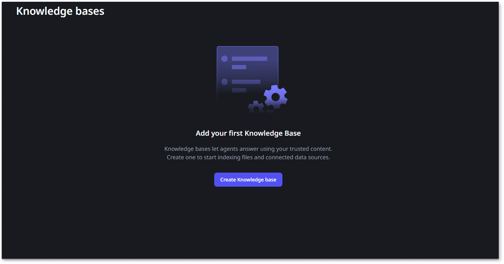

1. In **Knowledge base details**, enter a **Name** for the knowledge base, up to 42 characters. Use a name that identifies the document set, for example, `HR Policies` or `Legal Contracts`.
1. Enter a **Description** that states what the knowledge base contains and who uses it, and then click **Continue**. ODC Studio shows the description with the knowledge base reference in apps that use the knowledge base.

    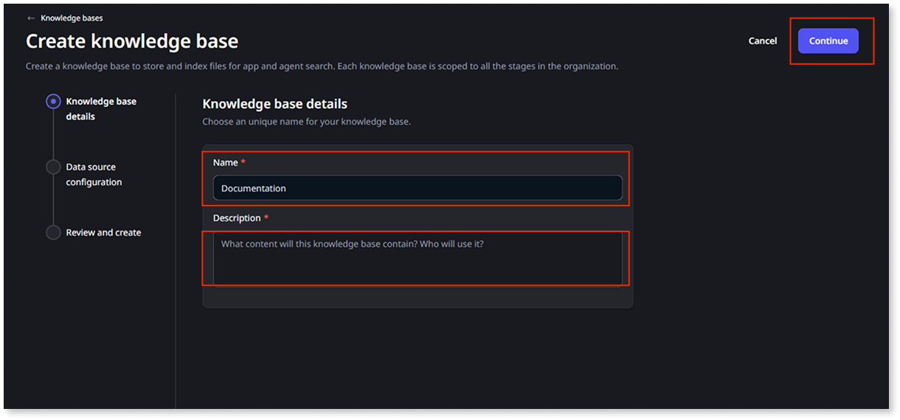

1. In **Data source configuration**, enter a **Name** for the data source. The **Description** of the data source is optional.
1. In **Chunking method**, select the chunk method for the files, and then click **Continue**.

    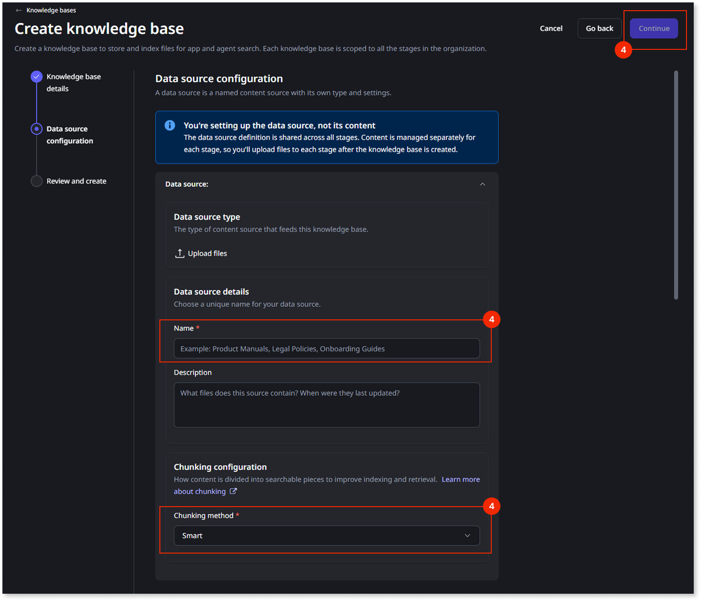

1. In **Review and create**, check the knowledge base details and the data source configuration, and then click **Publish and create knowledge base**.

    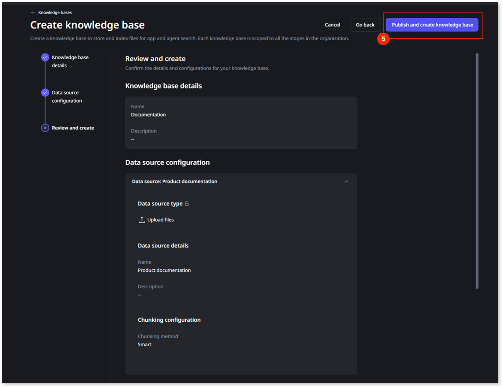

The knowledge base appears in the list with the **Ready** status. It has no files until you upload them in each stage.

## Upload files to a knowledge base

Each stage has its own files, so upload the files in every stage where an agent or app searches the knowledge base. The platform indexes each file after the upload, and the status of each file shows when the file is searchable.

1. In the ODC Portal, go to **Integrate** > **Knowledge bases**.
1. On the card of the knowledge base, click **...**, and select **Open knowledge base**.
1. In the stage selector, select the stage to upload the files to.
1. On the **Data Sources** tab, click **...** next to the data source, and select **Open data source**.

    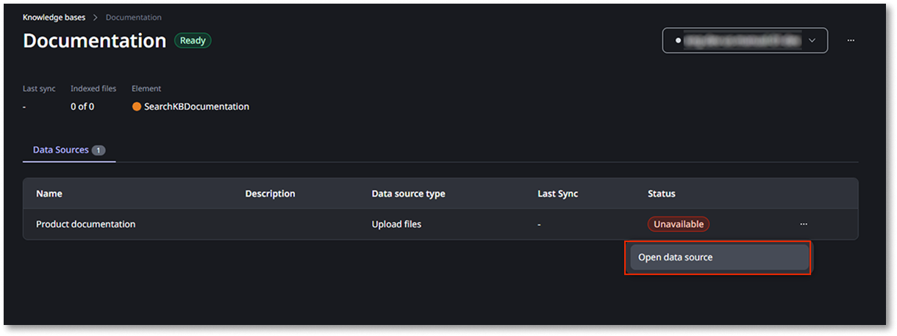

1. Click **Upload files**.

    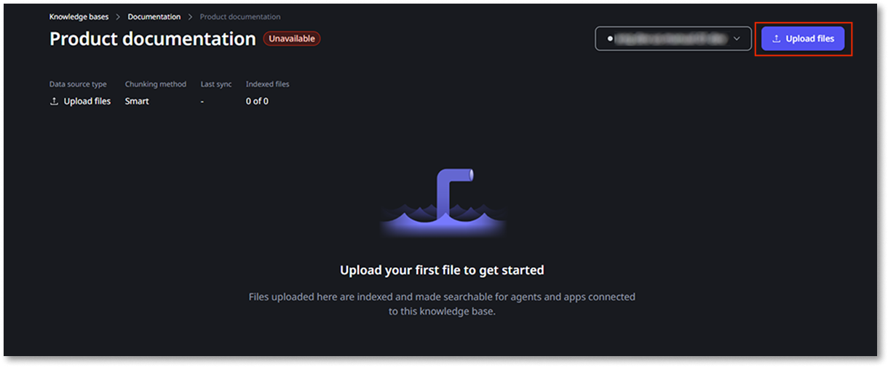

1. In the **Upload files** dialog, click **Browse** or drag the files to the dialog, and then click **Upload**. The dialog lists the supported file types and the maximum size of each file.

    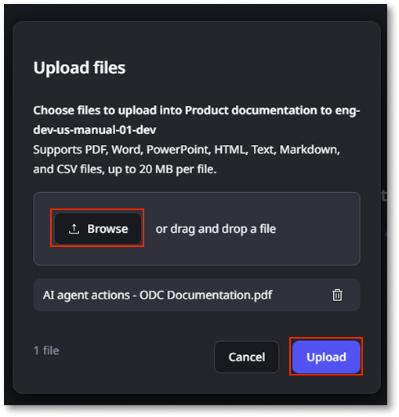

    The **Uploading files** panel shows the progress of each upload. You can continue to work in the ODC Portal while the upload and the indexing run. Indexing takes longer for more files and for larger files.

    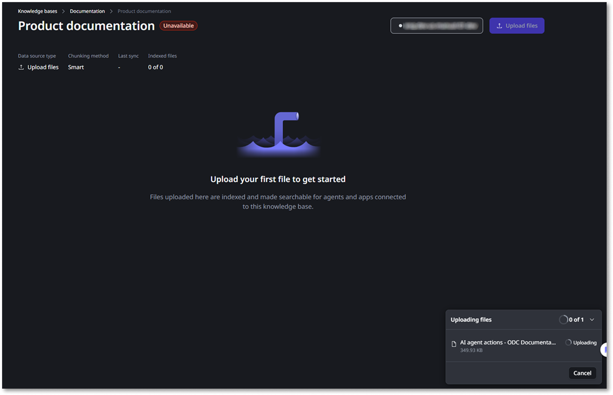

1. To check the indexing, on the **Files** tab of the data source, click **Refresh**. A file has the **Indexing** status while the platform processes it, and the **Indexed** status when it's searchable.

    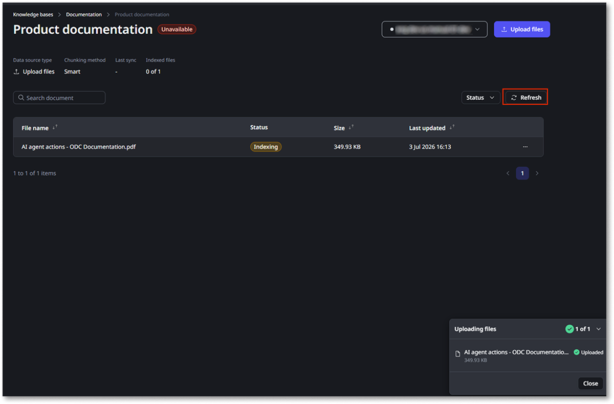

## View knowledge base details

The knowledge base page shows the status of the knowledge base, its data sources, and the search action that the platform generates. Each data source shows its files and their status in each stage.

1. In the ODC Portal, go to **Integrate** > **Knowledge bases**.
1. On the card of the knowledge base, click **...**, and select **Open knowledge base**.
1. In the stage selector, select the stage.

The knowledge base page shows the following details for the stage:

* The status of the knowledge base, next to its name.
* **Indexed files**: The number of indexed files out of the uploaded files.
* **Element**: The name of the `SearchKB<KnowledgeBaseName>` action.
* **Data Sources**: The data sources of the knowledge base, with the type and the status of each one.

To see the files of a data source, open the data source and select the **Files** tab. The tab lists each file with its status, size, and last update. To find the files with a given status, use the **Status** filter.

## Edit knowledge base settings

To keep the name and the description of a knowledge base in line with its content, edit them in the ODC Portal. The knowledge base is shared by all stages, so the change applies to every stage.

1. In the ODC Portal, go to **Integrate** > **Knowledge bases**.
1. On the card of the knowledge base, click **...**, and select **Edit knowledge base details**.

    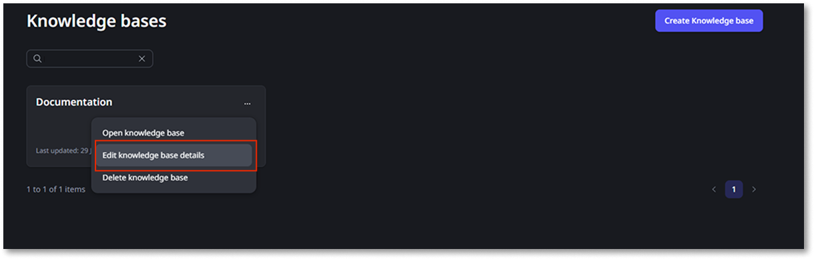

1. Change the **Name** or the **Description**.
1. Click **Save**.

Renaming a knowledge base changes the name of its `SearchKB<KnowledgeBaseName>` action. The action keeps the identifier of the knowledge base, so apps that use it keep working and show the new name the next time you publish them.

## Delete a knowledge base

You can't delete a knowledge base while an app or agent references it. Remove the references from the apps and agents, and then delete the knowledge base.

Deleting a knowledge base permanently removes it from every stage, with its uploaded files, its chunks, and their embeddings. You can't undo the deletion.

1. In the ODC Portal, go to **Integrate** > **Knowledge bases**.
1. On the card of the knowledge base, click **...**, and select **Delete knowledge base**.

    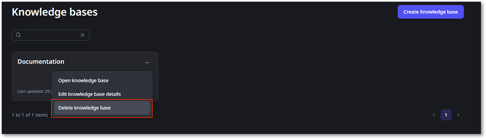

1. In the confirmation dialog, enter the name of the knowledge base, and then click **Delete permanently**.

    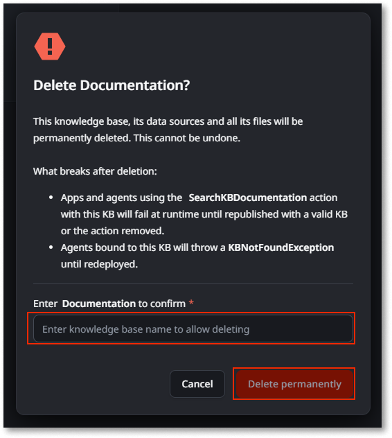

## Call a knowledge base from an app

For every knowledge base that you create and publish in the ODC Portal, the platform generates a `SearchKB<KnowledgeBaseName>` server action that you add to your app in ODC Studio. To add and call the action, refer to [Add semantic search to your app](../semantic-search/add-semantic-search.md).
