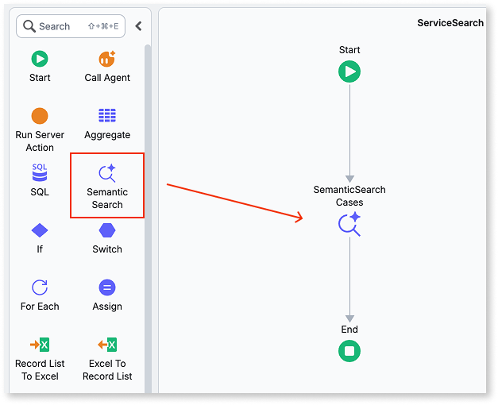
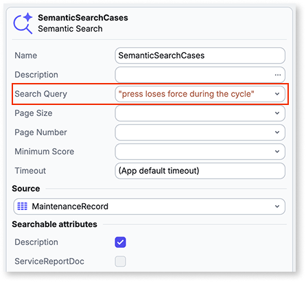
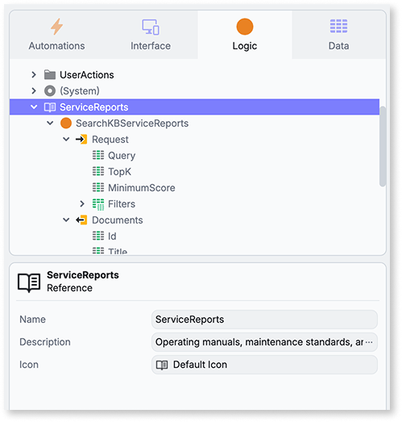
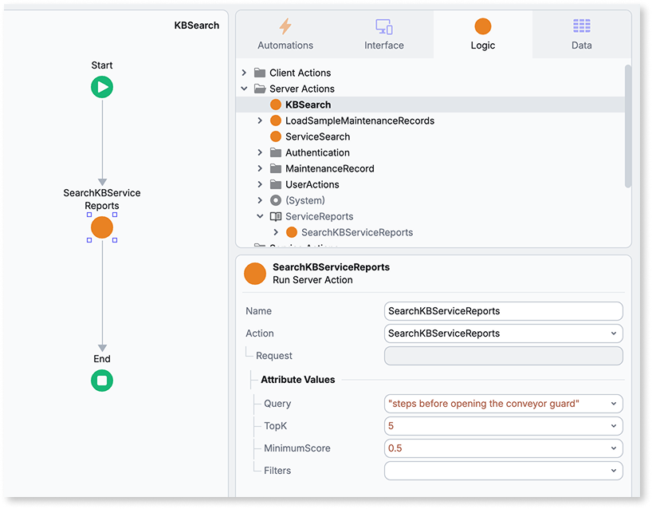

# Add semantic search to your app

To let users and agents find content by meaning, add a semantic search to a server action in ODC Studio. The search runs over the searchable attributes of an entity or over a knowledge base, and it returns the matching content as a list.

## Prerequisites

A search returns only indexed content, and the search elements need a minimum ODC Studio version. Confirm the following before you add the search:

* For entity attributes, the attributes are searchable, and the app that holds the entity is published. For more information, refer to [Make entity attributes searchable](make-attributes-searchable.md).
* For a knowledge base, the status of the knowledge base is **Ready**, and the files to search have the **Indexed** status in the stage where your app runs. The knowledge base definition is shared by all stages, but each stage has its own files. For more information, refer to [Create and manage a knowledge base in the ODC Portal](../knowledge-base/create-manage-knowledge-base.md).
* You use ODC Studio 1.7.15 or later for knowledge bases and text attributes, or ODC Studio 1.7.20 or later for File attributes.

## Search entity attributes

To search the text or File attributes of an entity, add the Semantic Search node to a server action. A node searches either text attributes or File attributes, so to search both kinds in the same entity, add a node for each.

1. In ODC Studio, create a server action for the search, or open an existing server action.
1. Drag the **Semantic Search** element from the toolbox to the flow of the server action.

    

1. In **Search Query**, set the text to search for.
1. In **Source**, select the entity that holds the searchable attributes.
1. In **Searchable attributes**, select the text attributes or the File attributes to search.

    

    

    The screenshot uses a fixed query in **Search Query** to illustrate the search. In an app, set **Search Query** to an input parameter or a variable that holds the text that users or agents search for.

    

1. Optional: To limit the search to the records that meet a condition, set **Filters** to a condition on the attributes of the source entity. You write the condition the same way as an Aggregate filter, and you can combine conditions with `and` and `or`. For example, `MaintenanceRecord.MachineId = MachineId` returns only the chunks from the records of one machine, where `MachineId` is an input parameter of the server action.

The node returns the results in the `Records` output list. Each item holds the matching entity record and a `SearchResult` structure with the matching content and its score.

To return the results from the server action, add an output parameter with the same data type as the `Records` list. The data type is a record list of the source entity and the `SearchResult` structure. Then, assign the `Records` list of the node to the output parameter, for example `SemanticSearchCases.Records`.

## Search a knowledge base

To search a knowledge base, add the search action that the platform generates for the knowledge base to your app, then call the action in a server action. The action takes a `Request` structure that holds the query, and it returns the matching chunks in the `Documents` output.

### Add the search action

For each knowledge base, the platform generates a server action named `SearchKB<KnowledgeBaseName>`. The **Element** field on the details page of the knowledge base in the ODC Portal shows the exact name of the action.

1. In the app tree, right-click and select **Add public element**.
1. In the **All sources** drop-down, filter by the name of the knowledge base.
1. Select the server action `SearchKB<KnowledgeBaseName>`. The **Source** column shows the originating knowledge base.
1. Click **Add**. The server action appears under **Server Actions** in the **Logic** tab, inside a reference with the name of the knowledge base. The reference shows the description of the knowledge base, and the action shows its `Request` input and `Documents` output.

    

The server action references the knowledge base by its identifier, so renaming the knowledge base in the ODC Portal keeps your app working. The action name changes to match the new name of the knowledge base, and your app shows the new name the next time you publish it. If an administrator deletes the knowledge base and creates one with the same name, the new knowledge base has a different identifier. Add the server action of the new knowledge base to your app again.

### Call the search action

Call the action in a server action, and pass the text to search for in the `Query` field of the `Request` input.

1. In ODC Studio, create a server action for the search, or open an existing server action.
1. Drag the `SearchKB<KnowledgeBaseName>` action from the **Logic** tab to the flow of the server action.
1. In the action properties, set the text to search for in the `Query` field of the `Request` input.

    

    

    The screenshot uses a fixed query in the `Query` field to illustrate the search. In an app, set `Query` to an input parameter or a variable that holds the text that users or agents search for.

    

1. Optional: To limit the search to one file, add an item to the `Filters` field, and set `Name` to `"filename"` and `Value` to the name of the file in quotes. For more information, refer to [Knowledge base search filters](search-inputs-results.md#knowledge-base-search-filters).

The action returns the results as a list of documents.

## Use the results

Both search elements return a list of results ranked by score. Each result carries a chunk of content, so your app can display the chunks on a screen or pass them to an AI model as grounding data. To keep the results relevant, set a minimum score and filters on the search. For the properties and results of each element, refer to [Semantic search inputs and results](search-inputs-results.md).

To let an agent run the search, expose the server action to the agent as an agent action. For more information, refer to [AI agent actions](../function-calling.md).

The Semantic Search node doesn't check whether the end user can access a record or a file. Before you show the results to users or expose the search to an agent, set **Filters** on the node to return only the records that the user can access.

## Test the search

A search returns only the content that the platform has indexed, so confirm the indexing status before you run a test query. Each search option reports its status in a different place:

* **Text attributes**: In the ODC Portal, the `Embedding sync` logs under **Monitor** > **Logs** show when a full reindex starts and completes. Indexing of individual record changes doesn't produce logs.
* **File attributes**: No indicator shows when a file is indexed, so run a search for content in the file. When the platform can't index a file, for example because of its type or size, the app logs under **Monitor** > **Logs** show an entry with the record, the attribute, and the reason.
* **Knowledge bases**: The details page of the knowledge base in the ODC Portal shows the number of indexed files under **Indexed files**, and the **Files** tab of the data source shows the status of each file.

To test the search, do the following:

1. Publish the app.
1. Add content that matches your test query: a record with text, a file in a File attribute, or a file in the knowledge base. For a knowledge base, add the file in the stage where your app runs, because each stage has its own files.
1. For text attributes and knowledge bases, wait until the status shows that the platform finished indexing the content. File attributes have no status indicator, so if the results of the next step omit the file, wait and run the search again.
1. Run the server action with a query that matches the meaning of the content.
1. Confirm that the results include the content.

**Result**: A server action that searches your content and returns the matching results to your app and agents.
