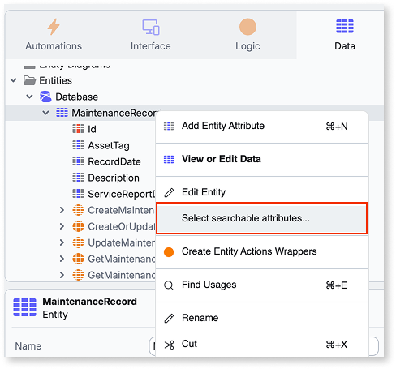
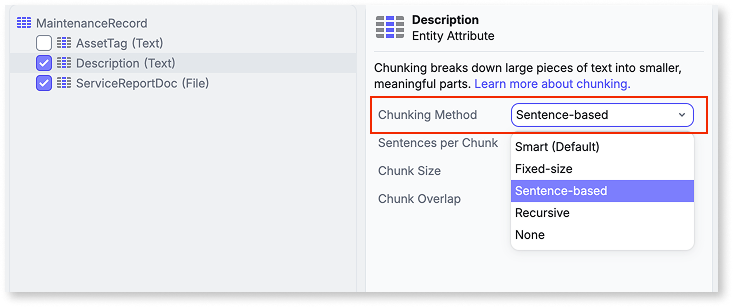
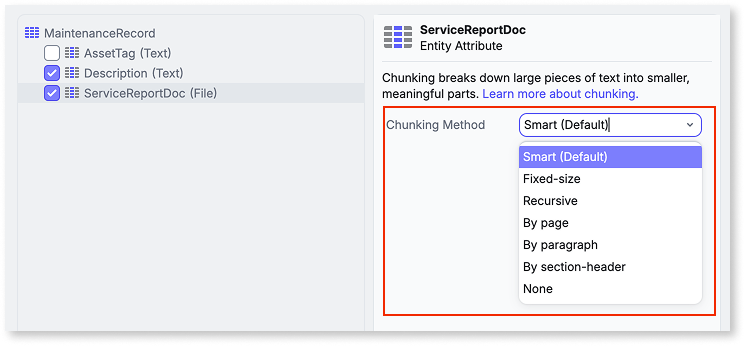

# Make entity attributes searchable

To let your app search records and their files by meaning, make the entity attributes that hold the content searchable in ODC Studio, then publish the app. The platform indexes the content that already exists in the entity, and it keeps the index current as records and files change.

## Prerequisites

Confirm the following before you make attributes searchable:

* The entity has a text attribute, or a File attribute that uses the File data type. Binary Data attributes aren't eligible.
* The entity has an entity identifier.
* For File attributes, semantic search over File attributes is available in the runtime region of each stage where your app runs. For the list of regions, refer to [Regions and languages for semantic search](search-regions-languages.md).
* You use ODC Studio 1.7.15 or later for text attributes, or ODC Studio 1.7.20 or later for File attributes.

## Choose a chunk method for each attribute

The chunk method sets how the platform splits the content of an attribute into the passages that a search returns. **Smart (Default)** applies to text and File attributes, and it fits content with mixed or inconsistent structure. Choose another method when each result must follow the structure of the content. For example, **By section-header** creates one chunk for each section of a report with headings, and **By page** creates one chunk for each slide of a presentation. For all methods and their parameters, refer to [Chunk methods in ODC](chunk-methods.md).

## Select the searchable attributes

To mark attributes as searchable, select them in the **Select searchable attributes** dialog and set the chunk method for each one.

1. In ODC Studio, open your app and select the **Data** tab.
1. Right-click the entity that holds the content, and select **Select searchable attributes...**. The **Select searchable attributes** dialog opens.

    

1. Select the checkbox of each attribute to make searchable.
1. To set the chunk method of an attribute, select the attribute, and then select a method in **Chunking Method**. Text attributes and File attributes offer different methods.

    

    For a File attribute, the list includes the methods that follow the structure of a document.

    

1. If the method has parameters, such as **Chunk Size**, enter their values.
1. Click **Close**.

## Publish the app and check the indexing

Publishing the app applies the semantic search configuration, and the platform starts indexing the records that already exist in the entity. For text attributes, ODC writes an `Embedding sync` log when this full reindex starts and when it completes.

1. In ODC Studio, publish the app.
1. To check the indexing of text attributes, in the ODC Portal, go to **Monitor** > **Logs**.
1. In the search box, enter `Embedding sync`.

The completed log shows the number of records and the time the sync took.

**Result**: Searchable attributes, which the platform indexes in the background. You can add the search to your app while the indexing runs.

## Change the chunk method

If search results miss expected passages or include unrelated content, change the chunk method of the attribute and publish the app again.

1. In the ODC Studio **Data** tab, right-click the entity and select **Select searchable attributes...**.
1. Select the attribute, and then change the method in **Chunking Method** or the values of its parameters.
1. Click **Close**, and then publish the app.

The change reindexes every existing record in the entity. The search results reflect the new chunks after the reindex finishes.
