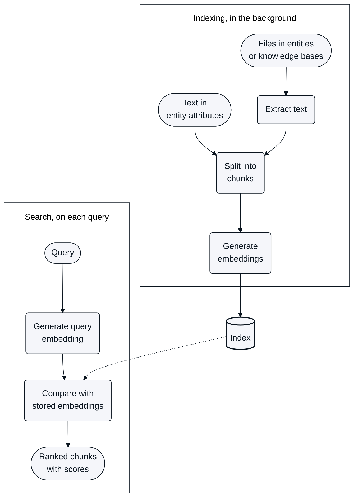

# Semantic search in ODC

Users and agents ask questions in their own words, and the words in a question often differ from the words in the content that answers it. A keyword search returns only the content that contains the query terms. Semantic search returns the passages that are closest in meaning to the query, ranked by relevance. An agent grounds its answers in your content, and a user finds a record without knowing its exact wording.

ODC runs semantic search, also known as Native Semantic Search, over app data in text attributes, app files in File attributes, and documents in knowledge bases. The platform manages the embedding model, the index, and the indexing. You choose the content to search, how the platform splits it, and how your app or agent uses the results.

## Semantic search use cases

Semantic search fits when users describe what they need in their own words and the content uses different words. The following scenarios cover agents and apps:

* A support agent answers customer questions from product manuals and past support tickets.
* An app lets employees search HR policies by topic instead of by exact keywords.
* A review app finds clauses with a similar meaning across uploaded contracts.
* A store app suggests products whose descriptions match what a shopper describes.

Content that a search must match exactly, such as serial numbers and error codes, calls for a keyword search, for example a filter in an Aggregate. An app can combine both. A semantic search finds the relevant passages, and filters on other attributes narrow the results.

## Indexing and search flow

Semantic search has two parts. Indexing prepares your content in the background before anyone searches. Search runs each time an app or agent sends a query.

During indexing, the platform performs the following tasks:

1. For content in files, the platform extracts the text.
1. The platform splits the text into chunks, using the chunk method that you select. A chunk is a passage of the content, and each chunk is one search result.
1. For each chunk, the platform generates an embedding, a vector that represents the meaning of the chunk.
1. The platform stores the embeddings, which form the index of the content, and keeps them synchronized when the content changes.

During search, the platform converts the query into an embedding and compares it with the stored embeddings. The platform returns the chunks whose meaning is closest to the query, ranked by a score. A higher score means a closer match, and you can exclude the results below a minimum score.

Indexing writes embeddings to the index, and each search reads from it. The following diagram shows the two flows.

Saving a record or uploading a file completes without waiting for the indexing. A change appears in search results after the platform finishes processing it. The page for each search option describes its indexing events and how to check the indexing status.

Because each result is a chunk, the chunk method affects which passages a search returns and how much context each passage carries. For more information, refer to [Chunk methods in ODC](chunk-methods.md).

## Search option by content source

ODC offers three search options. Match your content to an option by where the content lives and who manages it:

* **Semantic search over text attributes**: Use this option when the content is text in entity attributes, such as product descriptions or support notes, and the app and its users create and update the text.
* **Semantic search over File attributes**: Use this option when users or app logic store files, such as PDF and Word documents, in entity records. Results link to the entity records, and you can filter them on other entity attributes.
* **Knowledge bases**: Use this option when an administrator curates a set of documents that's separate from the app data, or when several agents or apps ground their answers in the same documents. You manage the content in the ODC Portal, without app logic.

An entity can have both searchable text attributes and searchable File attributes. A Semantic Search node targets one kind, so you use a separate node for each.

Content that an external search service indexes uses a separate path. For more information, refer to [Native and external search](#native-and-external-search).

## Differences that affect design

The following table compares how each option works, so you can check the design effects after you choose an option.

| Difference | Semantic search over text attributes | Semantic search over File attributes | Knowledge bases |
| --- | --- | --- | --- |
| Searches | Text attributes that you mark as searchable | File attributes that you mark as searchable | Documents uploaded to a knowledge base |
| Content added by | App logic and users, as entity records | App logic and users, as files in entity records | An administrator, in the ODC Portal |
| Configured in | ODC Studio | ODC Studio | ODC Portal |
| Indexing starts when | A record is created, updated, or deleted | A file is uploaded, replaced, or deleted | An administrator uploads a file |
| Chunk method after setup | Changeable. The platform reindexes every record. | Changeable. The platform reindexes every file. | Fixed when you create the knowledge base |
| Queried with | The Semantic Search node, in a server action | The Semantic Search node, in a server action | The `SearchKB<KnowledgeBaseName>` server action that the platform generates for each knowledge base |
| Content in each stage | The entity data of the stage | The entity data of the stage | One configuration for all stages, with separate files and search index in each stage |

For the chunk methods, refer to [Chunk methods in ODC](chunk-methods.md). For how a knowledge base works in each stage, refer to [Knowledge bases in ODC](../knowledge-base/knowledge-bases-overview.md).

The runtime region of a stage determines which options are available in that stage and where the platform generates the embeddings. For more information, refer to [Regions and languages for semantic search](search-regions-languages.md).

## Native and external search

ODC offers two ways to ground an app or an agent in your content. Native semantic search indexes content in ODC. A search service connection queries content that an external search service indexes, such as Azure AI Search, Amazon Kendra, or a custom search service. The following table compares the two.

| Difference | Native semantic search | Search service connection |
| --- | --- | --- |
| Content | App data, app files, and knowledge base documents in ODC | Content that the external search service indexes |
| Index managed by | The platform | The external search service |
| Set up in | ODC Studio for entity attributes, and the ODC Portal for knowledge bases | The search service provider for the service, and the ODC Portal for the connection |
| Queried with | The Semantic Search node or the `SearchKB<KnowledgeBaseName>` server action | The search action of the connection, in ODC Studio |

For more information about adding a search service connection, refer to [Adding search services](../add-ai-search-services.md). For more information about grounding AI model responses with either option, refer to [AI models and search services in ODC](../ai-models.md).

## Search in app logic and in AI agents

An app or an AI agent runs a semantic search through a server action. The two approaches differ in what triggers the search and who sets the query.

* **App logic**: The app calls the server action on every request that needs results. The app logic sets the query, from an input parameter or a variable, and sets the filters.
* **AI agent**: An Agent Workbench agent calls the server action as an agent action when the AI model selects it. The agent sets the query when you set **Generated by AI** on the query parameter. The app logic still sets the filters in the server action.

To limit the results to content that a user can access, refer to [Use the results](add-semantic-search.md#use-the-results). For the steps to expose the server action to an agent, refer to [AI agent actions](../function-calling.md).

## Next steps

Continue with the page that matches your content and your next task:

* To learn how the platform indexes and searches text in entities, refer to [Semantic search over text attributes](search-over-text-attributes.md).
* To learn how the platform indexes and searches files in entities, refer to [Semantic search over files](search-over-files.md).
* To learn how the platform indexes and searches curated documents, refer to [Knowledge bases in ODC](../knowledge-base/knowledge-bases-overview.md).
* To choose a chunk method for your content, refer to [Chunk methods in ODC](chunk-methods.md).
* To plan the tasks from making content searchable to testing the search, refer to [Implementing semantic search in ODC](implementing-semantic-search.md).
* To check the usage limits and the file size limits, refer to [Semantic search and knowledge bases in OutSystems system requirements for ODC](../../../getting-started/system-requirements.md#semantic-search-and-knowledge-bases).
