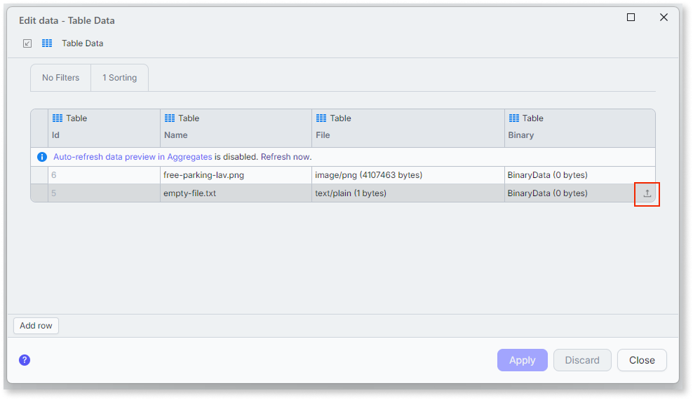
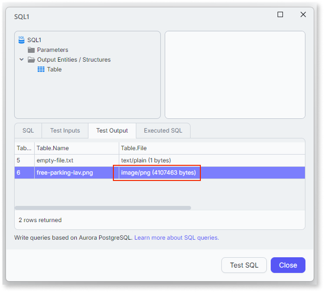
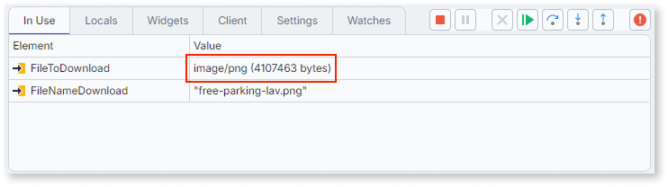
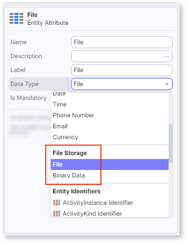

# Preview file data in ODC Studio

When an entity or Aggregate has a **File** attribute, ODC Studio previews the file's metadata instead of its content. Understanding this preview format helps you interpret **File** values while you inspect data, test queries, or debug your app.

## Preview file values in Edit Data

When you open **Edit Data** for an entity with a **File** attribute, ODC Studio shows the attribute's metadata instead of its content, formatted as `MIMEType`. For example, a PNG image previews as `image/png (4107463 bytes)`. To learn how to open **Edit Data**, refer to [Edit data in ODC Studio](../edit-data.md).

Unlike **BinaryData** cells, which let you upload a file directly, **File** cells are read-only in Edit Data. The **Upload** and **Delete** actions are disabled for **File** attributes. To add or replace a **File** attribute's content, use your app's logic instead, for example, an **Upload** widget or a server action.

## Preview file values in Advanced SQL test queries

When you test an **Advanced SQL** query that returns a **File** column, ODC Studio previews the column using the same `MIMEType` format as Edit Data.

## Preview file values while debugging

When you debug an action with a **File** variable, the variable inspector shows the value in the same format, mirroring how it displays **BinaryData** variables as `Binary`. For example, a **File** variable displays as `image/png (4107463 bytes)`.

## File in the data type picker

In the data type picker for entity attributes, ODC Studio groups **File** together with **BinaryData** under a **File Storage** category, separate from the basic data types.

## Next steps

After understanding how ODC Studio previews **File** values, you can explore related tasks:

* [The File data type](binaries-native-cloud.md): learn when to use **File** instead of **BinaryData**.
* [File lifecycle](file-reference-lifecycle.md): learn how a **File** reference behaves in entities and aggregates, and how ODC manages it over time.
* [Edit data in ODC Studio](../edit-data.md): learn how to add, delete, and modify entity records, including **BinaryData** attributes.
