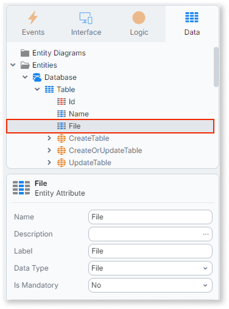
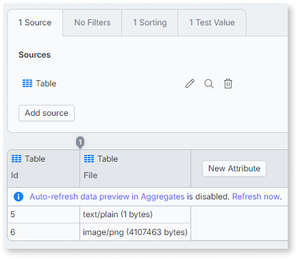

# File lifecycle

When you add a **File** attribute to an entity, ODC stores the file content in cloud storage and keeps a lightweight reference in the database. This article covers two things: how that reference behaves while you build with it, and what happens to it operationally once your app is in production.

For background on the **File** type and how it differs from **BinaryData**, refer to [The File data type](binaries-native-cloud.md). For the **File** reference's properties and where the **File** type isn't available, refer to the quick facts in that article.

The **File** type isn't supported in ODC Self-hosted.

## Working with file references

This section covers how a **File** reference behaves while you build your app: in entities, in aggregates, and in client logic.

The reference also carries a storage key and a version identifier that the platform manages internally. You don't interact with these directly.

To create or return **File** values from External Library functions, refer to [Working with file values in external libraries](working-with-file-in-external-logic.md).

### Adding a file attribute to an entity

You add a **File** attribute to an entity the same way you add any other attribute. Refer to [Create an Entity to Persist Data](../modeling/entity-create.md) for the general procedure.

The database column for a **File** attribute stores the reference, not the binary content, so it stays small regardless of file size. The binary content lives in cloud storage.

### What aggregates return for file attributes

When an aggregate includes an entity with a **File** attribute, ODC does not load binary content into the query result. Instead, the aggregate returns the file metadata together with a URL the client uses to download the file directly from cloud storage.

When a user clicks a link or button that uses this URL, the browser fetches the file directly from cloud storage, without routing the content through the application server.

The result is:

* Binary content is never included in aggregate payloads, regardless of file size.
* The application server handles no binary data during the query.
* You work with the URL in your screen logic the same way you use any other string value.

The download URL is time-limited and not suitable for long-term sharing. Request a fresh URL each time the user needs access. Refer to [File access and signed URLs](file-signed-urls.md) if you need to control how long that access lasts or reuse the URL safely.

### File states

A **File** value moves through the following states as your application creates, updates, and deletes the entity records that reference it:

* **Uploaded**: the content has been received by the platform but isn't yet attached to a committed entity record.
* **Active**: a committed entity record references the file. The content is available through the entity or Aggregate that holds it.
* **Pending deletion**: no committed entity record references the file anymore. The platform doesn't delete the underlying content immediately, deletion happens asynchronously after a retention window.

### Reference counting

Multiple entity records can reference the same **File** value. ODC tracks how many committed records reference a file and only marks it for deletion when you remove the last reference.

This means:

* Sharing the same **File** across records doesn't duplicate storage.
* Removing one record that references a shared **File** doesn't delete the file if other records still reference it.
* If a record is removed through a foreign key cascade delete, ODC decrements the reference count for the associated file in the same transaction, following the same rules as a direct delete.

### Local files vs. cloud files in client logic

Client-side logic distinguishes between a **local file**, content that exists only on the user's device and hasn't been uploaded yet, and a **cloud file**, content that already exists in cloud storage and serializes as a normal **File** reference.

A local file must be uploaded before you can save its reference to an entity attribute. If your logic assumes every **File** value it handles is already a cloud file, a local file that hasn't been uploaded yet causes unexpected behavior. Confirm which case you're handling before you serialize or save a **File** value.

## Operating file storage in production

This section covers what happens to File content over time once your app is live: deletion timing, disaster recovery, and storage monitoring.

### Disaster recovery {#disaster-recovery}

File storage follows the same disaster recovery posture as your environment's database. The platform manages this for you as part of its standard DR strategy.

This works because ODC doesn't delete a file from cloud storage immediately when its reference count reaches zero. Instead, the platform keeps the file for a retention period that keeps file storage consistent with your app's database backups: if you restore your database to an earlier point in time, the files referenced at that point are still available. Don't design logic that depends on File content being deleted immediately after you remove the last reference to it.

### Monitoring storage usage

ODC tracks File storage usage per environment, including total stored size and object count, and surfaces it through the Portal's analytics so you can monitor consumption against your storage entitlement.

Replacing or removing a **File** value doesn't immediately reduce storage usage. The old content continues to count against your storage entitlement until the retention period ends and the platform completes the deletion. Refer to [Disaster recovery](#disaster-recovery) for details on the retention period.

### Automatic cleanup of incomplete operations

If an operation that stores File content doesn't complete successfully, for example a rolled-back transaction or a failed request, the platform automatically reclaims any content that was written but never committed to an entity record. You don't need to build your own cleanup logic for these cases.
