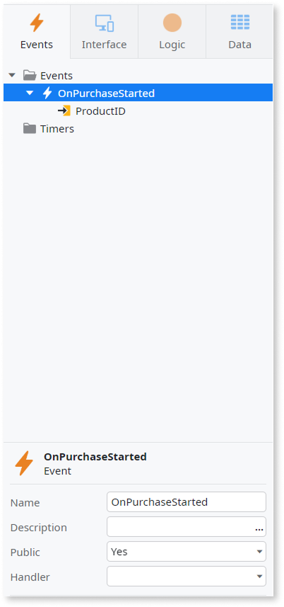
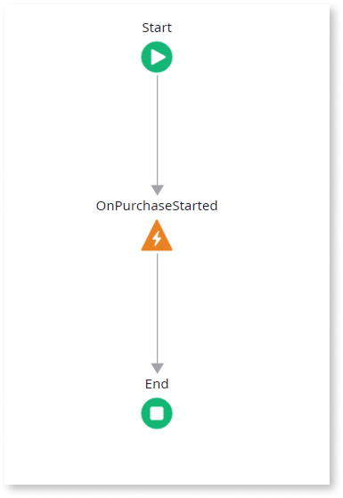
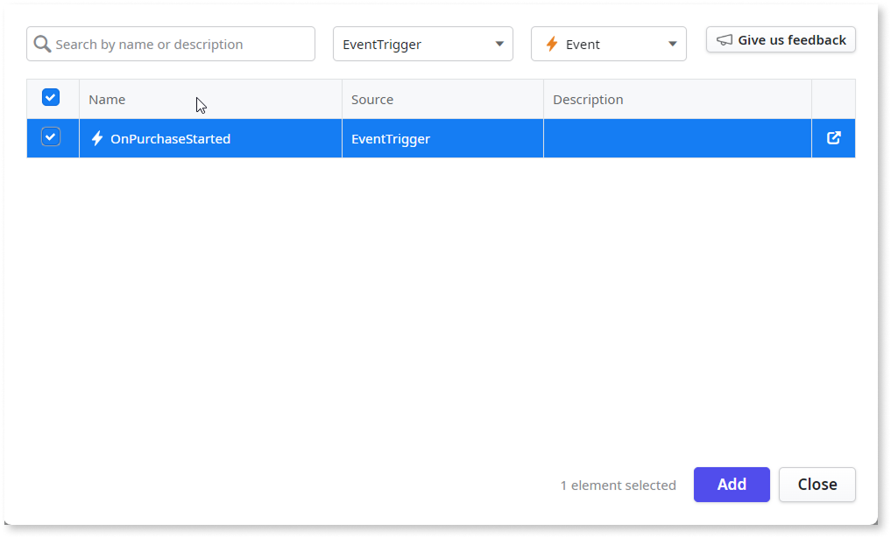
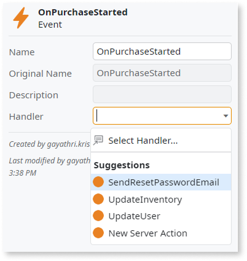

# Implement events in ODC

Events allow apps to communicate changes and updates asynchronously. You can create events in an app to notify other apps when specific actions occur. These events can then be triggered within the app's logic and handled either in the same app or in other apps that consume the event.

You implement events by describing them to Mentor Studio and validating the result, or by building them manually in ODC Studio.

## Implement an event with Mentor Studio

Create, trigger, and handle an event by describing it in Mentor Studio, and validate the event, its trigger, and its handler before you publish.

In your prompt, include the following:

* The event
* Its input parameters
* The server action or service action that triggers it
* The server action that handles it

For a consumer app, name the producer app and the event.

For example, the following sentences form one prompt:

* "Create a public event named OnPurchaseStarted with an input parameter ProductId of type Product Identifier."
* "Trigger it at the end of the PlacePurchase server action, and handle it in this app with a new server action named UpdateStock."

To handle an event that another app produces, add the event to your app as a public element first, then reference the event by name in your prompt. The producer app must set the **Public** property of the event to **Yes** and be published. For more information, refer to [Reuse tenant public elements](../../agentic-development/mentor-studio/capabilities.md#reuse-tenant-public-elements).

### Validate the event

The platform guarantees that the model is valid, and you decide whether the event, its trigger, and its handler implement your requirement. In the **Events** and **Logic** tabs of ODC Studio, check the following:

* The event has the **Public** property set to **Yes** when other apps must handle it.
* The event input parameters use basic data types. Binaries, structures, lists, and entity records aren't valid, and a Text parameter holds at most 2000 characters. The payload doesn't exceed 10KB.
* A server action or a service action triggers the event, and the **Trigger Event** element selects the event you expect.
* When the event data comes from the same transaction, the logic commits the transaction before it triggers the event.
* The **Handler** property of the event, or of the event added to the consumer app, selects the server action that implements the handling logic.
* The handler logic doesn't depend on the order of delivery and completes within 2 minutes.
* The producer and the consumer apps handle the exceptions that events raise with **All Exceptions**. For more information, refer to [Error processing in events](#error-processing-in-events).
* After you publish the producer app, the consumer app can add the event as a public element.

## Create an event manually in ODC Studio {#create-event}

You can create events in your ODC apps to capture and communicate important changes. Events enables asynchronous communication between apps. For example, in an eCommerce app, you can create an **OnPurchaseStarted** event that is triggered whenever a customer initiates a purchase. You can pass details such as the product ID in your event and communicate asynchronously to other apps, such as an Inventory app to update stock levels or a Fraud Detection app to monitor suspicious transactions.

To create an event in an app, follow these steps:

1. Go to **ODC Studio**.

1. On the **Events** tab, right-click **Events**, and select **Add Event**.

   

1. Set the relevant properties for the new event:

   1. If you want other apps to [handle or process](backend-events.md#publishersubscriber-model) the event, you must set the **Public** property to **Yes**.

   1. If you want to handle the event in the same app, select the **Handler** for the event. The handler can either be a new server action or an existing server action. For detailed information about processing events in a different consumer app, refer to [Handle an event](#handle-an-event).

1. To pass information to the event using the event payload, right-click the newly created event and select **Add Input Parameter**. For detailed information about event payload, refer to [Properties of ODC events](events-properties.md).

Once the event is created, you can trigger the event in the logic flow of your app.

## Trigger an event manually in ODC Studio {#trigger-an-event}

After creating an event, you must trigger it within the same app to ensure that other consumer apps can handle it. You can trigger the event using either a server action or a service action. For example, in an eCommerce app, you can trigger the event **OnPurchaseStarted** within a server action that executes when a user clicks the **Purchase** button, allowing other apps, such as the Inventory app or Fraud Detection app, to handle the event asynchronously.

ODC uses the read committed isolation level, meaning only committed data is visible. Therefore, if you trigger an event based on data created in the same transaction, you must commit that transaction before triggering the event.

Otherwise, the event handler won't be able to access the new data, as it's not yet committed and thus not visible.

This procedure assumes that you are triggering the event in the server action.

To trigger an event in the producer app, follow these steps:

1. Go to **ODC Studio**.

1. On the **Logic** tab, right-click **Server Actions**, and select **Add server action**.

1. Drag the **Trigger Event** element to the server action flow. The Select Event popup displays.

    

1. Select the event to be triggered.

1. Publish the app.

Once the producer app is successfully published, the event is now available to be consumed and handled by other consumer apps.

## Handle an event manually in ODC Studio {#handle-an-event}

You can handle an event either within the same app where it was created or in other consumer apps using a server action. For example, in an eCommerce app, when the **OnPurchaseStarted** event is triggered, consumer apps such as the Inventory app can handle it by updating stock levels, and the Fraud Detection app can analyze the transaction for any suspicious activity.

To handle an event in the consumer app, follow these steps.

1. Go to ODC Studio.

1. On the **Events** tab, right-click **Events**, and select **Add public element**. The public element popup displays.

    

1. Select the producer app and choose the event you want to add.

    The selected event and its input parameters are now added to the consumer app.

1. From the event properties panel, click **Handler** and select the server action that handles the event. The sever action implements the logic to handle the event.

    

To handle an event in the producer app, you can select the server action to handle the event at the time the event was created.

## Error processing in events

When you trigger events, exceptions are raised in the producer app in the following scenarios:

* The event payload exceeds the maximum size of 10KB.

* The event queue is full, with more than 10000 events.

* The event cannot be delivered as the maximum number of retries has been reached.

These exceptions must be handled in the producer app using the **All Exceptions** exception handler.

When you consume events, an exception is raised in the consumer app if the execution time of the event handler exceeds 2 mins. You must handle this exception in the consumer app using **All Exceptions**.

## Related resources

The following resources describe prompt examples, the steps to prompt Mentor Studio, event architecture, event properties, and what the platform guarantees.

* For more prompt examples, refer to [Prompts for Mentor Studio](../../agentic-development/mentor-studio/prompts.md#logic).

* For the requirements and the steps to prompt Mentor Studio and review the change, refer to [Modify an app with AI in ODC Studio](../../agentic-development/mentor-studio/modify-app.md) and [Review and accept the plan](../../agentic-development/mentor-studio/how-it-works.md#accept-plan).

* [Event-driven architecture in ODC](backend-events.md)

* [Properties of ODC events](events-properties.md)

* [Platform guarantees and AI interpretation](../../agentic-development/odc-ai-and-platform.md)
