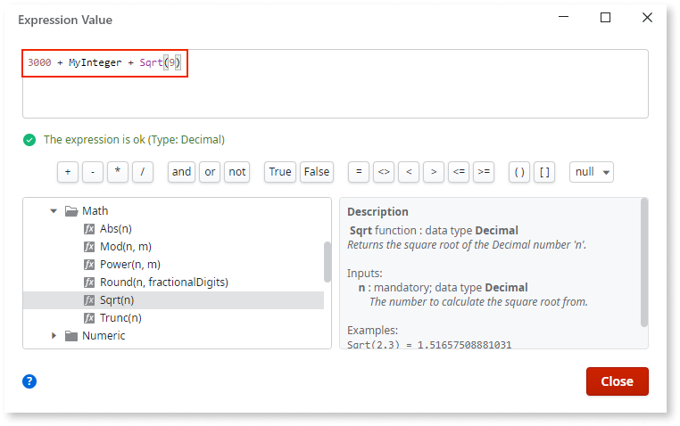
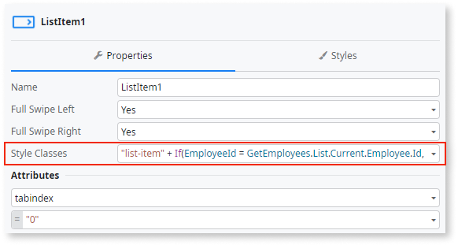
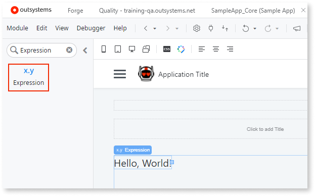

# Expressions

An expression consists of operands and operators, or just one operand. For example, **n + 1** is an expression with two operands, **n** and **1**, joined by the addition operator **+**.

Here is how you can edit expressions and show the expression values.

* Use the [expression editor](expressions/expression-editor.md) to **edit expressions**. The expression editor shows you available elements. It automatically completes the text and shows suggestions after you press **Ctrl+Space**.

    

* **Edit expressions** inline in the properties of elements.

    

* To **show the result** of an expression, use the Expression widget. This is similar to the **print** command in other programming languages.

    

## Notes

Here are some tips for using expressions.

* You can use  many functions to manipulate the type Text, however, you can only use the  **+** (addition) operand with type Text.

    Example: `"Hello, " + UserName`, where the value of **UserName** is **Billy**, returns `"Hello, Billy!"`.

* You can use the [built-in functions](../../reference/built-in-functions/dateandtime.md) or use the [libraries](../../reference/libraries/datetime.md) to perform various operations on the types **Date**, **Time**, and **DateTime**.

    Example: `AddDays(#2020-01-01 00:00:00#, 90)`. **AddDays** is a function that adds **n** days to a Date Time value. Date Time is here a literal `#2020-01-01 00:00:00#`. The expression returns `#2020-03-31 00:00:00#`.

* You can only use the operators **=** and **&lt;&gt;** (equality operators) for the type `Record`.

* For the type **Identifier**, use the [built-in functions](../../reference/built-in-functions/data-conversion.md).

* The types **BinaryData** and **Record List** don't support calculations.

## Correct expression output

The platform guarantees that the model is valid, and you decide whether an expression returns the value you need. When Mentor Studio proposes logic, the proposal includes expressions, so apply the same checks. The following checks are examples, not a complete list.

* **Operators fit the types.** The **+** operator is the only arithmetic operator for the type Text. The equality operators **=** and **&lt;&gt;** are the only operators for the type `Record`.
* **Unsupported types.** No expression calculates with the types **BinaryData** and **Record List**.
* **Identifiers.** An expression that converts an **Identifier** to another type uses the [built-in functions](../../reference/built-in-functions/data-conversion.md). The equality operators **=** and **&lt;&gt;** compare two Identifiers directly, and ODC Studio shows a warning when the Identifiers belong to different entities.
* **Date and time.** An expression compares **Date**, **Time**, and **DateTime** values with the comparison and equality operators. To calculate with these values or convert them, the expression uses the [built-in functions](../../reference/built-in-functions/dateandtime.md) or the [libraries](../../reference/libraries/datetime.md).
* **Status.** The expression status in the [expression editor](expressions/expression-editor.md) shows that the expression is valid.

## Related resources

The following resource describes what the platform guarantees and what you check in a Mentor Studio proposal.

* For what the platform guarantees and what you validate, refer to [Platform guarantees and AI interpretation](../../agentic-development/odc-ai-and-platform.md).
