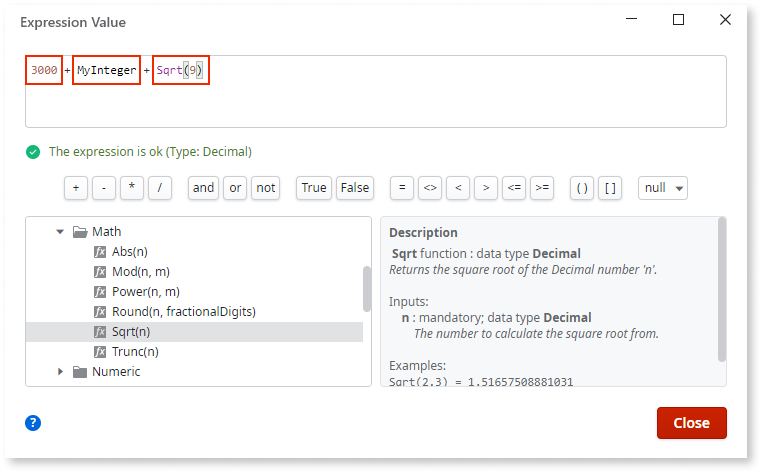

# Operands

An operand tells the platform which data to use to manipulate an expression. For example, in the expression `MyValue + 1`, `MyValue` and `1` are the operands.

Use the [expression editor](expression-editor.md) to see which operands are available in the current scope. The expression editor checks what variable, parameters, functions, and other values, you can use for an operation in, for example, a screen or an action.

All operands always have a [data type](../../data/data-types.md).

## Literals

Literals are hard-coded values that you write in expressions, most often numbers and text. The following are some examples:

* In `Message = "Hello, world!"`, **Hello, world!** is a literal.
* In `1 + i`, **1** is a literal.
* In `isValid = False`, **False** is a literal.

Check out [basic data types](../../data/data-types.md#Basic-Data-Types) for other examples of how you can use literals in expressions.

## Variables

Variables are identifiers that point to values. Here are some examples.

* In `Message = "Hello, world!"`, **Message** is a variable.
* In `1 + i`, **i** is a variable.
* In `isValid = False`, **isValid** is a variable.

Use smart names to set the data type automatically. For example, if you create a value or parameter, and name it **PurchaseDate**, ODC Studio sets the data type to **Date**.

## Functions

You can use functions as operands. The following are some examples:

* In `Sqrt(9) + 3`, **Sqrt()** is one of the built-in functions.
* In `MyFunction(1000) * 100`, **MyFunction()** is a user-defined function.

See [Built-in Functions](../../../reference/built-in-functions/intro.md) for more information.

## Example

The following is a screenshot showing an expression in the expression editor. The expression consists of:

* `3000`: a literal
* `MyInteger`: a local variable
* `Sqrt()`: a built-in function

## Correct operand output

The platform guarantees that the model is valid, and you decide whether the operands express what you need. The following checks are examples, not a complete list.

* **Data type.** Each operand has the [data type](../../data/data-types.md) that the operation needs.
* **Scope.** Each variable, parameter, and function is available in the scope where you edit the expression. The [expression editor](expression-editor.md) shows the available operands.
* **Literals.** A value that changes over time is a variable or a value from settings, not a literal hard-coded in the expression.
* **Functions.** Each function is a built-in function, a user-defined function in the app, or a function that the app consumes from a library.
* **Smart names.** A value named with a smart name, such as **PurchaseDate**, has the data type that ODC Studio sets from the name.

## Related resources

The following resource describes what the platform guarantees and what you check in a Mentor Studio proposal.

* For what the platform guarantees and what you validate, refer to [Platform guarantees and AI interpretation](../../../agentic-development/odc-ai-and-platform.md).
