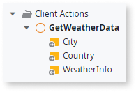
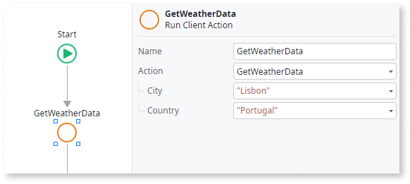

# Input Parameter

An Input Parameter allows you to provide data to an element for further use. The Input Parameter becomes available in that element's scope.

For example, if you add an Input Parameter to a Client Action you can:

* Provide a value for that Input Parameter when calling the Client Action.

* Use the value in the logic flow of the Client Action, for example in expressions or as a part of Input Parameter values of other calls.

In the following example, the `GetWeatherData` Client Action has two Input Parameters (`City` and `Country`) and one Output Parameter (`WeatherInfo`):

Input Parameters can be mandatory or optional, according to their **Is Mandatory** property.

If you call other Actions from the Client Action you can no longer access the Input Parameter because it's not longer in the Client Action scope. To make the Input Parameter value accessible to other calls, include the Input Parameter in the arguments of the Action Call.

## Add an Input Parameter with Mentor Studio

Add an Input Parameter and the arguments that pass its value by describing them in Mentor Studio, and validate the parameter and every call before you publish.

In your prompt, include the following:

* The element
* The Input Parameter
* Its data type
* Whether it is mandatory
* The calls that pass a value

For example, the following sentences form one prompt:

* "Add a Text Input Parameter named City and a Text Input Parameter named Country to the GetWeatherData Client Action."
* "Make both mandatory, and set their values in every Run Client Action call to GetWeatherData."

### Validate the parameter

The platform guarantees that the model is valid, and you decide whether the Input Parameter fits your requirement. Check the following:

* The element is one of the [elements that can have Input Parameters](#input-parameters-availability).
* The Input Parameter has the data type you need, and its **Is Mandatory** property matches whether callers must provide a value.
* Every call to the element sets a value for each mandatory Input Parameter in the properties of the call, such as the Run Client Action element.
* An action that the element calls receives the value as an argument of the Action Call, because the Input Parameter isn't in the scope of the called action.

## Set Input Parameter values manually in ODC Studio {#how-to-use}

When invoking an element with Input Parameters, like a Client Action, you must specify the **values** for all the mandatory Input Parameters sent to the Client Action as part of the invocation, optionally specifying values for Input Parameters that are optional. Input Parameter values are also known as input **arguments**.

For example, considering the same `GetWeatherData` Client Action presented before, you could invoke this Client Action setting the values for the `City` and `Country` Input Parameters in the following manner:

You define the Input Parameter values in the properties of the Run Client Action element. These arguments appear indented from the remaining properties.

To set an Input Parameter value, enter an expression in the corresponding property.

## Input Parameters availability {#input-parameters-availability}

The following elements displayed in the element tree can have Input Parameters:

* Server Actions and Client Actions
* Screens and Blocks
* Processes
* Exposed/Consumed REST Methods
* Callback and Authentication actions for REST integrations (although you can't modify the default Input Parameters of these actions)
* Emails
* External Sites
* JavaScript elements (available on Client Actions)

## Related resources

The following resources describe prompt examples, the steps to prompt Mentor Studio, and what the platform guarantees.

* For more prompt examples, refer to [Prompts for Mentor Studio](../../agentic-development/mentor-studio/prompts.md#logic).
* For the requirements and the steps to prompt Mentor Studio and review the change, refer to [Modify an app with AI in ODC Studio](../../agentic-development/mentor-studio/modify-app.md) and [Review and accept the plan](../../agentic-development/mentor-studio/how-it-works.md#accept-plan).
* For what the platform guarantees and what you validate, refer to [Platform guarantees and AI interpretation](../../agentic-development/odc-ai-and-platform.md).
