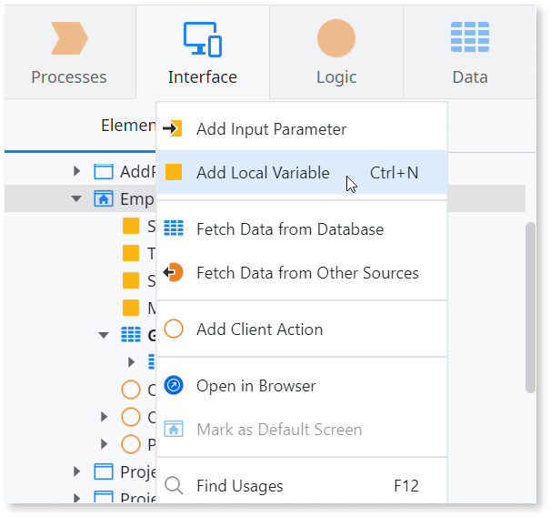
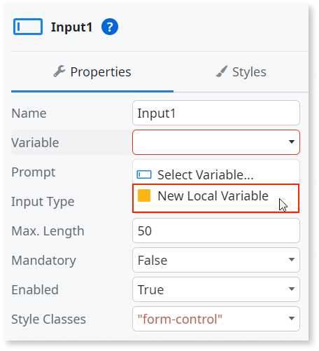
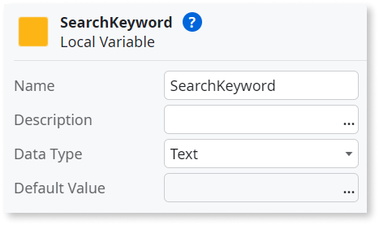
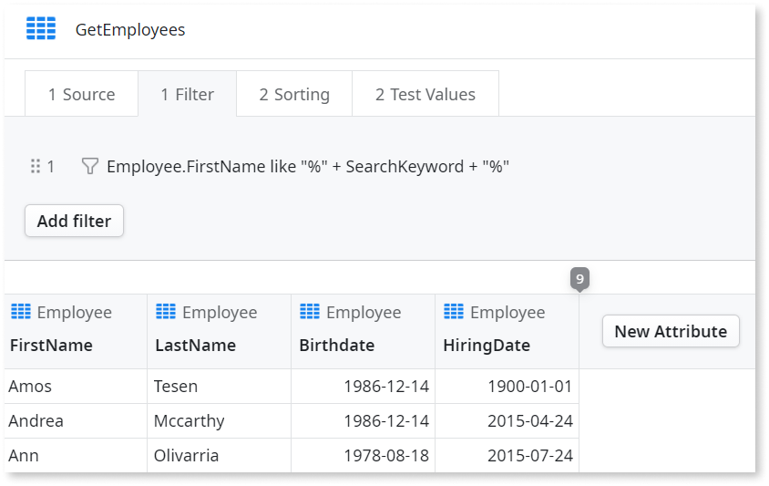

# Local Variable

A Local Variable exists only in the scope of its parent element, for example, a Screen or an Action. A Local Variable can only be assigned and used locally inside that scope. Local variables are destroyed when execution leaves the scope of the parent element. The image below shows how to add a Local Variable inside a Screen.  



## Add a Local Variable with Mentor Studio

Create a Local Variable by describing it and the elements that use it in Mentor Studio, and validate the variable and its usages before you publish.

In your prompt, include the following:

* The variable
* Its data type
* The element that owns it
* The widget or logic that uses it

For example, the following sentences form one prompt:

* "Create a Local Variable named SearchKeyword of type Text on the Employees screen."
* "Bind it to the Search input, and filter the Employee aggregate by FirstName using the variable."

### Validate the Local Variable

The platform guarantees that the model is valid, and you decide whether the Local Variable is correct for your requirement. Check the following:

* The variable belongs to the element whose scope must contain it, such as the Screen or Action that uses it.
* The variable has the data type you need, such as `Text` for a search keyword.
* The widget that sets the value, such as the Input widget, has the **Variable** property set to the variable.
* The logic that reads the value, such as the aggregate filter, references the same variable. For example, `Employee.FirstName like "%" + SearchKeyword + "%"`.
* After you publish the app, the filter applies to the text in the Input widget, and the variable is destroyed when you change to another screen or close the browser.

## Add a Local Variable manually in ODC Studio {#how-to-use}

This example shows how to use a Local Variable to keep the value of a Search widget. The value of the Local Variable is then used to filter an Aggregate.

1. Select the Input widget.

1. On the **Properties** tab, select the **Variable** dropdown and select **New Local Variable**.

    

1. Enter a name for the variable, for example `SearchKeyword`. Make sure the **Data Type** is set to `Text`.

    

1. Double-click the aggregate on the Elements tree.

1. On the **Filter** tab, click **Add filter**.

1. Insert the filter condition.

    ```
    Employee.FirstName like "%" + SearchKeyword + "%"
    ```

1. To save the filter, click **Close**.

    

After you follow these steps and publish your app, you can test the functionality of the filter in your browser. The text inserted in the Input of the Search widget is stored in the defined Local Variable and is then used to filter the aggregate. When you change to another screen or close your browser, the Local Variable is destroyed and the filter no longer applies.

## Related resources

The following resources describe prompt examples, the steps to prompt Mentor Studio, and what the platform guarantees.

* For more prompt examples, refer to [Prompts for Mentor Studio](../../agentic-development/mentor-studio/prompts.md#logic).
* For the requirements and the steps to prompt Mentor Studio and review the change, refer to [Modify an app with AI in ODC Studio](../../agentic-development/mentor-studio/modify-app.md) and [Review and accept the plan](../../agentic-development/mentor-studio/how-it-works.md#accept-plan).
* For what the platform guarantees and what you validate, refer to [Platform guarantees and AI interpretation](../../agentic-development/odc-ai-and-platform.md).
