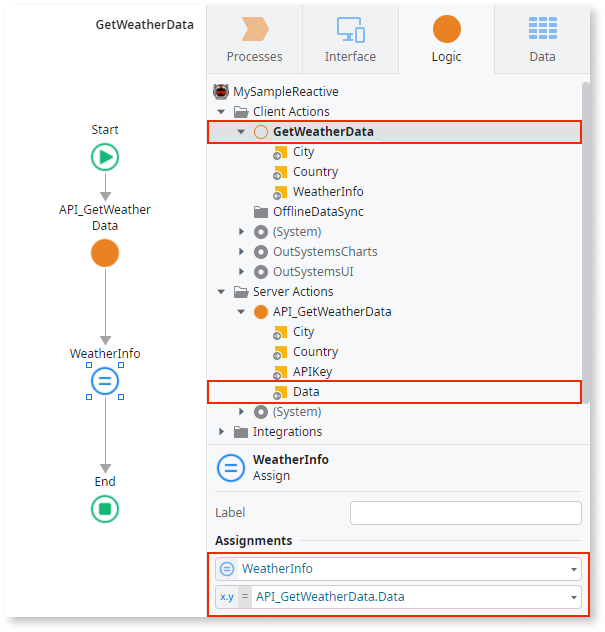

# Output Parameter

An Output Parameter allows you to return computed values from an action.

In the following example, the `GetWeatherData` Client Action has two Input Parameters (`City` and `Country`) and one Output Parameter (`WeatherInfo`):

## Return a value with Mentor Studio

Add an Output Parameter and the logic that sets its value by describing them in Mentor Studio, and validate the parameter and the assignment before you publish.

In your prompt, include the following:

* The action
* The Output Parameter
* Its data type
* The value to return

For example, the following sentences form one prompt:

* "In the GetWeatherData Client Action, add an Output Parameter named WeatherInfo with the same data type as the Data Output Parameter of the API_GetWeatherData Server Action."
* "Assign it that Data Output Parameter."

### Validate the parameter

The platform guarantees that the model is valid, and you decide whether the action returns the value you need. Check the following:

* The element is one of the [elements that can have Output Parameters](#output-parameters-availability).
* An Assign element sets the Output Parameter to the value you want to return, for example `API_GetWeatherData.Data`.
* An expression that reads the Output Parameter of an invoked action uses the format `<flow_element_name>.<output_parameter_name>`.
* For a consumed REST API, the logic doesn't assign the Output Parameter, because OutSystems fills the value from the response of the external system.

## Return a value manually in ODC Studio {#how-to-use}

To return a value from inside an action flow, you can use an Assign element to set the Output Parameter to the value you wish to return.

For example, consider the `GetWeatherData` Client Action presented previously. You can use an Assign to set the value of the `WeatherInfo` Output Parameter to the `Data` Output Parameter value returned by the `API_GetWeatherData` Server Action:

You can access the value of an Output Parameter of an invoked action (in this case, the `API_GetWeatherData` Server Action) later in the flow using an expression with the following format:

`<flow_element_name>.<output_parameter_name>`

In the example presented above, the expression becomes the following:

`API_GetWeatherData.Data`

## Output Parameters availability {#output-parameters-availability}

The following elements displayed in the element tree can have Output Parameters:

* Server Actions and Client Actions
* Processes, Process Activities, and Wait elements
* Exposed/Consumed REST Methods

Additionally, JavaScript elements (available on Client Actions) also have Output Parameters.

External integrations like consumed REST APIs have their logic defined in an external system. In this case, OutSystems fills the Output Parameter values from the values returned by the external system. You can then use the Output Parameter values in your business logic.

## Related resources

The following resources describe prompt examples, the steps to prompt Mentor Studio, and what the platform guarantees.

* For more prompt examples, refer to [Prompts for Mentor Studio](../../agentic-development/mentor-studio/prompts.md#logic).
* For the requirements and the steps to prompt Mentor Studio and review the change, refer to [Modify an app with AI in ODC Studio](../../agentic-development/mentor-studio/modify-app.md) and [Review and accept the plan](../../agentic-development/mentor-studio/how-it-works.md#accept-plan).
* For what the platform guarantees and what you validate, refer to [Platform guarantees and AI interpretation](../../agentic-development/odc-ai-and-platform.md).
