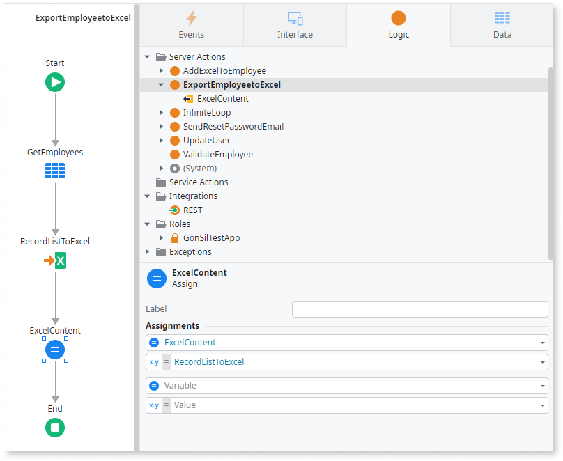
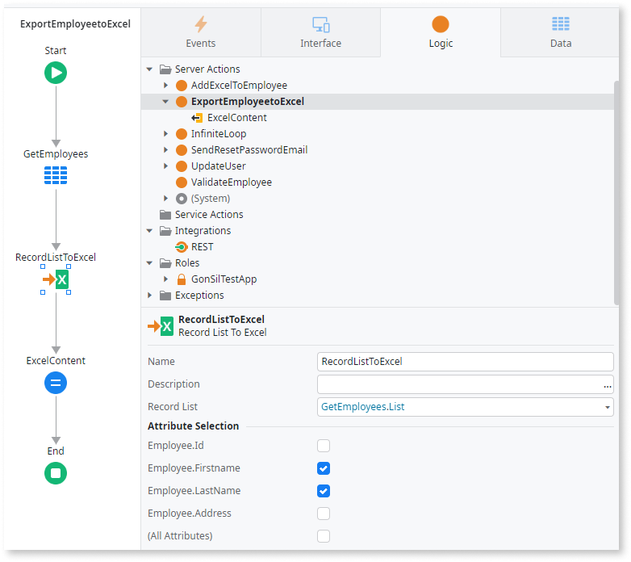

# Record List to Excel

The **Record List to Excel** action converts a Record list to an Excel file. This article explains how you can use the Record List action to convert your data into an Excel file.

## Export data to Excel with Mentor Studio

Add the **Record List to Excel** action to a Server Action by describing the export in Mentor Studio, and validate the parameters and the assignment before you publish.

In your prompt, include the following:

* The Server Action
* The entity to export
* The attributes to include or exclude
* The Output Parameter that returns the file

For example, the following sentences form one prompt:

* "Create a Server Action named ExportEmployeeToExcel with a Binary Data Output Parameter named ExcelContent."
* "Fetch the Employee entity with an aggregate, convert GetEmployees.List with Record List to Excel, and assign the result to ExcelContent."
* "Exclude the Employee.Address attribute from the export."

### Validate the conversion

The platform guarantees that the model is valid, and you decide whether the export contains the data you need. Check the following against the [Properties](#properties) on this page:

* The Server Action has an Output Parameter with a **Binary Data** data type.
* The **Record List** property of **Record List to Excel** is a Record List, such as `GetEmployees.List`.
* An Assign node sets the Output Parameter to the output of **Record List to Excel**.
* The **Attribute Selection** section of **Record List to Excel** leaves out the attributes you don't want to export, such as **Employee.Address**.

## Export data to Excel manually in ODC Studio

The following example shows a scenario in which you export a list of employees from an Entity called **Employee** into an Excel spreadsheet.

1. In a Server Action, create an Output Parameter called **ExcelContent** with a **Binary Data** data type.

1. Drag an **Aggregate** node and add the **Employee** Entity as a source.

1. Drag the **Record List to Excel** Action and define the **Record List** parameter as **GetEmployees.List**.

1. Drag an **Assign** node and assign the output of **Record List to Exce**l to the **ExcelContent** Output Parameter.

    

1. (Optional) You can omit which information is exported into Excel. For example, you may want your employees' names but not their addresses. In the previous logic, you can untick the **Employee.Address** attribute to ensure it's not exported.

    

## Properties {#properties}

| Name | Description | Mandatory | Default value | Observations |
| --- | --- | --- | --- | --- |
| Name | Identifies an element in the scope where it's defined, like a screen, action, or app/library. | Yes | RecordListToExcel1 | |
| Description | Text that documents the element. | No | | Useful for documentation purposes. The maximum size of this property is 2000 characters. |
| Record List | Holds the list of records to be exported to an Excel file | Yes | | The required type for this property is **Record List**. |

## Related resources

The following resources describe prompt examples, the steps to prompt Mentor Studio, and the reverse conversion.

* For more prompt examples, refer to [Prompts for Mentor Studio](../../agentic-development/mentor-studio/prompts.md#logic).
* For the requirements and the steps to prompt Mentor Studio and review the change, refer to [Modify an app with AI in ODC Studio](../../agentic-development/mentor-studio/modify-app.md) and [Review and accept the plan](../../agentic-development/mentor-studio/how-it-works.md#accept-plan).
* [Excel to Record List](excel-record-list.md)
* For what the platform guarantees and what you validate, refer to [Platform guarantees and AI interpretation](../../agentic-development/odc-ai-and-platform.md).
