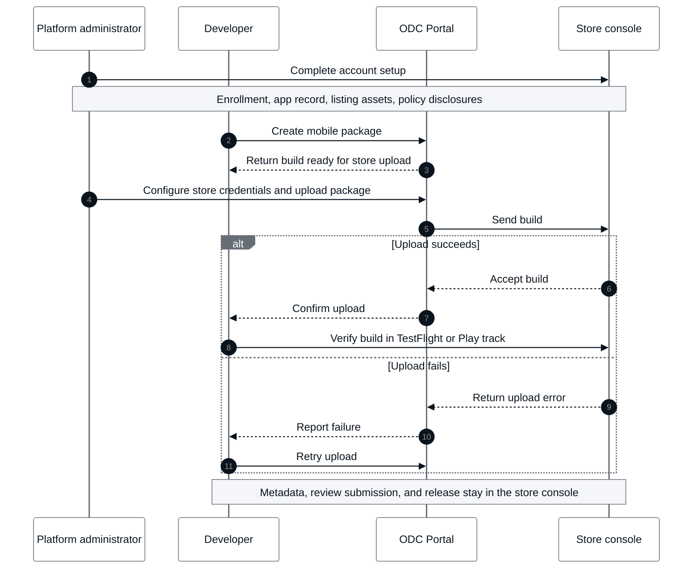

# Upload a mobile package to a store

This article explains how to upload a mobile package to the Apple App Store or Google Play. It's intended for mobile developers who create mobile packages in ODC and want to send them to a store from the ODC Portal.

Uploading a package requires steps in both ODC and the target store console. You complete the account setup each store enforces, create a mobile package in ODC, configure the store credentials, upload the package, and confirm that it arrived. ODC uploads the package to the store console.

For an introduction to what ODC automates and where an uploaded build lands, refer to [Uploading apps to an app store](overview.md).

The following diagram shows how the upload process moves between the platform administrator, the developer, the ODC Portal, and the store console, including what happens when an upload fails.

## Prerequisites {#prerequisites}

Before you send your first package to a store, ensure that you complete the setup that [Apple](#apple-prerequisites) or [Google](#google-play-prerequisites) requires.

### ODC permissions {#odc-permissions}

Besides the store-side setup, uploading a package requires specific permissions in ODC.

* The **Edit asset configurations** permission lets you configure an app's store credentials.

* The **Upload to Stores** permission lets you upload a package to a store.

For details, refer to [Roles and permissions for members (IT-users)](../../../user-management/roles.md#permissions-registry).

By default, the **Administrator** role has both permissions in every environment. The **Developer** role has neither permission and can't upload a package to any store.

Restrict store uploads to your production environment. Anyone with the **Upload to Stores** permission can upload a package from a non-production environment unless an administrator restricts store uploads in that environment.

### Apple App Store Connect prerequisites {#apple-prerequisites}

Complete the following steps in your Apple Developer account and App Store Connect before you upload or publish a package to the App Store.

#### Prerequisites to upload a package {#apple-upload-prerequisites}

App Store Connect blocks the upload itself until you complete the following steps.

* Enroll in the Apple Developer Program. For more information, refer to [Apple Developer Program enrollment](https://developer.apple.com/help/account/membership/program-enrollment).
* Register your bundle ID and create the app record in App Store Connect. Complete this step before you create the mobile package, because a mobile provisioning profile requires an existing app record.

#### Prerequisites to submit for App Review {#apple-review-prerequisites}

Before you submit the uploaded build for App Review, complete the submission requirements for your app in App Store Connect. For more information, refer to Apple's [App Store Connect help](https://developer.apple.com/help/app-store-connect/).

For details about privacy manifest files in ODC, refer to [Providing a privacy manifest file in ODC](../privacy-updates-for-apple-app-store-submissions.md#providing-a-privacy-manifest-file-in-odc).

### Google Play prerequisites {#google-play-prerequisites}

Complete the following in your Google Play Developer account and Play Console before you upload a package to Google Play Console.

#### Prerequisites to upload a package {#google-play-upload-prerequisites}

Complete the following high-level steps before you upload a package to the Play Console.

* Have a Google Cloud Platform instance.
* [Enable the Google Play Developer API](https://developers.google.com/android-publisher/getting_started#enable) on that Cloud instance.
* [Create a Google Cloud service account](https://developers.google.com/android-publisher/getting_started#service-account)
* Create a JSON key for that Google Cloud service account.
* [Register a developer account in the Google Play Console](https://support.google.com/googleplay/android-developer/answer/10788890)
* Create an app in the Play Console.
* [Create a keystore file](https://developer.android.com/studio/publish/app-signing#sign-apk)
* Register the package name with the SHA-1 hash value of the keystore file.
* Invite the Google Cloud service account email address as a new user to the Play Console.
* Assign the service account the permissions to view app information and perform releases to tracks.

#### Prerequisites to publish {#google-play-publish-prerequisites}

Complete the following steps after you upload a package, before you request production access.

* Set up a payments profile if your app sells apps or in-app products.
* After you upload your package, run a closed testing track before you request production access for a new app. Depending on your account type, Google Play requires a minimum number of testers over 14 continuous days before it grants production access. For more information, refer to [Prepare and roll out a release](https://support.google.com/googleplay/android-developer/answer/9859152).
* Prepare your store listing assets. Play Console requires listing text and assets within Google's limits: an app title, a short description, a full description, an app icon (512 x 512 px), a feature graphic (1024 x 500 px), and 2 to 8 screenshots, plus additional screenshot variants for tablets or other form factors your app supports.

For the complete submission requirements, refer to Google's [Play Console help](https://support.google.com/googleplay/android-developer), [Developer Program Policies](https://play.google.com/about/developer-content-policy/), and [Play App Signing](https://support.google.com/googleplay/android-developer/answer/9842756).

## Steps to upload a package {#upload-steps}

To upload a package, follow the procedure for the target store:

* [Upload a mobile package to iOS App Store Connect](submit-package-to-app-store-connect.md)
* [Upload a mobile package to Google Play](submit-package-to-google-play.md)

After the upload finishes, ODC marks the upload as **Uploaded to App Store Connect** or **Uploaded to Google Play** on the **Mobile distribution** tab. To confirm the build in the store console, find it under TestFlight's **Builds** section for iOS, or under **Test and release > Testing > Internal testing > Releases** for Android. Resolve any upload errors before you continue.

## Related resources {#related-resources}

For more information about uploading mobile packages to app stores, refer to the following resources:

* [Uploading apps to an app store](overview.md)
* [Create mobile app package](../creating-mobile-package.md)
* [Mobile build types](../mobile-build-types.md)
* [Roles and permissions for members (IT-users)](../../../user-management/roles.md)
* [Native mobile build API](../../../reference/apis/native-mobile-builds-api-v1.md)
