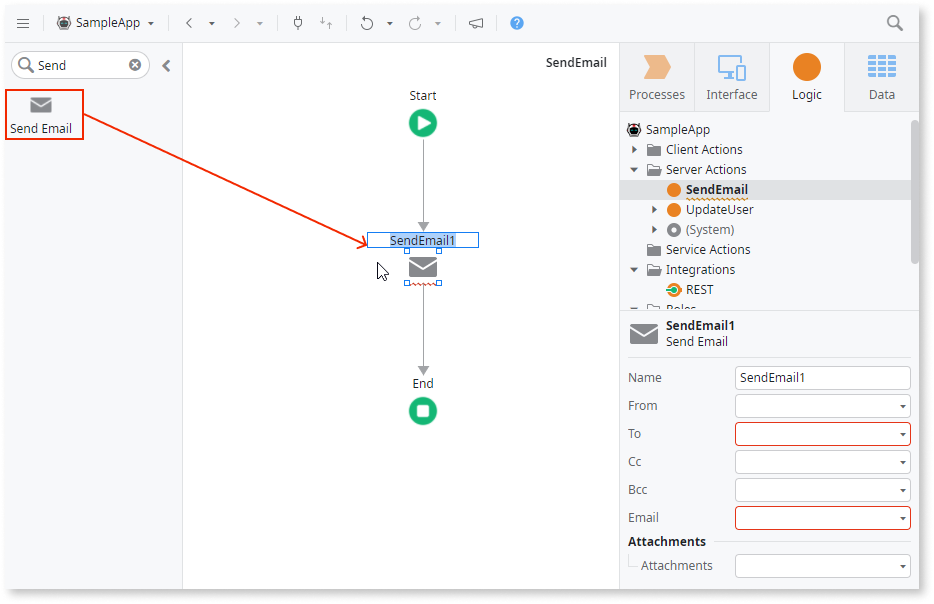
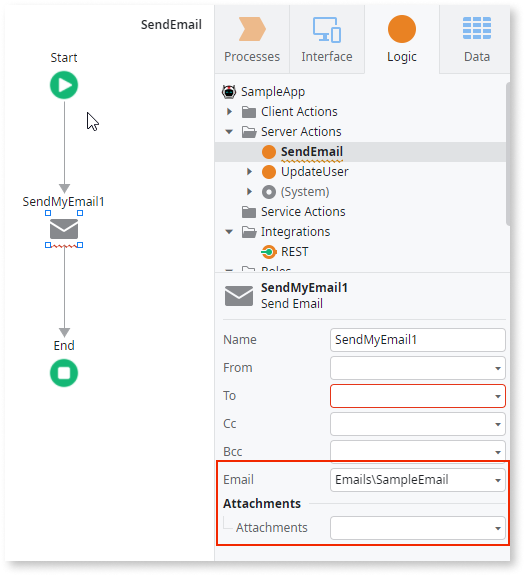
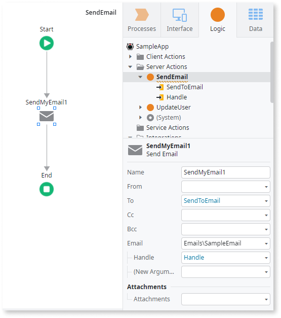
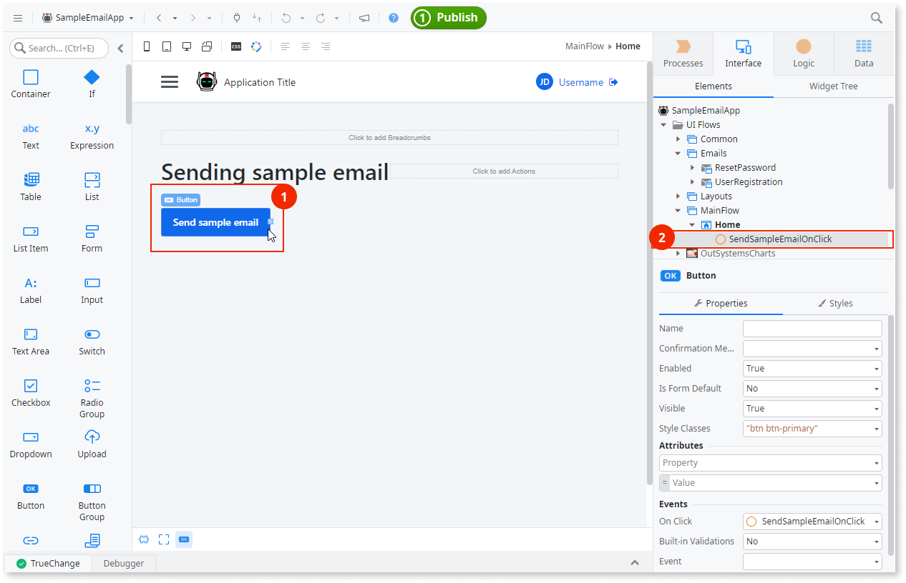
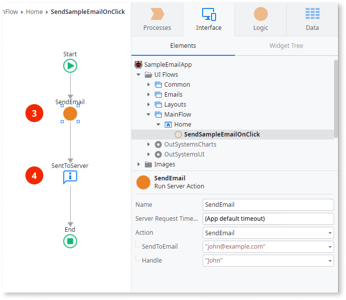
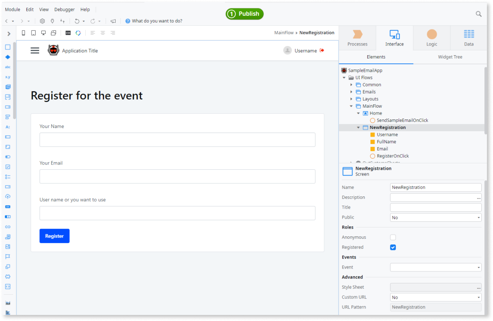
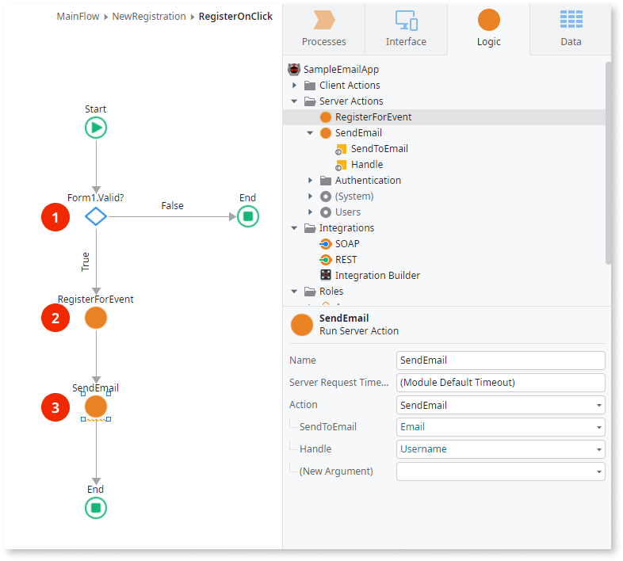

# Sending emails

Email is a fundamental component of app development, serving as a channel for communicating directly with your users. In OutSystems, you can design, build, and send emails to handle communication workflows.

To send an Email from your app, create a server action that runs the **Send Email** action, and then call the server action from your app logic. When **Send Email** runs, ODC renders the Email you create in ODC Studio and sends it to the recipients.

## Create logic for sending emails with Mentor Studio

Create the server action that sends an Email by describing it in Mentor Studio, and validate the action and its parameters before you publish.

In your prompt, include the following:

* The server action
* The Email to send
* The input parameters that the Email requires
* The input parameter for the **To** field of the **Send Email** action

To call the server action from a screen, also name the widget and the screen.

For example, the following sentences form one prompt:

* "Create a server action named SendRegistrationConfirmation that sends the RegistrationConfirmation email."
* "Add an input parameter named Recipient of type Text for the To field."
* "For each input parameter of the email, add an input parameter with the same name and data type, and pass it to the email."

### Validate the sending logic

The platform guarantees that the model is valid, and you decide whether the logic sends the Email you intend. In the **Logic** tab of ODC Studio, check the following:

* The logic is a server action or a service action, because the logic for sending emails runs on the server.
* The **Send Email** action has your Email selected in the **Email** property, and the flow shows no error for missing parameters.
* The server action has an input parameter for each parameter that the Email requires, and an input parameter for the **To** property.
* The **To** property and the Email parameters of the **Send Email** action have the values you intend.
* The **From** property is unchanged unless you intend to change it. Most spam algorithms reject emails with a misconfigured **From** field.
* The logic that calls the server action provides the input parameters that the action requires.
* The **Send Email** action runs after the logic it depends on, because ODC sends the email as soon as **Send Email** runs and doesn't cancel the email if later logic fails. For more information, refer to [Email sending behavior](intro.md#email-sending-behavior).

## Create logic for sending emails manually in ODC Studio {#creating-logic-for-sending-emails}

To create logic that sends an email manually, go to ODC Studio and follow these steps:

1. To create a server action, go to the **Logic** tab and right-click **Server Actions** and from the menu, select  **Add Server Action**.  A new server action opens for editing. (The logic for sending emails runs on server.)
1. To add  the **Send Email** to the flow, drag the **Send Email** action to the flow. ODC Studio adds **Send Email** to the flow and shows an error to let you know some parameters are missing.

    

1. To display  the list of input parameters required for your email, go to the **Send Email** properties action and select your Email in the **Email** list. The list of input parameters is displayed.

    

1. To complete the parameters in the server action to pass the values to the Email, right-click the **Server Action** and select **Add Input Parameter**. Repeat as needed to add the following:

    * All parameters that the Email requires
    * The input parameter for the **To** field of the **Send Email** action

1. To set the **To** property and the required values for the selected Email, go to the **Send Email** action properties in the flow.

    

    

    Be careful when editing the **From** property in the **Send Email** action. Most spam algorithms reject emails with a misconfigured **from** field.

    

Your app is now ready to send the email. Next, call the server action from your app logic.

## Call the server action that sends the email

Call the server action from the logic that runs when your app needs to send the email. Apps often send an email in response to a user action, such as a registration confirmation, a password reset, or a purchase receipt. The following examples show how to send an email when a user clicks a button and after a user submits a form.

### Send an email when a user clicks a button

To send an email when a user clicks a button, for example to test the app, add a **Button** widget (1) with an **On Click** event that calls a client action (2).

In the client action, you can call the server action that sends the email (3). For this to work, you must provide the input parameters required by the action. In the feedback message from the UI (4), you can notify users that the app called the logic to send the message.

### Send an email after a user submits a form

Consider an event registration, where users who want to attend the event fill in the registration details in a form.

The logic for new registrations checks if the user entered valid information (1). If the information is valid, the logic handles the registration request (2) and then sends the confirmation email (3).

The pattern shown here is simplified for demonstration. To improve performance and maintainability, avoid calling multiple server actions from a single client action. Instead, create one wrapper server action that runs the registration logic first and then the **Send Email** action. ODC sends the email as soon as **Send Email** runs. With **Send Email** after the registration logic, the app sends the confirmation only after the registration logic completes.

For more information, refer to [Avoid multiple server calls in a client action flow](../logic/best-practices-logic.md#multiple-server-calls) and [Email sending behavior](intro.md#email-sending-behavior).

## Related resources

The following resources describe prompt examples, the steps to prompt Mentor Studio, and what the platform guarantees.

* For more prompt examples, refer to [Prompts for Mentor Studio](../../agentic-development/mentor-studio/prompts.md#logic).
* For the requirements and the steps to prompt Mentor Studio and review the change, refer to [Modify an app with AI in ODC Studio](../../agentic-development/mentor-studio/modify-app.md) and [Review and accept the plan](../../agentic-development/mentor-studio/how-it-works.md#accept-plan).
* For what the platform guarantees and what you validate, refer to [Platform guarantees and AI interpretation](../../agentic-development/odc-ai-and-platform.md).
