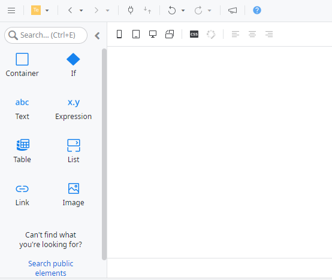

# Widgets in emails

OutSystems designed widgets to help you create lightweight emails that most email readers can open. When you edit an email, ODC Studio shows the available widgets in the [available Email widgets](#widgets-available-in-emails) in the widgets tool bar.

Use the Email widgets like you use the Screen widgets, with the following common differences designed to make the emails light and secure:

* Email widgets don't have features that require handling plenty of data. For example, Tables in Emails don't show a pagination section.
* You can't use JavaScript and custom actions in Email widgets. Most email clients don't support JavaScript due to security concerns.

## Widgets available in Emails

You can use the following widgets in Emails.

| Widget | Description | Notes |
| ----------- | --------------------------------------------------- | -------------------------------------------------------------- |
| Container | Lets you arrange other widgets. | |
| Expressions | Evaluates expressions and displays variable values. | |
| If | Shows content based on a condition. | |
| Images | Embeds an image. | Using binary content from a database |
| Link(*) | Adds a navigational element. | |
| List | Shows records as items in a list. | To quickly create a list in a Mobile App, drag an Entity to Email. |
| Table | Shows records in columns and rows. | To quickly create a table in a Web App, drag an Entity to Email. |

(*) If your app uses a [custom domain](../../manage-platform-app-lifecycle/domains/custom-domains.md) and you want to link to an app screen, you must link to the URL of that screen. For example, to link to `Screen1` in `App1` using the custom domain `example.com`, set the **OnClick** property to **RedirectToURL** with the expression `"https://example.com/App1/Screen1"`. For guidance on building expressions, see [Expressions](../../building-apps/logic/expressions.md).

## Correct email widget output

The platform guarantees that the model is valid, and you decide whether the widgets in an Email suit your content. The following checks are examples, not a complete list.

* **Supported widgets.** The Email uses only the widgets in [Widgets available in Emails](#widgets-available-in-emails).
* **No scripts.** The Email has no JavaScript and no custom actions, because most email clients don't support JavaScript.
* **Light content.** The Email doesn't depend on features that handle plenty of data, because Tables in Emails don't show a pagination section.
* **Images.** An Images widget embeds an image from binary content in a database.
* **Links to screens.** When the app uses a custom domain, a link to an app screen sets **OnClick** to **RedirectToURL** with the URL of the screen.

## Related resources

The following resource describes what the platform guarantees and what you check in a Mentor Studio proposal.

* For what the platform guarantees and what you validate, refer to [Platform guarantees and AI interpretation](../../agentic-development/odc-ai-and-platform.md).
