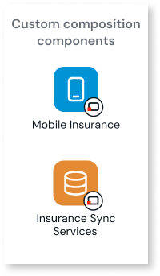
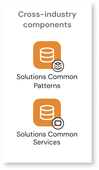

# Architecture of the First Notice of Loss solution

To understand how the solution works, start with how its components are organized. Components with similar responsibilities form four groups, and each component has a level of specificity, from specific to this solution to reusable across industries.

## Solution components {#solution-components}

The components of the solution follow the groups that [How agentic industry solutions are built](../agentic-industry-solutions.md#groups-of-components) describes.

The solution includes the following components:

* **End-user apps**:
    * **Mobile Insurance**: Lets policyholders file and track a claim, chat with the Claims Conversation Agent, capture photos and documents, and follow the status of the claim.
* **AI agents**:
    * **Claims Conversation Agent**: Runs the conversation with the policyholder one turn at a time, based on the claim data from Claims Services. It's the only agent that converses with the policyholder, and the other three agents work in the background.
    * **Claims Document and Evidence Agent**: Converts each photo and scanned document into structured evidence, without deciding the claim.
    * **Claims Damage Report Agent**: Writes the claim summary that the policyholder reads at wrap-up, from the evidence collected in the conversation, reporting observable facts only.
    * **Claims Policy and Fraud Agent**: Answers the policyholder's policy questions, and returns the coverages that the policy elects when the `GetCoveragesFromPolicyDoc` setting is on.
* **Core services**:
    * **Claims Services**: Owns the ACORD-aligned claims data model, including the claim, its parties, vehicles, and evidence. It writes an audit entry for each audited operation and keeps an immutable history of status changes.
    * **Insurance Sync Services**: Orchestrates data synchronization across the core services and keeps the last-successful-sync checkpoint for each domain.
    * **Solutions Common Services**: Provides common concepts that are reusable across industries, and owns the audit log for business operations.
    * **Solutions Common Patterns**: Provides reusable UI patterns, stateless utility actions, and data converters.
* **Integration wrappers**:
    * **Claims Management Integration Wrapper**: Abstracts the APIs of your insurance core and claim management systems.
    * **Vehicle Data Integration Wrapper**: Abstracts vehicle data providers, and decodes a vehicle identification number (VIN) through a public US service.
    * **Roadside Assistance Integration Wrapper**: Abstracts roadside assistance and tow provider APIs, such as tow dispatch and status.
    * **Car Rental Integration Wrapper**: Abstracts car rental providers and the submission of rental requests.

Calls that the integration wrappers make to external providers appear in the platform logs, which you read in ODC Portal monitoring.

For more information about each component, refer to [Agentic First Notice of Loss (ODC) on Forge](https://www.outsystems.com/forge/component-overview/25993/agentic-first-notice-of-loss-odc).

## Custom versus shared components {#custom-versus-shared-components}

The components of the solution sit at the levels that [How agentic industry solutions are built](../agentic-industry-solutions.md#custom-and-shared-components) describes. Two components are custom, and the rest are shared.

### Custom composition components {#custom-composition-components}

Mobile Insurance and Insurance Sync Services are the custom components of this solution. They hold the parts that differ between organizations, so you can tailor them to yours.

* **Mobile Insurance**: Holds the policyholder experience that varies by organization and region. Change the settings and copy that depend on your market, such as the emergency number and the legal text in the chat disclaimer. Choose which photo steps the claim asks for. Replace the simulated crash alert with a crash detection service.
* **Insurance Sync Services**: Connects the solution data to your insurance core. You choose which core services take part in the synchronization by editing its synchronization flow.

### Add-on components {#add-on-components}

The add-on components are the capabilities for claims handling: the four AI agents, Claims Services, and the four integration wrappers.

### Cross-industry components {#cross-industry-components}

Solutions Common Services and Solutions Common Patterns are the cross-industry components. They are also used in other agentic industry solutions.

## Next steps {#next-steps}

To see how the claim moves through these components, refer to [Claim flow in the First Notice of Loss solution](claims-flow-and-status.md) and [AI agents in the First Notice of Loss solution](claims-agents.md).
