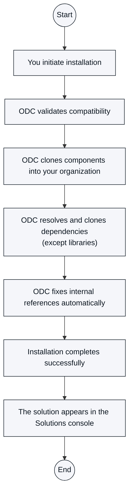

# Install and manage a solution

To start from a pre-built solution, install it from Forge into your organization. After installation, you manage the solution components like any other asset.

## Install a solution

To install a solution, do the following:

1. Open **Forge** in the ODC Portal and select **Solutions** in **Filters**.

1. Click **Install** on the solution card, or navigate to the **Versions** tab of the solution's detail page, to install the solution package.

1. A confirmation popup appears whose content depends on your portfolio configuration and Terms of Use status.

    * If your organization has multiple portfolios:
        * You haven't already accepted the **Forge Terms of Use**: the popup displays both portfolio selection and terms of use acceptance.
        * You have already accepted the **Forge Terms of Use**: the popup displays only portfolio selection.
    * If you have a single portfolio:
        * You haven't already accepted the **Forge Terms of Use**: the popup displays terms of use acceptance, and the installation starts after you accept.
        * You have already accepted the **Forge Terms of Use**: the installation starts directly without additional prompts.

1. After you accept the terms, the **Install** button on the solution card or detail page switches to a loading state. At the same time, a catalog card displays the installation progress of each component and dependency.

    When the install completes successfully, the button on the solution card changes to an **Installed** state.

The one-click installation process is fully automated: you initiate installation, and ODC validates compatibility, clones components and dependencies (except libraries) into your organization, fixes internal references automatically, completes the installation successfully, and makes the solution available in the Solutions console.

The following diagram shows how ODC handles each step:

## Manage a solution after installation

After installation, solution components behave like standard assets in your organization. You deploy them independently to production, customize them for your specific needs, integrate them with other apps, monitor their performance using standard tools, and manage them with standard governance policies.

When you modify a solution component, you own that modified version.

Installed solution components appear in the following places:

1. **Solutions console**, a centralized view of every solution installed in your organization.
1. **Apps list**, where apps and libraries are available for use, deployable to environments, and manageable as standard assets.
1. **Agents list**, where agentic apps are available for use and management.
1. **Workflows list**, where workflows are available for use and management.

## Related resources

* [Solutions in ODC](introduction-to-solutions.md)
* [Agentic industry solutions](agentic-industry-solutions.md)
