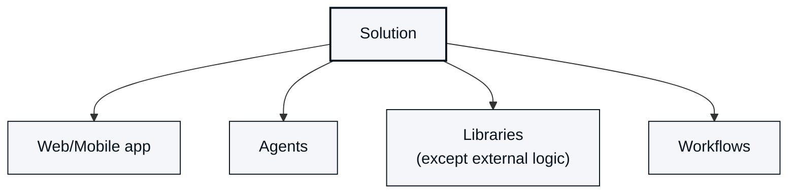
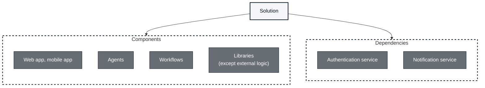

# Solutions in ODC

A **solution** is a complete package that bundles everything needed to solve a specific business problem: apps, agents, libraries, and workflows that work together as one unit. Instead of assembling assets one by one, you get a pre-built, tested collection designed to behave as a single, cohesive offering.

## Why solutions matter

Solutions shorten time to value. Rather than building from scratch or working out which components fit together, you start from a pre-tested, validated package that's ready to use.

## How solutions are built

Every solution is categorized into **Components** you customize for your core business outcomes and **Dependencies** you maintain to power them behind the scenes.

### Components

Components are what you customize for your specific needs. They are the core, primary assets that deliver direct business value and are yours to shape and control completely. After installation, your organization controls them within their license terms, and they follow an independent lifecycle based on your customization and deployment needs.

The following asset types can be components:

* **Apps**: Web and mobile user-facing apps.

* **[Agents](https://success.outsystems.com/documentation/outsystems_developer_cloud/building_apps/build_ai_powered_apps/about_ai_agent_builder/)**: AI agents to perform tasks, automate workflows, or handle complex multi-step interactions.

* **[Workflows](https://success.outsystems.com/documentation/outsystems_developer_cloud/building_apps/about_business_processes/workflows_in_odc/)**: Business processes and orchestration logic.

* **[Libraries](https://success.outsystems.com/documentation/outsystems_developer_cloud/building_apps/libraries/)**: Business-specific reusable libraries, except external logic.

### Dependencies

Dependencies sit underneath your components to provide foundational support. They are the underlying assets your components rely on, including Forge assets that produce the functionality your components consume. ODC manages dependencies by resolving and validating them during installation, similar to asset installation, and keeping their versions aligned. OutSystems maintains solutions only while they are in Forge. After installation, your organization is responsible for maintaining the dependencies in your environment.

The following diagram shows how components and dependencies relate to a solution:

## Install and manage solutions

All solutions install from Forge in the same way. After installation, the **Solutions console** in the **ODC Portal** groups the solution's components. It shows solution metadata and documentation, and allows tracking components together.

For more information, refer to [Install and manage a solution](install-and-manage-solutions.md).

## Agentic industry solutions

OutSystems builds agentic industry solutions for specific business problems, such as lending in banking and claims in insurance. For the list of available solutions and their documentation, refer to [Agentic industry solutions](agentic-industry-solutions.md).
