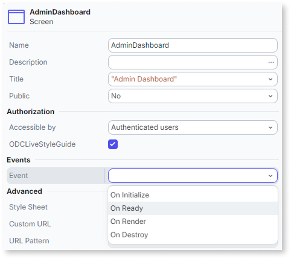
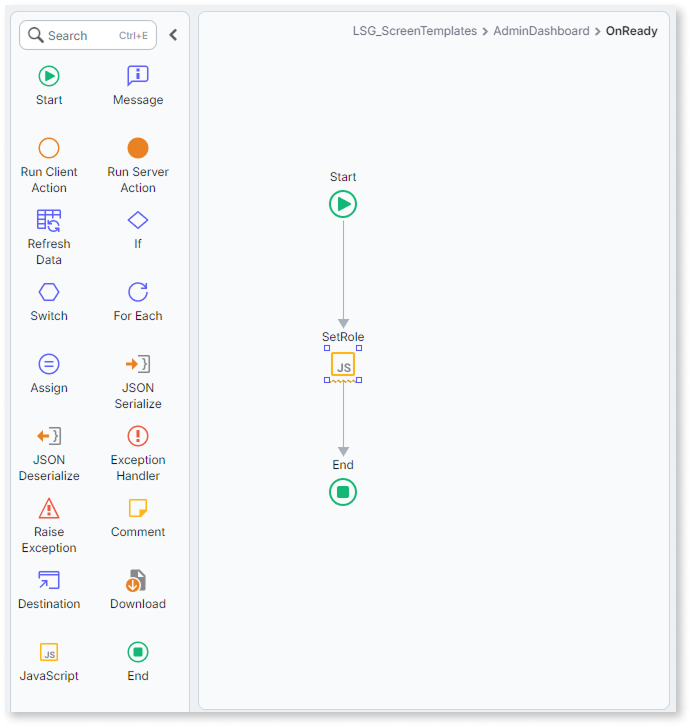
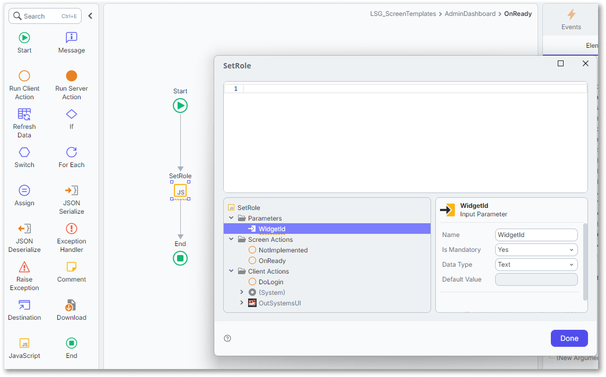
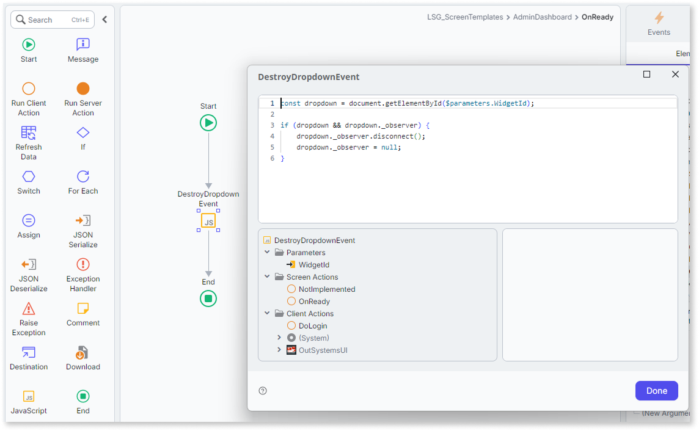

# Dropdown

Use the following guidelines to make the **Dropdown** widget meet WCAG 2.2 AA compliance in your apps.

## Accessibility – WCAG 2.2 AA compliance {#accessibility}

By default, the **Dropdown** widget is accessible when **OptionsContent** is set to **Text Only**, because it renders a native `<select>` element that exposes correct semantics to assistive technologies.

When **OptionsContent** is set to **Custom**, the Dropdown is built with `<div>` elements instead. In this case, **it does not expose the correct ARIA semantics**, and assistive technologies may not recognize it as a combobox.

For Dropdowns that use **custom content**, add combobox semantics so screen readers recognize the control, understand its expanded state, and associate it with its option list.

<div class="info" markdown="1">

These steps apply only when the **Dropdown** Built-in Widget uses **OptionsContent = Custom**.
If you use **Text Only**, no additional ARIA configuration is required.

</div>

### Set the correct ARIA roles for custom dropdowns

1. In **ODC Studio**, go to the **Interface** tab and select the **Screen/Block** that uses the **Dropdown** with custom options.

1. In the **Screen/Block** properties, under **Events**, select **OnReady** to create a client action.

    

1. In **OnReady**, add a **JavaScript** node to flow.

    

1. In the **JavaScript** node, add an input parameter named **WidgetId** (type `Text`) and set it to the **Dropdown** widget ID (for example, `CustomDropdown.Id`).

    

1. Add the following script:

    ```javascript
    const dropdown = document.getElementById($parameters.WidgetId);
    if (!dropdown) return;

    const trigger = dropdown.querySelector('.dropdown-display');
    if (!trigger) return;

    // Generate ID for the listbox
    const listId = `${$parameters.WidgetId}_listbox`;

    // Base combobox semantics
    trigger.setAttribute('role', 'combobox');
    trigger.setAttribute('aria-haspopup', 'listbox');
    trigger.setAttribute('aria-controls', listId);

    // Ensure trigger is focusable if not a native interactive element
    if (!trigger.hasAttribute('tabindex') && 
        !['BUTTON', 'A', 'INPUT', 'SELECT'].includes(trigger.tagName)) {
        trigger.setAttribute('tabindex', '0');
    }

    function enhanceListbox() {
        const list = dropdown.querySelector('.dropdown-list');
        if (!list) return;

        list.id = listId;
        list.setAttribute('role', 'listbox');

        const options = list.querySelectorAll('.dropdown-popup-row');
        options.forEach(option => {
            option.setAttribute('role', 'option');
            option.setAttribute('aria-selected', option.classList.contains('dropdown-popup-row-selected') ? 'true' : 'false');
        });
    }

    // Set correct initial aria-expanded state
    const isInitiallyExpanded = dropdown.classList.contains('dropdown-expanded');
    trigger.setAttribute('aria-expanded', String(isInitiallyExpanded));

    // Call enhanceListbox on init
    enhanceListbox();

    const dropdownObserver = new MutationObserver((mutations) => {
        mutations.forEach((mutation) => {
            if (mutation.type === 'attributes' && mutation.attributeName === 'class') {
                const isExpanded = dropdown.classList.contains('dropdown-expanded');

                trigger.setAttribute('aria-expanded', String(isExpanded));

                // Re-run enhanceListbox on expand to handle dynamic options
                if (isExpanded) enhanceListbox();
            }
        });
    });

    // Start observing
    dropdownObserver.observe(dropdown, {
        attributes: true,
        attributeFilter: ['class']
    });

    // Store for cleanup in OnDestroy
    dropdown._observer = dropdownObserver;
    ```

    <div class="info" markdown="1">

    **Important:**  
    Because the Dropdown list (`.dropdown-list`) is only created in the DOM **after the user opens the Dropdown**, assistive technologies may not always detect the relationship defined by `aria-controls` or `aria-owns` at initial render.  
    These attributes are applied correctly once the list exists, but the association cannot be guaranteed before the first interaction. As a result, this may still trigger warnings when validating with automated tools or screen readers.

    This behavior is a limitation of the underlying Dropdown pattern when using **OptionsContent = Custom**.

    </div>

1. In the **Screen/Block** properties, under **Events**, select **OnDestroy** to create a client action.

1. In **OnDestroy**, add a **JavaScript** node.

1. Add the same **WidgetId** input parameter (type `Text`) and set it to the **Dropdown** widget ID (for example, `CustomDropdown.Id`).

1. Add the following script to disconnect the observer and avoid memory leaks:

    ```javascript
    const dropdown = document.getElementById($parameters.WidgetId);

    if (dropdown && dropdown._observer) {
        dropdown._observer.disconnect();
        dropdown._observer = null;
    }  
    ```

    

1. Publish the app.

### Result

After completing these steps, Dropdowns that use **custom content** expose proper **combobox** semantics:

* Screen readers announce the control as a **combobox** and can determine whether it is expanded or collapsed.

* The popup list is exposed as a **listbox** with **option** items, associated to the combobox via `aria-controls`/`aria-owns`.

Test the Dropdown in your app (especially with a screen reader) to confirm that the role, state, and relationships are applied and announced correctly.
