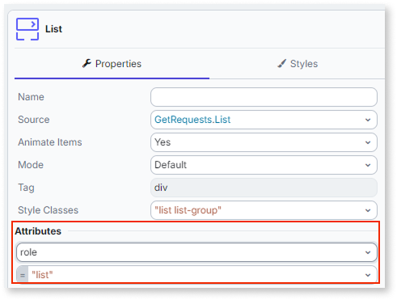
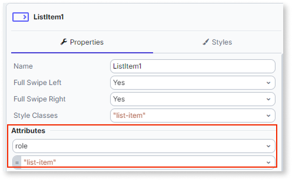

# List

Use the following guidelines to make the **List** widget meet WCAG 2.2 AA compliance in your apps.

## Accessibility – WCAG 2.2 AA compliance {#accessibility}

The fixes in this section describe how to add the appropriate ARIA roles that help screen readers announce the list structure correctly. If the **List** is interactive, you can also add keyboard support so users can focus items and activate them using `Enter` or `Space`.

### Add list and listitem roles

1. In **ODC Studio**, go to the **Interface** tab, and select the **Screen/Block** where you use the **List**.

1. In the **Widget Tree**, select the **List**.

1. In **List Properties**, under **Attributes**, add `role="list"`.

     

1. In the **Widget Tree**, select the **List Item** inside that **List**.

1. In **List Item Properties**, under **Attributes**, add `role="listitem"`.

     

1. Publish the app.

### Add keyboard-accessible interactions to list items

Use native interactive elements inside **List Items** to provide keyboard navigation and activation without additional attributes or JavaScript.

For interactive **Lists**, use a **Button** to trigger an action or a **Link** to navigate to another page. For non-interactive **Lists** used only to display information, no additional attributes are required.

1. In **ODC Studio**, go to the **Interface** tab and select the **Screen** or **Block** where you use the **List**.

1. In the **Widget Tree**, select the **List Item** inside the **List**.

1. Add a **Button** or **Link** inside the **List Item**, depending on the intended interaction.

1. Configure the **Button** or **Link** to perform the required action or navigation.

1. Ensure the interactive element has a descriptive, accessible name that communicates its purpose.

1. Publish the app.

### Result

After completing these steps:

* Users can navigate between interactive elements using the Tab key.
* Buttons support activation using Enter or Space, while Links support activation using Enter.
* Screen readers identify the interactive elements according to their native HTML semantics.

Test the List in your app to verify keyboard navigation, focus visibility, and screen reader announcements.
