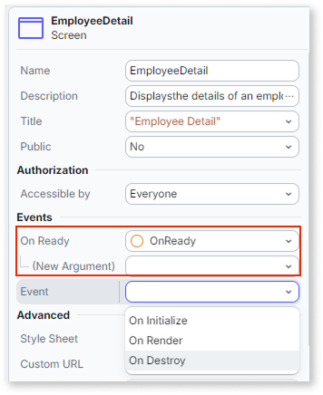
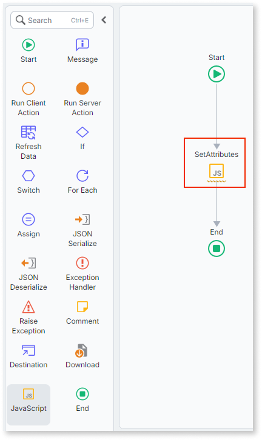
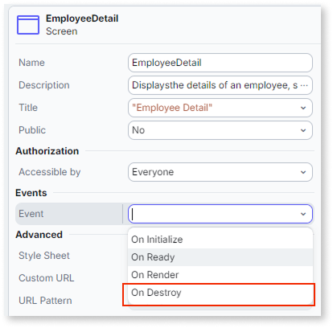

# Popover menu

Use the following guidelines to improve the accessibility of the **Popover menu** widget and support WCAG 2.2 AA compliance in your apps.

## Accessibility – WCAG 2.2 AA compliance {#accessibility}

By default, the **Popover** widget may not expose the correct ARIA relationships or support all expected keyboard interactions. In this procedure, you update the trigger attributes, enable dismissal using `Escape`, and return focus to the trigger when the Popover closes through keyboard interaction. These changes help keyboard and screen reader users identify, navigate, and dismiss the Popover.

### Add ARIA attributes and keyboard support

1. In **ODC Studio**, go to the **Interface** tab.  

1. Select the **Screen/Block** that uses the **Popover**.  

1. In **Screen/Block** properties, select **OnReady** to create a client action.  

    

1. In **OnReady**, drag a **JavaScript** node to the flow.  

    

1. Add an input parameter **WidgetId** (**Text**) and set it to the **Popover** widget ID (for example, `Popover.Id`).  

1. Add the following script to the **JavaScript** node:

    ```javascript
    const popover = document.getElementById($parameters.WidgetId);
    if (!popover) return;

    const trigger = popover.querySelector(".popover-top");
    if (!trigger) return;

    // Remove previously registered handlers.
    if (popover._observer) {
        popover._observer.disconnect();
    }

    if (popover._escapeHandler) {
        document.removeEventListener(
            "keydown",
            popover._escapeHandler
        );
    }

    // Configure the trigger.
    trigger.setAttribute("role", "button");
    trigger.setAttribute("tabindex", "0");

    // Give the associated content a unique ID.
    const panelId = $parameters.WidgetId + "-panel";

    function getPanel() {
        return document.getElementById(panelId);
    }

    function updateAccessibility() {
        const isExpanded = popover.classList.contains("popover-expanded");

        trigger.setAttribute("aria-expanded", String(isExpanded));

        const panel = getPanel();

        if (panel) {
            trigger.setAttribute("aria-controls", panel.id);
        } else {
            trigger.removeAttribute("aria-controls");
        }
    }

    // Monitor changes to the Popover state.
    const observer = new MutationObserver(() => {
        updateAccessibility();
    });

    observer.observe(popover, {
        attributes: true,
        attributeFilter: ["class"]
    });

    popover._observer = observer;

    // Close the Popover with Escape.
    function handleEscape(event) {
        if (event.key !== "Escape") return;

        const isExpanded = popover.classList.contains("popover-expanded");
        if (!isExpanded) return;

        const panel = getPanel();
        const active = document.activeElement;

        // Only handle Escape when focus is in this Popover.
        if (active !== trigger &&
            !trigger.contains(active) &&
            !(panel && panel.contains(active))) {
            return;
        }

        event.preventDefault();
        event.stopPropagation();

        // Use the existing trigger interaction to close.
        trigger.click();

        // Return focus to the trigger.
        requestAnimationFrame(() => {
            if (trigger.isConnected) {
                trigger.focus();
            }
        });
    }

    document.addEventListener("keydown", handleEscape);
    popover._escapeHandler = handleEscape;

    updateAccessibility();
    ```

    <div class="info" markdown="1">

    The **Popover** is a non-modal component. Keyboard users can navigate outside it using `Tab` and `Shift+Tab`, so focus shouldn't be trapped inside the Popover.

    The script uses the trigger's click behavior to close the Popover. Verify that this matches the component's behavior in your OutSystems UI version.

    The associated panel must have a unique HTML `id` for `aria-controls` to reference it. If OutSystems UI renders the panel dynamically or outside the original Popover container, adapt `getPanel()` to locate the correct panel and assign the expected ID. Don't use the position of the panel among other Popover widgets to identify it.

    </div>

### Remove event listeners and observers

1. In **Screen/Block** properties, select **OnDestroy** to create a Client Action.

    

1. In **OnDestroy**, add a **JavaScript** node.

1. Add an input parameter named **WidgetId** of type **Text** and set it to the **Popover** widget ID, for example, `Popover.Id`.

1. Add the following code to the **JavaScript** node:

   ```javascript
    const popover = document.getElementById($parameters.WidgetId);

    if (popover) {
        if (popover._observer) {
            popover._observer.disconnect();
            delete popover._observer;
        }

        if (popover._escapeHandler) {
            document.removeEventListener(
                "keydown",
                popover._escapeHandler
            );
            delete popover._escapeHandler;
        }
    }
    ```

1. Publish the app.

### Result

After completing these steps, the **Popover** trigger exposes `aria-expanded` to communicate its open or closed state. When the associated content has a valid HTML ID, `aria-controls` identifies the relationship between the trigger and the content.

Keyboard users can close the Popover using `Escape`, with focus returning to the trigger. `Tab` and `Shift+Tab` retain their normal navigation behavior without trapping focus inside the Popover.

Test the pattern in your app to confirm that the Popover opens and closes correctly, the ARIA attributes reflect its state, `Escape` dismisses the content and restores focus, and keyboard navigation works as expected.
