# Popup

Use the following guidelines to improve the accessibility of the **Popup** widget and support WCAG 2.2 AA compliance in your apps.

## Accessibility – WCAG 2.2 AA compliance {#accessibility}

The fixes in this section help keep keyboard focus inside the **Popup** while it's open, make focus visible on its interactive elements, and return focus to the trigger when the **Popup** closes. They also establish the ARIA relationship between the trigger and the **Popup** and provide an accessible name so screen readers can identify its purpose.

### Set visible focus

Apply the accessibility class to the **Popup** when it opens so its interactive elements display the intended focus styles.

1. In **ODC Studio**, go to the **Interface** tab and select the **Screen/Block** where you use the **Popup**.

1. In **Elements**, select the Client Action that opens or closes the **Popup**.

    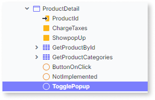

1. In the action flow, add an **If** node to check whether the variable that controls the **Popup** is `True`.

    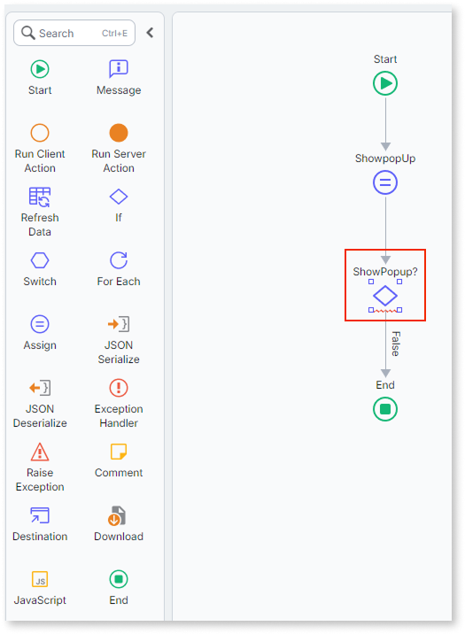

1. In the **True** branch of the **If**, add a **JavaScript** node.

    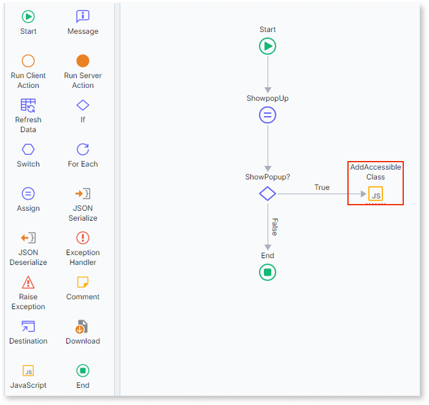

1. In the **JavaScript** node, add an input parameter named **WidgetId** of type **Text** and set it to the **Popup** widget ID, for example, `Popup.Id`.

    Ensure that the **Popup** widget has a **Name** defined in the screen.

    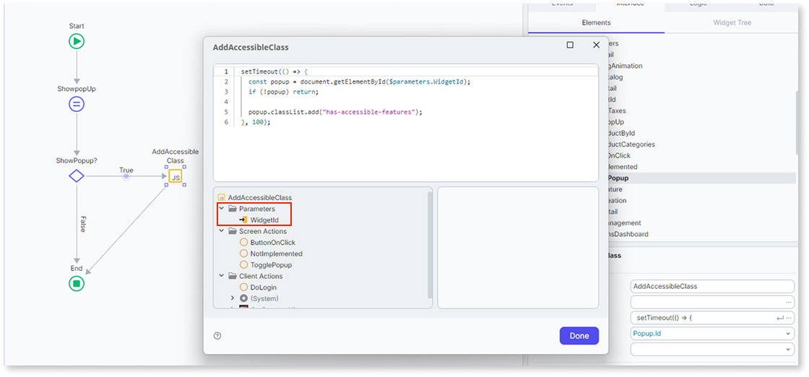

1. Add the following code to the **JavaScript** node:

    ```javascript
    setTimeout(() => {
        const popup = document.getElementById($parameters.WidgetId);
        if (!popup) return;

        popup.classList.add("has-accessible-features");
    }, 100);
    ```

<div class="info" markdown="1">

This script adds the `has-accessible-features` class to the **Popup**. Ensure that the corresponding CSS rules are available and provide a visible focus indicator for interactive elements. Adding the class alone doesn't create focus styles.

</div>

1. Publish the app.

### Add a focus trap

Keep keyboard focus inside the **Popup** while it's open. The script manages `Tab` and `Shift+Tab` navigation without overriding the native behavior of arrow keys.

1. In **ODC Studio**, go to the **Interface** tab and select the **Screen/Block** where you use the **Popup**.

1. In **Elements**, select the Client Action that opens the **Popup**.

1. In the **True** branch, add another **JavaScript** node after the previous one.

    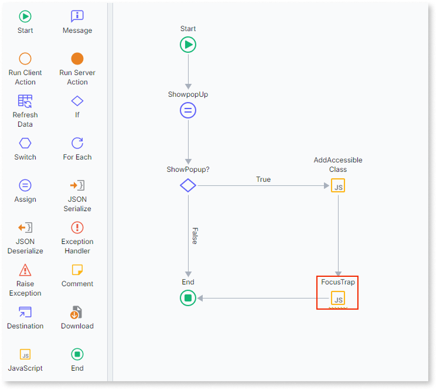

1. Add an input parameter named **WidgetId** of type **Text** and set it to the **Popup** widget ID, for example, `Popup.Id`.

    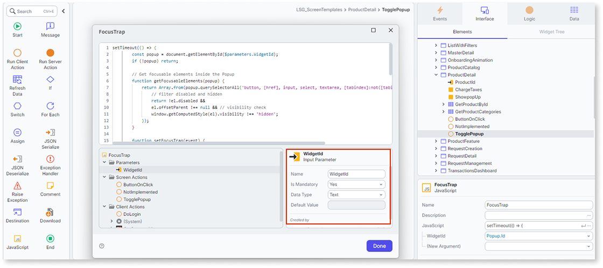

1. Add the following code to the **JavaScript** node:

    ```javascript
    setTimeout(() => {
        const popup = document.getElementById($parameters.WidgetId);
        if (!popup) return;

        const selector = [
            'button:not([disabled])',
            'a[href]',
            'input:not([disabled])',
            'select:not([disabled])',
            'textarea:not([disabled])',
            '[tabindex]:not([tabindex="-1"])'
        ].join(', ');

        function getFocusableElements() {
            return Array.from(popup.querySelectorAll(selector))
                .filter(el =>
                    !el.closest('[hidden], [inert]') &&
                    el.getClientRects().length > 0 &&
                    window.getComputedStyle(el).visibility !== 'hidden' &&
                    el.tabIndex >= 0
                );
        }

        // Remove an existing listener before adding a new one.
        if (popup._setFocusTrap) {
            popup.removeEventListener('keydown', popup._setFocusTrap);
        }

        function setFocusTrap(event) {
            if (event.key === 'Escape') {
                event.preventDefault();

                if (typeof $actions !== 'undefined' &&
                    typeof $actions.TogglePopup === 'function') {
                    $actions.TogglePopup();
                }
                return;
            }

            if (event.key !== 'Tab') return;

            const items = getFocusableElements();

            if (!items.length) {
                event.preventDefault();
                popup.focus();
                return;
            }

            const first = items[0];
            const last = items[items.length - 1];
            const active = document.activeElement;

            if (event.shiftKey &&
                (active === first || !items.includes(active))) {
                event.preventDefault();
                last.focus();
            } else if (!event.shiftKey &&
                (active === last || !items.includes(active))) {
                event.preventDefault();
                first.focus();
            }
        }

        popup.addEventListener('keydown', setFocusTrap);
        popup._setFocusTrap = setFocusTrap;

        // Move focus into the Popup when it opens.
        const items = getFocusableElements();

        if (items.length) {
            items[0].focus();
        } else {
            popup.setAttribute('tabindex', '-1');
            popup.focus();
        }
    }, 100);
    ```

<div class="info" markdown="1">

The script preserves the native behavior of arrow keys in text inputs, text areas, and other interactive elements. If your **Popup** contains components with custom keyboard interactions, test those interactions to ensure that the focus trap doesn't interfere with their behavior.

Replace `TogglePopup` with the name of the Client Action that closes the **Popup**, if different.

The `100` millisecond delay allows the **Popup** to render before the script runs. Adjust the implementation if the Popup's rendering lifecycle requires a different approach.

</div>

1. In the **False** branch of the **If**, where the **Popup** closes, add a **JavaScript** node.

1. In the **JavaScript** node, add an input parameter named **WidgetId** of type **Text** and set it to the **Popup** widget ID, for example, `Popup.Id`.

1. Add the following code to remove the event listener:

    ```javascript
    const popup = document.getElementById($parameters.WidgetId);

    if (popup && popup._setFocusTrap) {
        popup.removeEventListener('keydown', popup._setFocusTrap);
        delete popup._setFocusTrap;
    }
    ```

    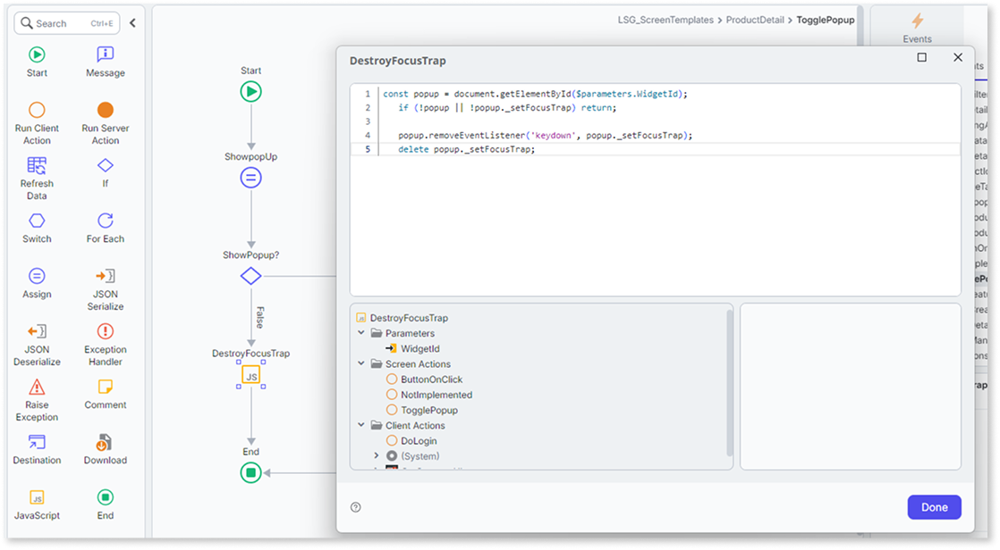

<div class="info" markdown="1">

Ensure that the cleanup action runs whenever the **Popup** closes, including when users dismiss it through the close button, `Escape`, or other supported interactions. If the Popup element is removed before cleanup, the script must use a reference retained before the element was removed.

</div>

1. Publish the app.

### Return focus to the trigger

Restore keyboard focus to the element that opened the **Popup** when it closes.

1. In **ODC Studio**, go to the **Interface** tab and select the **Screen/Block** where you use the **Popup**.

1. In **Elements**, select the Client Action that opens or closes the **Popup**.

1. In the **False** branch of the **If**, after the node that removes the focus trap, add a **Run Client Action** node.

1. Search for and select **SetFocus()**.

    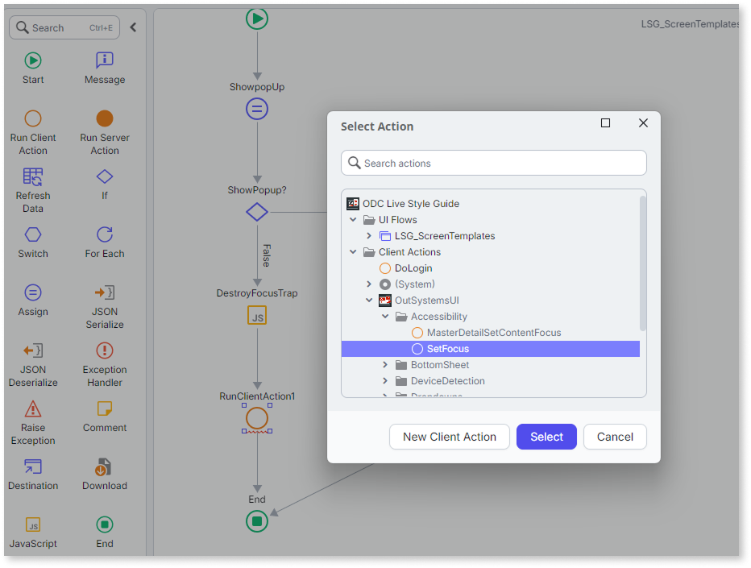

1. Set **WidgetId** to the **Popup** trigger ID, for example, `Button.Id`.

    Ensure that the **Button** widget has a **Name** defined in the screen.

    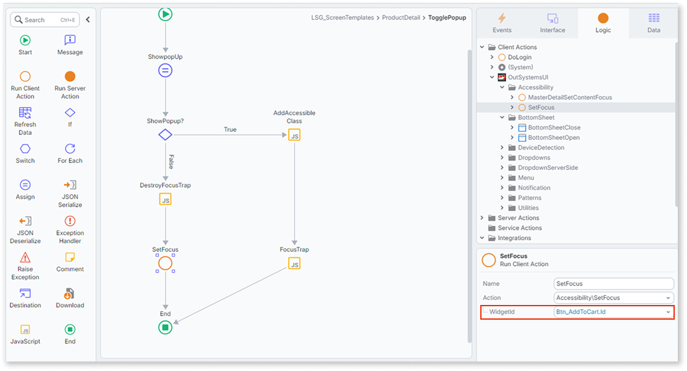

<div class="info" markdown="1">

If multiple elements can open the same **Popup**, restore focus to the element that initiated the interaction. If that element is no longer available, move focus to another appropriate element.

</div>

1. Publish the app.

### Set ARIA attributes on the trigger button

Expose the relationship between the trigger and the **Popup** so assistive technologies can identify the control that opens the dialog.

1. In **ODC Studio**, go to the **Interface** tab and select the **Screen/Block** where you use the **Popup**.

1. In the **Widget Tree**, select the button that opens the **Popup**.

1. In the button Properties, under **Attributes**, add the following attributes:

    ```text
    aria-controls = Popup.Id
    aria-expanded = If(ShowPopup, "true", "false")
    aria-haspopup = "dialog"
    ```

    Replace `ShowPopup` with the Boolean variable that controls the Popup's visibility.

    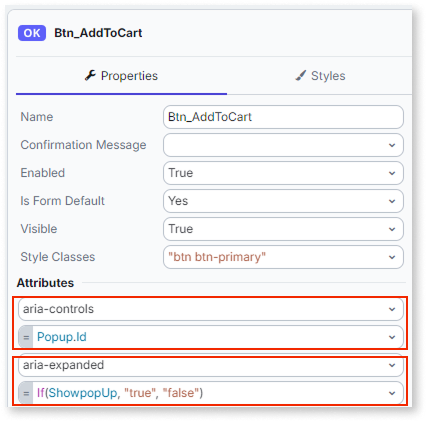

<div class="info" markdown="1">

Ensure that `aria-controls` references the HTML `id` of the Popup's dialog element. The `aria-haspopup="dialog"` attribute is appropriate when the Popup exposes dialog semantics, such as `role="dialog"`.

</div>

1. Publish the app.

### Add an accessible name to the Popup

Provide an accessible name so screen readers can identify the purpose of the **Popup**.

1. In **ODC Studio**, go to the **Interface** tab and select the **Screen/Block** where you use the **Popup**.

1. In the **Widget Tree**, select the **Popup** widget.

1. In **Popup Properties**, under **Attributes**, add one of the following attributes:

    * `aria-labelledby`: Reference the HTML `id` of a visible heading inside the Popup. This is the preferred option when a visible heading is available.
    * `aria-label`: Enter a descriptive name that identifies the Popup's purpose, such as `"Edit profile"`.

    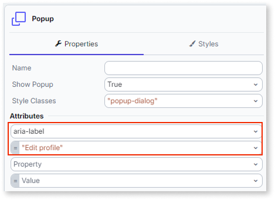

<div class="info" markdown="1">

When using `aria-labelledby`, ensure that the referenced heading has a unique HTML `id` that matches the attribute value. In OutSystems, the widget's **Name** property doesn't necessarily match its rendered HTML `id`.

Ensure that the selected labeling attribute is applied to the element with `role="dialog"`. If the Popup widget applies custom attributes to a different container, adjust the implementation to label the dialog element itself.

</div>

1. Publish the app.

### Result

After completing these steps, keyboard focus moves inside the **Popup** when it opens, remains within the Popup during keyboard navigation, and returns to the trigger when the Popup closes.

The trigger exposes the ARIA relationship through `aria-controls` and `aria-expanded`, while `aria-label` or `aria-labelledby` provides an accessible name so screen readers can identify the Popup's purpose.

Test the pattern in your app to confirm that:

* Focus is visible on interactive elements.
* Initial focus moves inside the Popup when it opens.
* `Tab` and `Shift+Tab` keep focus within the Popup.
* `Escape` closes the Popup.
* Focus returns to the trigger when the Popup closes.
* Screen readers announce the Popup's accessible name.
* Interactive elements retain their expected keyboard behavior.
