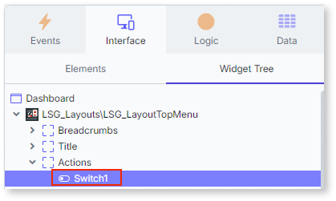
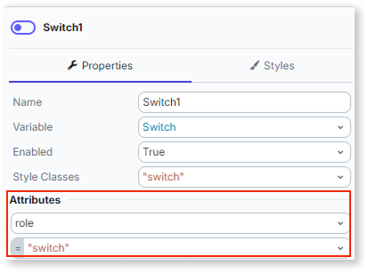
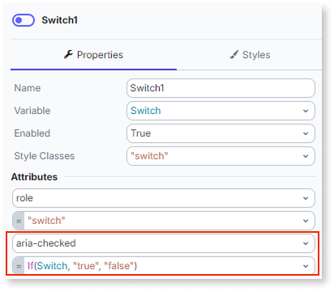

# Switch

Use the following guidelines to make the **Switch** widget meet WCAG 2.2 AA compliance in your apps.

## Accessibility – WCAG 2.2 AA compliance {#accessibility}

By default, the **Switch** widget may not expose the correct ARIA attributes for assistive technologies. Set the appropriate roles so that screen readers identify it as a switch and accurately announce its state.

### Set the correct ARIA attributes

1. In **ODC Studio**, go to the **Interface** tab and select the **Screen/Block** that uses the **Switch**.

1. In the **Widget Tree**, select the **Switch** widget.  

    

1. In the **Switch Properties**, under **Attributes**, set `role="switch"`.  

    

1. Then add a new attribute `aria-checked` with the following condition:

    ```text
    If([switch variable], "true", "false")
    ```

    

1. Publish the app.

### Result

After completing these steps, screen readers correctly announce the Switch as a toggle control and describe whether it's on or off, improving accessibility for all users.

Test the pattern in your app to confirm the update.
