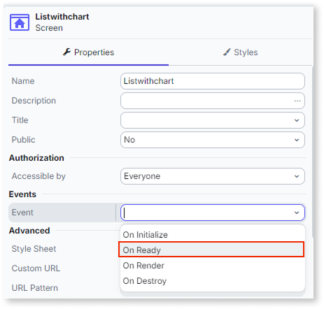
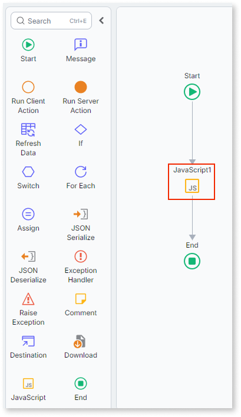
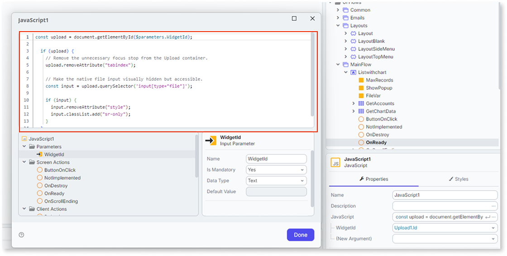

# Upload

Use the following guidelines to improve the accessibility of the **Upload** widget and support WCAG 2.2 AA compliance in your apps.

## Accessibility – WCAG 2.2 AA compliance {#accessibility}

By default, the **Upload** widget may create an additional keyboard focus stop on its container while keeping the native file input hidden. This can affect keyboard navigation and prevent users from identifying which element has focus. In this procedure, you make the native file input keyboard-accessible, remove the unnecessary focus stop, and provide a visible focus indicator.

### Improve keyboard navigation and focus visibility

Update the Upload widget's HTML attributes and CSS to ensure users can access the native file input and identify its focus state.

1. In **ODC Studio**, go to the **Interface** tab and select the **Screen** or **Block** containing the **Upload** widget.

1. In **Screen/Block Properties**, create an **OnReady** client action.

    

1. In the **OnReady** action, add a **JavaScript** node.

    

1. Add an input parameter named **WidgetId** of type **Text** and set its value to the Upload widget ID, for example, `Upload.Id`.

1. Add the following code to the **JavaScript** node:

    ```javascript

    const upload = document.getElementById($parameters.WidgetId);

    if (upload) {

        // Remove the unnecessary focus stop from the Upload container.
        upload.removeAttribute("tabindex");

        // Make the native file input visually hidden but accessible.
        const input = upload.querySelector('input[type="file"]');

        if (input) {
            input.removeAttribute("style");
            input.classList.add("sr-only");
        }
    }

    ```

    

1. Add the following CSS to your app's **Theme** to display a focus indicator when the native file input receives keyboard focus:

    ```css

    .upload:has(input[type="file"]:focus-visible) {
        box-shadow: 0 0 0 var(--osui-focus-shadow-gap) var(--color-background-surface), 0 0 0 calc(var(--osui-focus-shadow-gap) + var(--osui-focus-shadow-width)) var(--osui-focus-shadow-color);
    }
    ```

1. Publish the app.

### Result

The Upload widget provides a single keyboard focus stop through its native file input. Keyboard users can identify the focused widget through a visible focus indicator, while screen readers retain access to the native file input.

Ensure the file input has an accessible name that describes its purpose. Also, verify that the `sr-only` class visually hides the input without removing it from the accessibility tree or keyboard navigation. Test the implementation with keyboard navigation and a screen reader to confirm the expected behavior.
