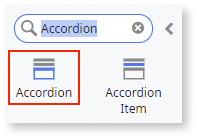
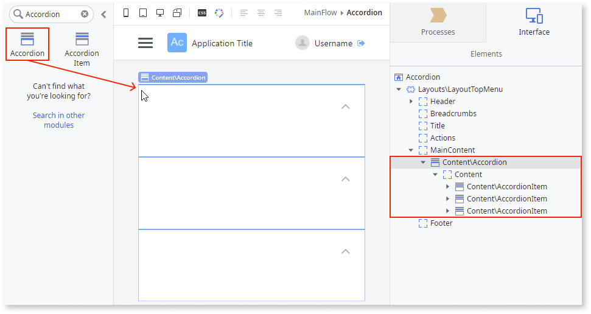
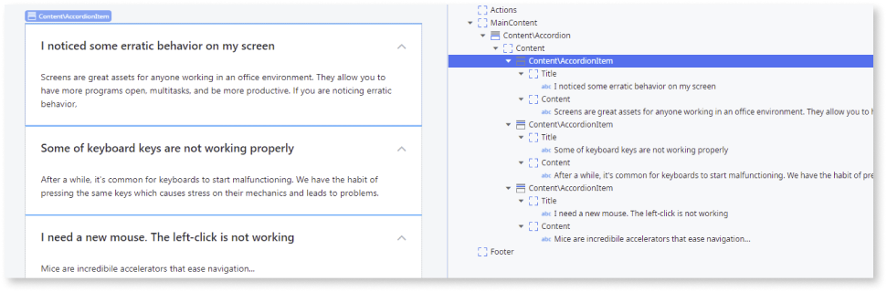
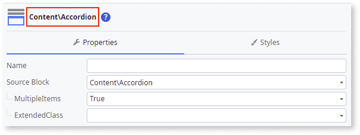
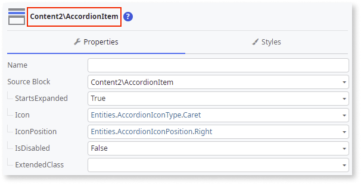
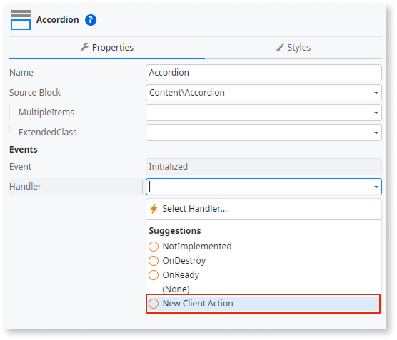
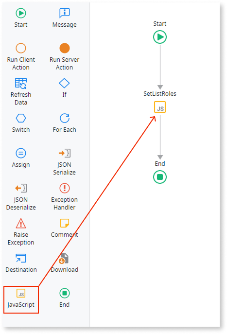

# Accordion

<div class="info" markdown="1">

Applies to the OutSystems UI framework only.

</div>

You can use the Accordion UI Pattern to allow users expand and hide content when clicked.

## How to use the accordion UI pattern

1. In ODC Studio, in the Toolbox, search for `Accordion`.

    The Accordion widget is displayed.

    

1. From the Toolbox, drag the Accordion widget into the Main Content area of your application's screen.

    

    **Note:** By default, the Accordion widget contains 3 **AccordionItem** widgets. You can add or delete Accordion Items as required.

1. Add the relevant content to the **AccordionItem** placeholders. In this example, some FAQs are added.
  
    

1. On the **Properties** tab, you can customize the Accordion's look and feel by setting any of the (optional) properties.

    

    

After following these steps and publishing the app, you can test the pattern in your app.

## Properties

### Accordion

| Property | Description |
| ----------------------------------- | ------------------------------------------------------------------------------------------------------------------------------------------------------------------------------------------------------------------------------------------------------------------------------------------------------------------------------------------------------------------------------------------------------------------------------------------------------------------------------------------------------------------------------------------------------------------------------------------------------------------------------------ |
| MultipleItems (Boolean): Optional | If True, you can have multiple Accordion Items expanded simultaneously. Default value is False. |
| ExtendedClass (Text): Optional | Adds custom style classes to the Pattern. You define your custom style classes in your application using CSS.<br/><br/>Examples<br/><br/> <ul><li>Blank - No custom styles are added (default value).</li><li>"myclass" - Adds the ``myclass`` style to the UI styles being applied.</li><li>"myclass1 myclass2" - Adds the ``myclass1`` and ``myclass2`` styles to the UI styles being applied.</li></ul>You can also use the classes available on the OutSystems UI. |

### Accordion item

| Property | Description |
| ------------------------------------------------ | ----------------------------------------------------------------------------------------------------------------------------------------------------------------------------------------------------------------------------------------------------------------------------------------------------------------------------------------------------------------------------------------------------------------------------------------------------------------------------------------------------------------------------------------------------------------------------------------------------------------------------------- |
| StartsExpanded (Boolean): Optional | If set to True, when the page is rendered, the Accordion Item is open. If set to False, the Accordion Item is closed. The default value is False. |
| Icon (Accordion Icon Type): Optional | Set the icons shown in  the Accordion Item. You can pick between the following: <br/> <ul><li>Carets: Arrow up icon when the item is expanded and arrow down icon when the item is collapsed. This is the default.</li><li> Plus/Minus: Minus icon (-) when the item is expanded and plus icon (+) when the item is collapsed.</li><li>Custom: Advanced option to customize the Accordion icons. To use custom icons, set the Icon property to Custom and drag and drop the Icon widget to the Accordion Item placeholder.</li></ul> |
| IconPosition (AccordionIconPosition): Optional | Set the position of the accordion icon. By default, the icon diplays on the right. |
| IsDisabled (Boolean): Optional | If True, the Accordion item can't be expanded when clicked. Default value is False. |
| ExtendedClass (Text): Optional | Adds custom style classes to the Pattern. You define your custom style classes in your application using CSS.<br/><br/>Examples<br/><br/> <ul><li>Blank No custom styles are added (default value).</li><li>"myclass" - Adds the ``myclass`` style to the UI styles being applied.</li><li>"myclass1 myclass2" - Adds the ``myclass1`` and ``myclass2`` styles to the UI styles being applied. </li></ul>You can also use the classes available on the OutSystems UI. |

## Accessibility – WCAG 2.2 AA compliance {#accessibility}

Starting with OutSystems UI version **2.29.0**, the **Accordion** is compliant with WCAG 2.2 AA accessibility standards by default. No changes or manual work are required. If you customized the pattern, validate your implementation to ensure it still meets accessibility requirements.

<div class="info" markdown="1">

**For versions earlier than 2.29.0**: If you use an OutSystems UI version earlier than **2.29.0** and manually applied accessibility fixes as described below, remove the manual code added by following the steps in this section before updating to version **2.29.0**.

</div>

### Manual fix required (for versions before 2.29.0)

#### Assign list roles in the Accordion

By default, the **Accordion** UI Pattern used together with a **List** Widget doesn't expose the correct roles for assistive technologies.

Assigning `list` and `listitem` roles ensures that screen readers interpret the structure properly, improving navigation and context for users who rely on assistive tools.

<div class="info" markdown="1">

If using Accordion Item pattern without Accordion pattern adapt the following instructions and the script to create the action in Accordion Item Initialized Event.

</div>

1. In **ODC Studio**, go to the **Interface** tab and select the **Screen/Block** where you use the **Accordion**.

1. In the **Accordion** properties, under **Event Initialized**, select **New Client Action** and name it `AccordionInitialized`.

    

1. In **AccordionInitialized**, add a **JavaScript** node.

    

1. Add the following code to apply correct list semantics:

    ```javascript
    const accordionItems = document.querySelectorAll("#"+ $parameters.WidgetId +" .osui-accordion .osui-accordion-item");
    if (!accordionItems) return;

    accordionItems.forEach(accordionItem => {
        let retryHandle;

        function applyRoles(currListEl) {
            if (!currListEl) return;
            currListEl.setAttribute('role', 'list');
            const items = currListEl.querySelectorAll(':scope > *');
            items.forEach(item => item.setAttribute('role', 'listitem'));
        }

        function waitListRender() {
            const listEl = document.querySelector("#"+ $parameters.WidgetId +".osui-accordion .list");
            if (listEl) {
                applyRoles(listEl);
                if (retryHandle) {
                    clearTimeout(retryHandle);
                }
            } else {
                retryHandle = setTimeout(waitListRender, 100);
            }
        }

        // Start the process
        waitListRender();
    });
    ```

1. Publish the app

#### Result

After completing these steps, any **List** inside an **Accordion** correctly exposes `list` and `listitem` roles.

Screen readers can now identify and announce list items accurately, improving both structure and usability for people who navigate using assistive technologies.

Test the pattern in your app to confirm the update.
