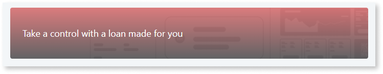
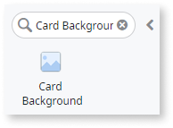
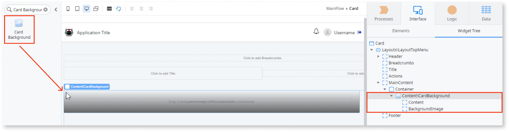
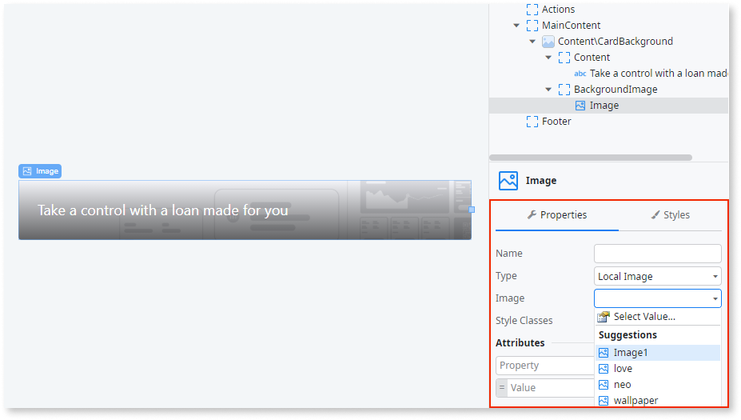
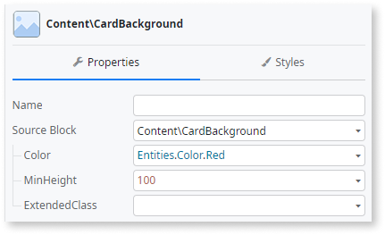
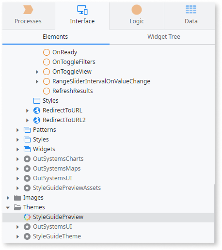

---
tags:
  - Accessibility
  - CSS
  - OutSystems UI
  - Themes
  - UI
  - UI Patterns
  - Widgets
summary: Card Background UI Pattern in ODC groups content blocks with a background image — set color, height, and custom styles in ODC Studio.
locale: en-us
guid: 8460d7b9-4aa2-410b-8869-635625d64a4f
app_type: mobile apps, reactive web apps
figma: https://www.figma.com/file/6G4tyYswfWPn5uJPDlBpvp/Building-apps?type=design&node-id=3203%3A11449&t=ZwHw8hXeFhwYsO5V-1
platform-version: odc
audience:
  - Developer
  - Front-end developer
outsystems-tools:
  - odc studio
coverage-type:
  - apply
  - remember
topic:
  - add-widget-ui-pattern
isautopublish: true
---

# Card Background

<div class="info" markdown="1">

Applies to the OutSystems UI framework only.

</div>

You can use the Card Background UI Pattern to group small pieces of information and highlight them on the screen using a background image. The information is grouped into a small block that is easily noticeable on-screen.



## How to use the card background UI pattern

1. In ODC Studio, in the Toolbox, search for `Card Background`.

    The Card Background widget is displayed.

    

1. From the Toolbox, drag the Card Background widget into the Main Content area of your application's screen.

    

    By default, the Card Background widget contains Content and Background Image placeholders.

1. Add your content to the placeholder.

    In this example, we add text to the Content placeholder and an image to the Background Image placeholder. To do this, from the Widget Tree, select the Image, and on the **Properties** tab, from the **Image** drop-down, select the image you want to display.

    

1. On the **Properties** tab, you can change the look and feel of the Card Background widget, by setting the (optional) properties, for example, the background color and a minimum height for the card.

    

After following these steps and publishing the app, you can test the pattern in your app.

## Properties

| Property | Description |
| ------------------------------------ | ----------------------------------------------------------------------------------------------------------------------------------------------------------------------------------------------------------------------------------------------------------------------------------------------------------------------------------------------------------------------------------------------------------------------------------------------------------------------------------------------------------------------------------------------------------------------------------------------------------------------- |
| Color (Color Identifier): Optional | Set the background color. Red, orange, yellow, lime, green, blue, violet, and pink are just some of predefined colors available for the badge. <p>Examples <ul><li>_Blank_ - No background color is applied. This is the default (Entities.Color.Transparent).</li><li>_Entities.Color.Red_ - Applies a red background color to the card.</li></ul></p> |
| MinHeight (Integer): Optional | Sets the minimum height of the card (in pixels).  <p>Examples</p><ul><li>_500_ - The Card height is 500 pixels. </li></ul> |
| Height (Integer): Optional | Set the height of the Card (in pixels). By default, the content is vertically aligned. <p>Examples</p><ul><li>_Blank_ - The Card height is 300 pixels. </li><li>_500_ - The Card height is 500 pixels. </li></ul> |
| ExtendedClass (Text): Optional | Adds custom style classes to the Pattern. You define your custom style classes in your application using CSS.<p>Examples</p><ul><li>Blank - No custom styles are added (default value).</li><li>"myclass" - Adds the ``myclass`` style to the UI styles being applied.</li><li>"myclass1 myclass2" - Adds the ``myclass1`` and ``myclass2`` styles to the UI styles being applied. </li></ul>You can also use the classes available on the OutSystems UI. |

## Accessibility – WCAG 2.2 AA compliance {#accessibility}

By default, the **Card Background** UI Pattern might not provide enough contrast between the overlaid text and its background image or color. This can make the text harder to read, especially for users with low vision or in bright environments.

To improve readability without altering your existing color palette, you can increase the opacity of the gradient mask applied to the lower half of the card background. This approach preserves the component's default appearance while ensuring that text meets WCAG 2.2 AA contrast requirements.

You can also customize the color palette, and adjusting individual color tokens might resolve contrast issues—but that can affect other components.  
If you choose this approach, make sure to meet the recommended minimum contrast ratio (**4.5:1 for normal text** or **3:1 for large text**).

### Improve text contrast by darkening the background mask

1. In **ODC Studio**, go to the **Elements** tab.

1. Select your **Theme** under **Themes**.

    

1. Add the following code to your theme's CSS to darken the lower portion of the card background:

    ```css
    .card-background-color:after {
        background: linear-gradient(180deg, rgba(0, 0, 0, 1) 100%, rgb(0, 0, 0) 0%);
        height: 50%;
        opacity: 1;
        top: 50%;
    }

    .card-background-color:before {
        background: -webkit-gradient(linear, left top, left bottom, from(rgba(0, 0, 0, 0)), to(rgb(0, 0, 0)));
        background: linear-gradient(180deg, rgba(0, 0, 0, 0) 0%, rgb(0, 0, 0) 100%);
        content: "";
        height: 50%;
        position: absolute;
        top: 0;
        width: 100%;
        z-index: var(--layer-local-tier-1);
    }
    ```

1. Publish the app.

### Result

After completing these steps, the lower area of each **Card Background** becomes slightly darker, improving the contrast between text and background without changing the card's color palette.

Test the component in your app to confirm that the text meets WCAG 2.2 AA contrast requirements.
