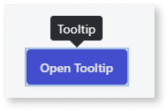
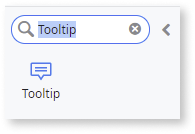
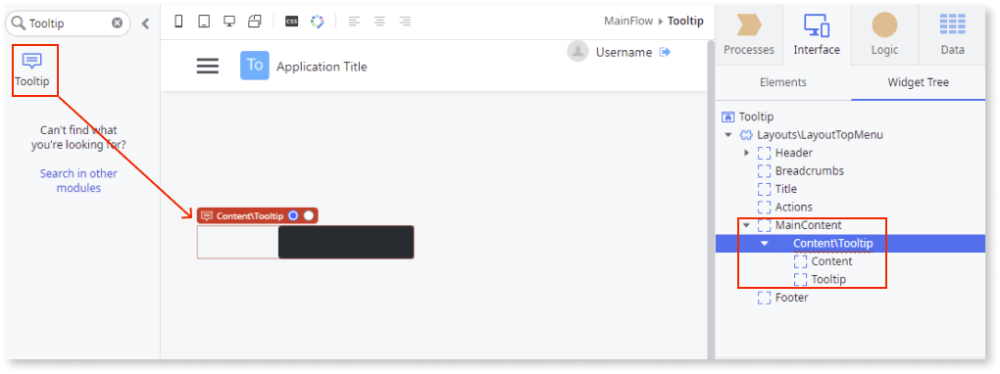
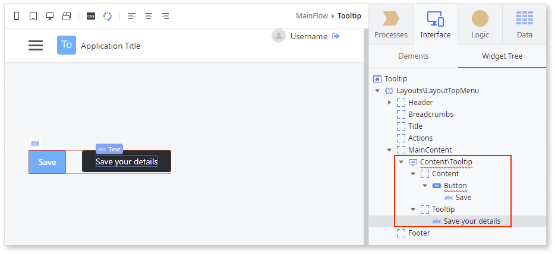
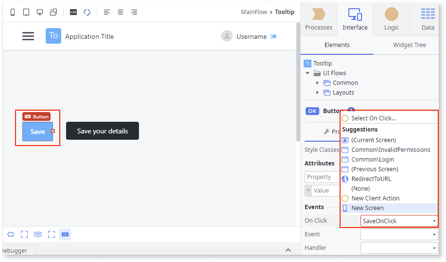
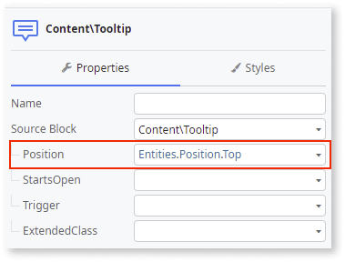
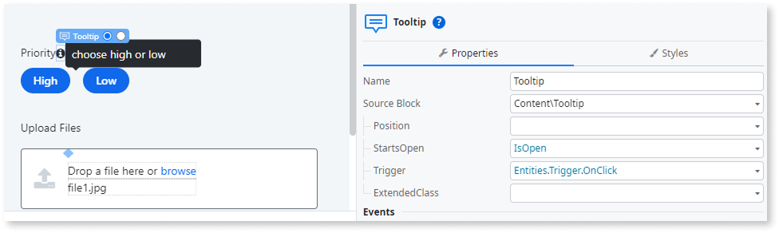

---
tags:
  - Accessibility
  - Front-End
  - OutSystems UI
  - Triggers
  - UI
  - UI Patterns
  - Widgets
summary: ODC Tooltip UI Pattern lets you display informative text when users hover, click, or tap an element, with configurable position and trigger properties.
locale: en-us
guid: 33a42743-0e9c-44c6-b67d-363ec53dc01a
app_type: mobile apps, reactive web apps
figma: https://www.figma.com/file/6G4tyYswfWPn5uJPDlBpvp/Building-apps?type=design&node-id=3203%3A11799&t=ZwHw8hXeFhwYsO5V-1
platform-version: odc
audience:
  - Developer
  - Front-end developer
outsystems-tools:
  - odc studio
coverage-type:
  - remember
  - apply
isautopublish: true
---

# Tooltip

Applies to the OutSystems UI framework only.

You can use the Tooltip UI Pattern to dynamically display informative text when a user hovers over, clicks, or taps an on-screen element.

## How to use the tooltip UI pattern

1. In ODC Studio, in the Toolbox, search for `Tooltip`.
  
    The Tooltip widget is displayed.

    

1. From the Toolbox, drag the Tooltip widget into the Main Content area of your application's screen.

    

    By default, the Tooltip widget contains Content and Tooltip placeholders.

1. Add your content to the placeholders.

    In this example, we add a **Save** button to the Content placeholder and enter the tooltip text ``Save your details`` in the Tooltip placeholder.

    

1. Select the **Save** button and add the relevant **On Click** event.

    

1. On the **Properties** tab, from the **Position** dropdown, select where you want the tooltip to appear. In this example we want the tooltip to appear on top of the **Save** button. You can also change the look and feel of the Tooltip by setting the (optional) properties.

    

After following these steps and publishing the app, you can test the pattern in your app.

## Properties

| Properties | Description |
| ------------------------------------------ | ------------------------------------------------------------------------------------------------------------------------------------------------------------------------------------------------------------------------------------------------------------------------------------------------------------------------------------------------------------------------------------------------------------------------------------------------------------------------------------------------------------------------------------------------------------------------------------------------------------------------------------------------- |
| Position (Position Identifier): Optional | Set the tooltip's position, for example, top, right, or left. |
| StartsOpen (Boolean): Optional | If True, the tooltip is visible when the page is first loaded (without the need for the initial trigger). If False, the tooltip is not visible. This is the default. |
| Trigger (TriggerIdentifier): Optional | Set how the tooltip is triggered. By default, the tooltip is triggered by hovering over the element. |
| ExtendedClass (Text): Optional | Adds custom style classes to the Pattern. You define your custom style classes in your application using CSS. 
Examples <ul><li>Blank - No custom styles are added (default value).</li><li>"myclass" - Adds the _myclass_ style to the UI styles being applied.</li><li>"myclass1 myclass2" - Adds the ``myclass1`` and ``myclass2`` styles to the UI styles being applied.</li></ul>
You can also use the classes available on the OutSystems UI. |

## Accessibility – WCAG 2.2 AA compliance {#accessibility}

By default, the Tooltip UI pattern isn't fully keyboard accessible when configured to open only on hover. To ensure WCAG 2.2 AA compliance, configure the Tooltip trigger to open on click, which also makes the Tooltip open on keyboard focus.

### Ensure that the trigger is set as OnClick

1. In **ODC Studio**, go to the **Interface** tab, and select the **Screen/Block** where you use the **Tooltip**.

1. In **Tooltip** Properties, in **Trigger**, select **OnClick**.

    

1. Publish the app

### Result

After completing these steps, the Tooltip behavior aligns with the [WAI-ARIA Authoring Practices Guide (APG) Tooltip pattern](https://www.w3.org/WAI/ARIA/apg/patterns/tooltip/), which defines the following keyboard interaction.

1. Keyboard users move focus to the trigger element, for example with `Tab`, and the Tooltip opens automatically.

1. The Tooltip closes when the user presses `Esc` or moves focus away from the trigger element.

**Note:** The APG defines `Esc` as the key for dismissing a tooltip and doesn't define `Enter` or `Space` as valid tooltip triggers, since the Tooltip is expected to open automatically on hover or focus rather than through an explicit key press. The W3C community continues to refine parts of this pattern, so refer to the [Tooltip pattern](https://www.w3.org/WAI/ARIA/apg/patterns/tooltip/) documentation for the latest guidance.

Test the pattern in your app to confirm that the Tooltip opens when the trigger element receives focus, and closes with the `Esc` key or when focus moves elsewhere.
