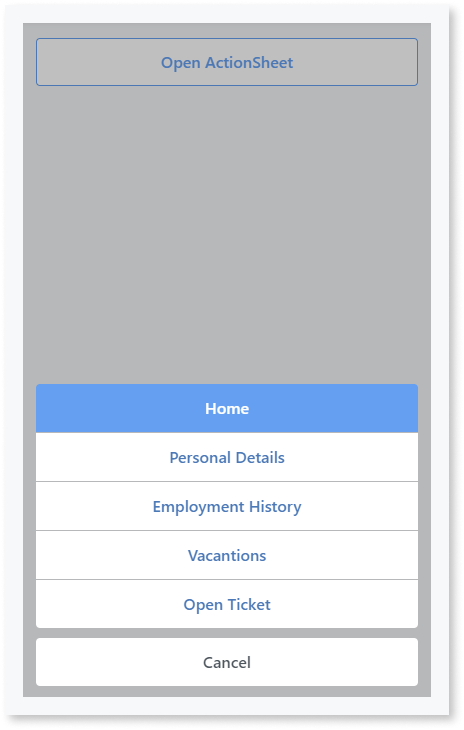
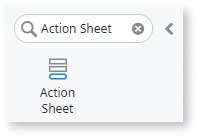
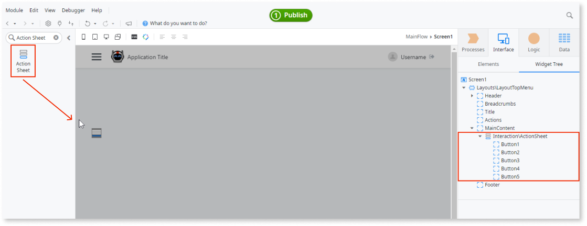
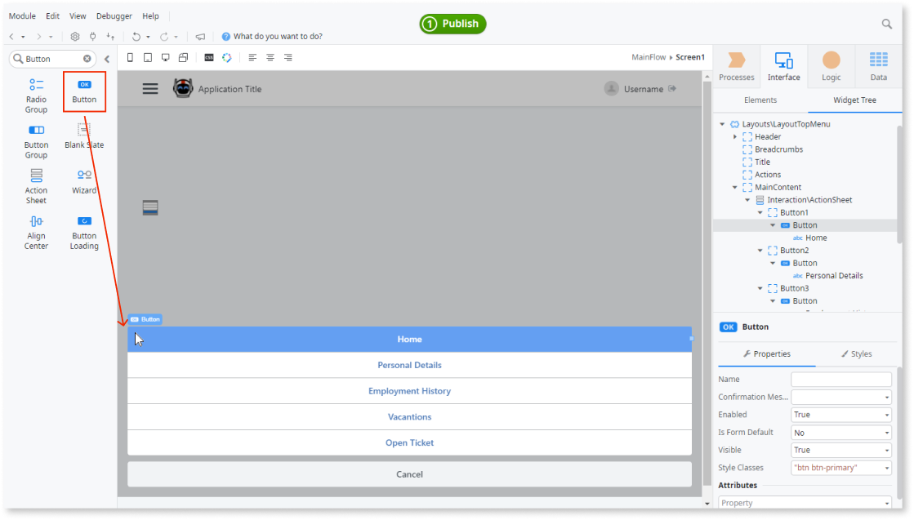
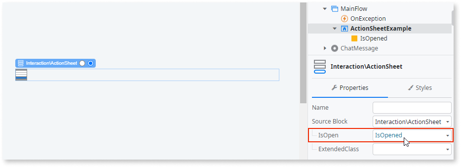
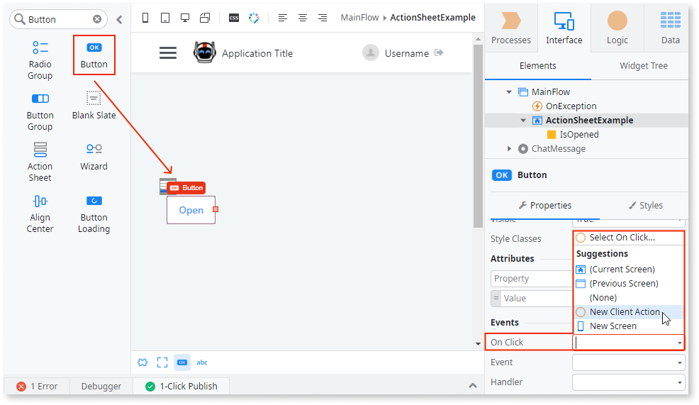
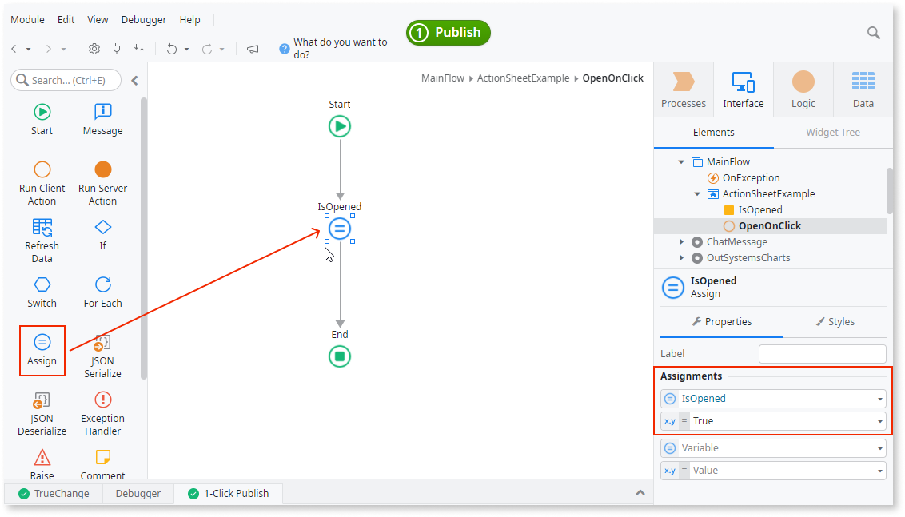
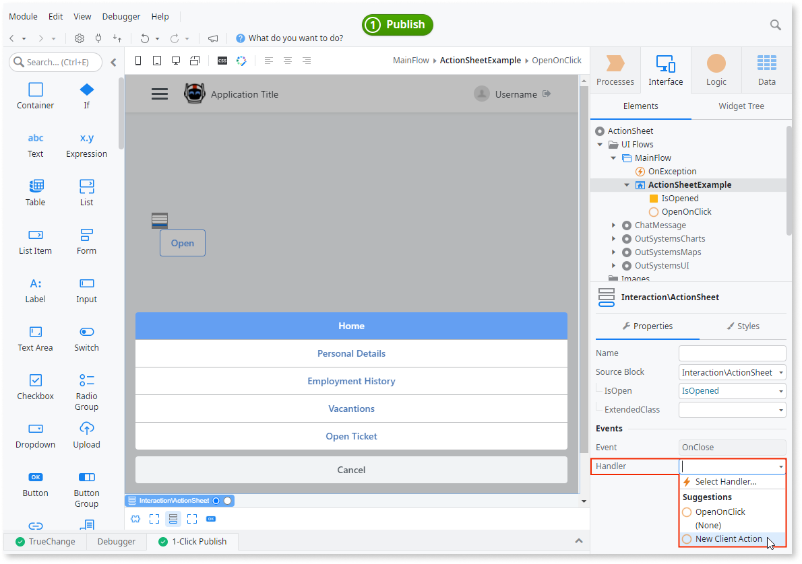
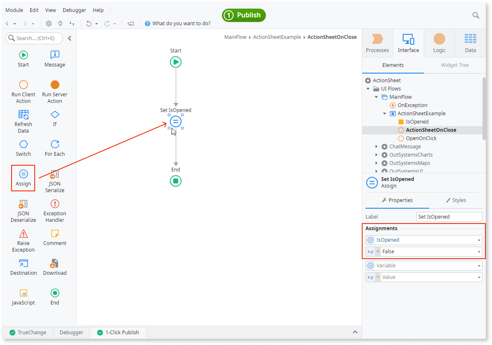

---
tags:
  - Accessibility
  - Events
  - Mobile app
  - OutSystems UI
  - UI
  - UI Patterns
  - Widgets
summary: Action Sheet UI Pattern in OutSystems Developer Cloud (ODC) configures a bottom-sliding menu with IsOpen and OnClose events in ODC Studio.
locale: en-us
guid: 7702c792-34d2-41e7-9bad-e9b88326a21e
app_type: mobile apps, reactive web apps
figma: https://www.figma.com/file/6G4tyYswfWPn5uJPDlBpvp/Building-apps?type=design&node-id=3203%3A12251&t=ZwHw8hXeFhwYsO5V-1
platform-version: odc
audience:
  - Developer
  - Front-end developer
outsystems-tools:
  - odc studio
coverage-type:
  - apply
  - remember
  - unblock
topic:
  - action-sheet-reference
  - use-action-sheet-pattern
isautopublish: true
---

# Action Sheet

<div class="info" markdown="1">

Applies to the OutSystems UI framework only.

</div>

You can use the Action Sheet UI Patterns to add a menu that slides from the bottom of the screen when triggered by a user action.



## How to use the action sheet UI pattern

1. In ODC Studio, in the Toolbox, search for `Action Sheet`.

    The Action Sheet widget is displayed.

    

1. From the Toolbox, drag the Action Sheet widget into the Main Content area of your application's screen.

    

    By default, the Action Sheet widget contains 5 button placeholders.

1. Add the relevant content to the Button placeholders. In this example, we add buttons that navigate to other pages when clicked.

    

1. Add a local variable. In this example, we call the variable **IsOpened**.

1. Select the Action Sheet pattern, and on the **Properties** tab, set the **IsOpen** property to the new local variable (in this example, **IsOpened**).

    

1. To open the Action Sheet menu, we add a button and on the **Properties** tab, from the **OnClick** dropdown, select **New Client Action**.

    

1. Add an Assign to the client action and set the **IsOpened** local variable to **True**.

    

1. To close the Action Sheet menu, on the **Properties** tab, from the **Handler** dropdrown of the **OnClose** event, select **New Client Action**.

    

1. Add an Assign to the client action and set the **IsOpened** local variable to **False**.

    

After following these steps and publishing the app, you can test the pattern in your app.

## Properties

| Property | Description |
| ---------------------------- | ----------------------------------------------------------------------------------------------------------------------------------------------------------------------------------------------------------------------------------------------------------------------------------------------------------------------------------------------------------------------------------------------------------------------------------------------------------------------------------------------------------------------------------------------------------------------------------------------------------------------------------- |
| IsOpen(Boolean): Mandatory | Assign a variable open/close the Action Sheet. |
| ExtendedClass | Adds custom style classes to the Pattern. You define your custom style classes in your application using CSS.<br/><br/>Examples<br/><br/><ul><li>Blank - No custom styles are added (default value).</li><li>"myclass" - Adds the ``myclass`` style to the UI styles being applied.</li><li>"myclass1 myclass2" - Adds the ``myclass1`` and ``myclass2`` styles to the UI styles being applied.</li></ul>You can also use the classes available on the OutSystems UI. |

## Accessibility – WCAG 2.2 AA compliance {#accessibility}

Starting with OutSystems UI version **2.29.0**, the **Action Sheet** is compliant with WCAG 2.2 AA accessibility standards by default. No changes or manual work are required. If you customized the pattern, validate your implementation to ensure it still meets accessibility requirements.

<div class="info" markdown="1">

**For versions earlier than 2.29.0**: If you use an OutSystems UI version earlier than **2.29.0** and manually applied accessibility fixes as described below, remove the manual code added by following the steps in this section before updating to version **2.29.0**.

</div>

### Manual fix required (for versions before 2.29.0)

<div class="info" markdown="1">

This solution follows the recommendation that the Action Sheet component should be instantiated only once per screen.
In scenarios with dynamic content, instead of creating multiple Action Sheet instances, update the content of the existing Action Sheet dynamically according to the context of use.

</div>

#### Set the correct ARIA state for the Action Sheet trigger

Expose the open and closed state through the trigger button and remove invalid state attributes from the container.

1. In **ODC Studio**, go to the **Interface** tab.

1. Select the **Screen/Block** where the **Action Sheet** is used.

1. Select the **Button** that triggers the **Action Sheet**. In **Properties**, under **Attributes**, add `aria-expanded=If(IsOpen, "true", "false")`, `aria-controls = actionSheetId` and `aria-haspopup="menu`.

#### Correct the ARIA attributes on the Action Sheet container

Remove `aria-expanded` from the Action Sheet container, since `aria-expanded` belongs on the trigger element.

1. In the **AdminDashboard** screen, under **Events**, create a client action for **OnRender**.

1. Add a **JavaScript** node, and paste the following code:

    ```javascript
    // 1. Use querySelector to find it anywhere in the DOM,
    // in case OutSystems moved it to a body-level layer.
    const actionSheet = document.querySelector('.action-sheet-container');

    // Fallback to the ID if the class isn't found.
    const targetElement = actionSheet || document.getElementById($parameters.ActionSheetId);

    if (!targetElement) return;

    // 2. Strip the attribute.
    if (targetElement.hasAttribute('aria-expanded')) {
    targetElement.removeAttribute('aria-expanded');
    }
    ```

1. Publish the app.

#### Result

After completing these steps:

* The trigger button exposes the Action Sheet state through `aria-expanded`, so assistive technologies can identify when the Action Sheet is open or closed.
* The trigger button references the Action Sheet container through `aria-controls`, clarifying which element the button affects.
* The trigger button indicates it opens a popup through `aria-haspopup`, helping screen readers set the right expectation before the Action Sheet opens.
* The Action Sheet container no longer exposes `aria-expanded`, which prevents incorrect semantics and reduces the risk of confusing screen reader output.

Test the pattern in your app to confirm that the Action Sheet opens and closes as expected, and that screen readers announce the state changes consistently.
