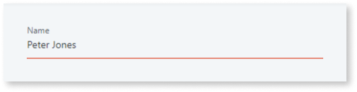
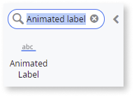
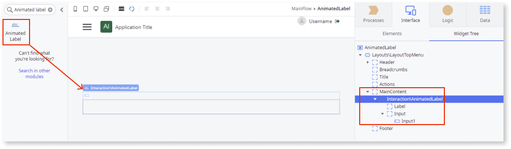
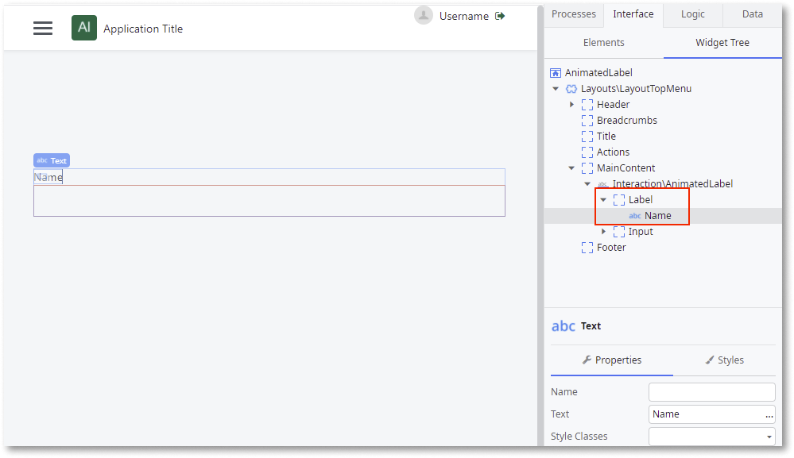
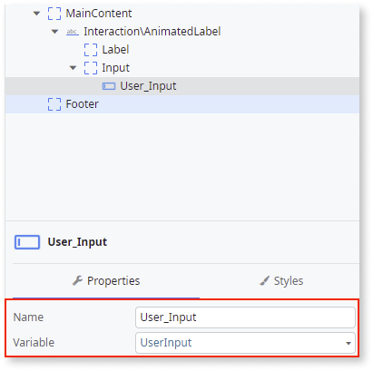
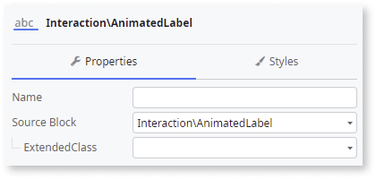
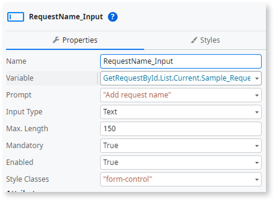
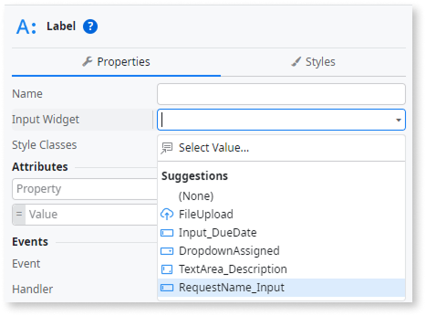

---
tags:
  - Accessibility
  - Front-End
  - OutSystems UI
  - UI
  - UI Patterns
  - UX
  - Widgets
summary: Explore how to animate user input labels using the Animated Label UI Pattern in OutSystems Developer Cloud (ODC).
locale: en-us
guid: 996f45dd-32e8-4480-aa55-a0e81d07d7e6
app_type: mobile apps, reactive web apps
figma: https://www.figma.com/file/6G4tyYswfWPn5uJPDlBpvp/Building-apps?type=design&node-id=3203%3A12991&t=ZwHw8hXeFhwYsO5V-1
platform-version: odc
audience:
  - Developer
  - Front-end developer
outsystems-tools:
  - odc studio
coverage-type:
  - apply
  - remember
topic:
  - add-widget-ui-pattern
isautopublish: true
---

# Animated Label

Applies to the OutSystems UI framework only.

You can use the Animated Label UI Pattern to animate a label when there is a user input.

## How to use the animated label UI pattern

1. In ODC Studio, in the Toolbox, search for `Animated Label`.

    The Animated Label widget is displayed.

    

1. From the Toolbox, drag the Animated Label widget into the Main Content area of your application's screen.

    

    By default, the Animated Label widget contains Label and Input placeholders. The Input placeholder contains a variable of type Text. You can use this variable throughout your app.

1. Enter the relevant text in the Label placeholder. In this example, we enter `Name`.

    

1. Enter a name and select a type for the Input variable.

    In this example, we enter the name User_Input and select UserInput as the variable type.

    

1. On the **Properties** tab, you can change the look and feel of the Animated Label by setting the (optional) properties.

    

After following these steps and publishing the app, you can test the pattern in your app.

## Properties

| Property | Description |
| -------------------------------- | ---------------------------------------------------------------------------------------------------------------------------------------------------------------------------------------------------------------------------------------------------------------------------------------------------------------------------------------------------------------------------------------------------------------------------------------------------------------------------------------------------------------------------------------------------------------------------------------------------------------------------------------------- |
| ExtendedClass (Text): Optional | Adds custom style classes to the Pattern. You define your custom style classes in your application using CSS.  Examples   <ul><li>Blank - No custom styles are added (default value).</li><li>"myclass" - Adds the ``myclass`` style to the UI styles being applied.</li><li>"myclass1 myclass2" - Adds the ``myclass1`` and ``myclass2`` styles to the UI styles being applied.</li></ul>You can also use the classes available on the OutSystems UI. |

## Accessibility – WCAG 2.2 AA compliance {#accessibility}

By default, the **Animated Label** UI pattern might not fully meet WCAG 2.2 AA accessibility requirements. Associating each input field with its corresponding label ensures that screen readers can correctly announce the purpose of the input, improving usability for all users, including those who rely on assistive technologies.

Every input must have a label associated with it so screen readers can identify and announce its purpose to users.

### Associate a label and an input

1. In **ODC Studio**, go to the **Elements** tab.

1. Select the **Screen/Block** where you use the **Animated Label**.

    

1. Select the **Input** widget inside the **Animated Label** (in the input placeholder), and give it a name. For example: `RequestName_Input`.

1. Select the **Label** widget inside the label placeholder of the same **Animated Label** block.

    

    If you only have a text or expression, wrap it with a **Label** widget before continuing to the next step.

    

1. In the **Label Properties**, set the **Input Widget** dropdown to `RequestName_Input`.

    

1. Publish the app.

### Result

After completing these steps, each **Animated Label** will have a properly associated label and input, allowing screen readers to announce the input purpose accurately and improving accessibility compliance.

Test it in your app to confirm the update.
