---
tags:
  - Accessibility
  - CSS
  - JavaScript
  - OutSystems UI
  - Pagination
  - UI Patterns
  - Widgets
summary: OutSystems Developer Cloud (ODC) Carousel UI Pattern lets you display images, configure slides, and meet WCAG 2.2 AA requirements in ODC Studio.
locale: en-us
guid: 84e84647-8129-4467-ade7-72b6102f9959
app_type: mobile apps, reactive web apps
figma: https://www.figma.com/file/6G4tyYswfWPn5uJPDlBpvp/Building-apps?type=design&node-id=3203%3A13594&t=ZwHw8hXeFhwYsO5V-1
platform-version: odc
audience:
  - Developer
  - Front-end developer
outsystems-tools:
  - odc studio
coverage-type:
  - apply
  - remember
topic:
  - add-widget-ui-pattern
isautopublish: true
---

# Carousel

<div class="info" markdown="1">

Applies to the OutSystems UI framework only.

</div>

You can use the Carousel UI Pattern to display multiple items in a horizontal slide.  The Carousel Pattern optimizes screen space by displaying only a few images from a larger collection which you can view using the navigation controls.

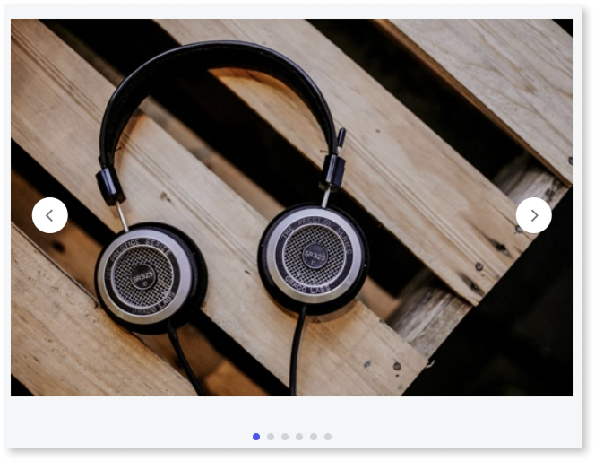

<div class="info" markdown="1">

The Carousel Pattern is based on the Splide.js library (v3). For more information about the Carousel’s behaviors and extensibility methods, see [Splide.js](https://splidejs.com/).  

</div>

## How to use the Carousel UI Pattern

1. In ODC Studio, in the Toolbox, search for `Carousel`.
  
     The Carousel widget is displayed.

    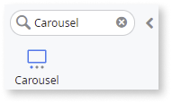

1. From the Toolbox, drag the Carousel widget into the Main Content area of your application's screen.

    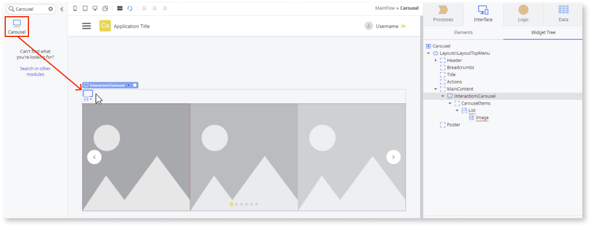

    By default, the Carousel pattern contains a **CarouselItems** placeholder with a **List** widget and **Image** widget. If you want a Carousel with static images, you can remove the **List** widget and add your images inside the **CarouselItems** placeholder.

1. Add your content to the **Carousel Items** placeholder.

    In this example, the List is deleted and 3 Image widgets are added.  

    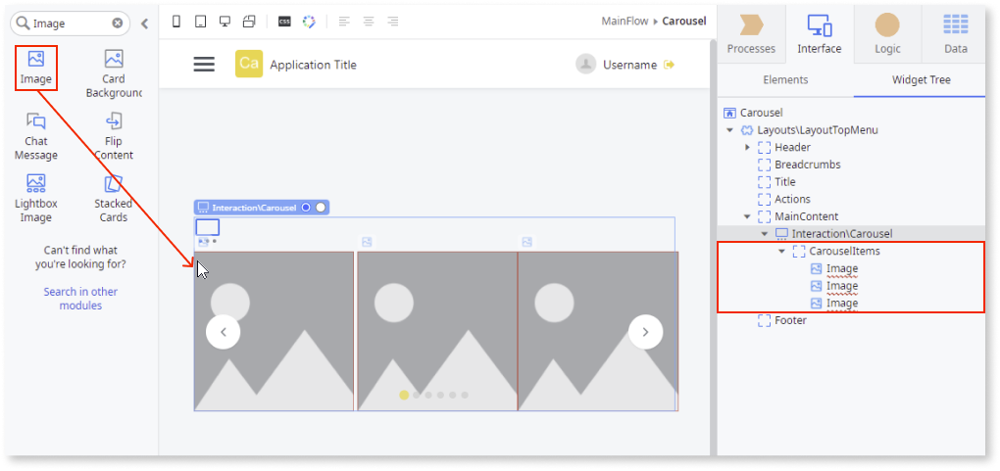

1. Select the **Image** widget, and on the **Properties** tab, from the **Image** drop-down, select or import the image you want in the Carousel.

    **Note:** In this example, the image property Type is set to **Local** image. You can also add External and Binary Data images.

    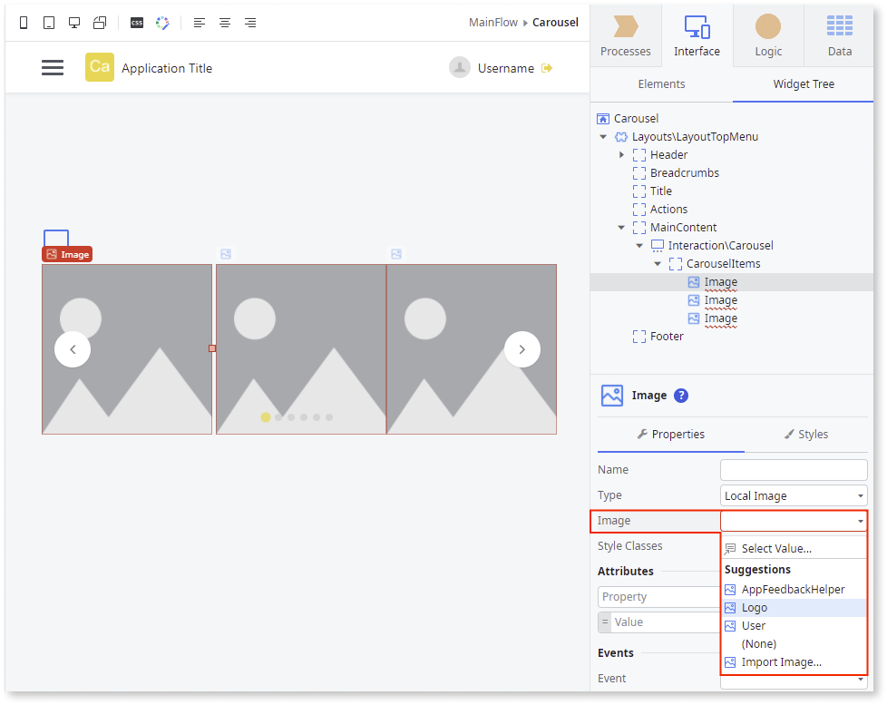

1. Repeat step 4 for each of the images in the Carousel.

1. You can configure the Carousel by selecting the pattern, and on the **Properties** tab, set the relevant (optional) properties, for example, **Navigation** or **ItemsPerSlide**.For more configurations, expand the **OptionalConfigs** property.

    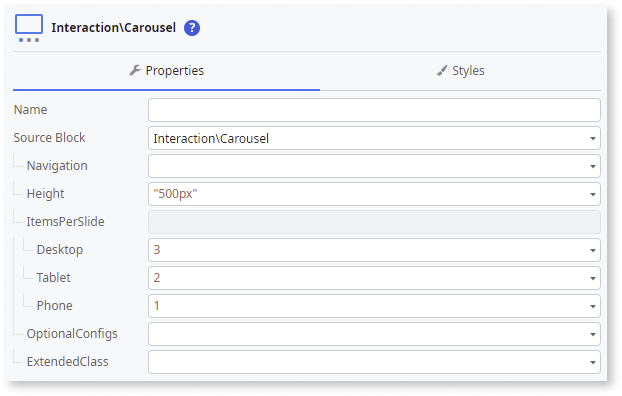  

After following these steps and publishing the app, you can test the pattern in your app.

## Properties

| **Property** | **Description** |
| ------------------------------------------------------ | -------------------------------------------------------------------------------------------------------------------------------------------------------------------------------------------------------------------------------------------------------------------------------------------------------------------------------------------------------------------------------------------------------------------------------------------------------------------------------------------------------------------------------------------------------------------------------------------------------------------------------------------- |
| Navigation (CarouselNavigation Identifier): Optional | Sets the navigation behavior:<ul><li>Dots</li><li>Arrows</li><li>Both (dots and arrows)</li><li>None</li></ul> |
| Height (Text): Optional | Set a custom height for the Carousel. The parameter accepts any CSS format, except percentage (library constraint). The default value is Auto (the height of the items inside Carousel). |
| ItemsPerSlide (CarouselItems): Optional | Number of Carousel items simultaneously visible on each slide.<ul><li>DesktopItems (Integer)</li><li>TabletItems (Integer)</li><li>PhoneItems (Integer)</li></ul> |
| ExtendedClass (Text): Optional | Adds custom style classes to the Pattern. You define your custom style classes in your application using CSS. <br/>Examples <ul><li>Blank - No custom styles are added (default value).</li><li>"myclass" - Adds the ``myclass`` style to the UI styles being applied.</li><li>"myclass1 myclass2" - Adds the ``myclass1`` and ``myclass2`` styles to the UI styles being applied.</li></ul><br/>You can also use the classes available on the OutSystems UI. |
| OptionalConfigs.AutoPlay (Boolean) | If True, the Carousel slides change automatically. If False, slides must be changed manually. The default value is True. |
| OptionalConfigs.Loop (Boolean) | If True, once the last item in the Carousel is reached, it loops around to the first item and begins displaying all of the items again. If False, the Carousel does not loop; it ends when the last item is reached. The default value is True. |
| OptionalConfigs.Padding (Text) | Distance between the Carousel edges and the visible items on each slide. Accepts any CSS size unit (such as, px, vw, %) or  CSS variables, for example, "100px". |
| OptionalConfigs.ItemsGap (Text) | Distance between each Carousel item. Accepts any CSS size unit (lsuch as px, vw, %) or CSS variables, for example, "var(--space-base)". |
| OptionalConfigs.StartingPosition (Integer) | Set the first item to display first in the Carousel. |
  
## Compatibility with other patterns

Avoid using the Carousel inside patterns with swipe events, such as the Tabs and Stacked Cards Patterns.

## Accessibility – WCAG 2.2 AA compliance {#accessibility}

Starting with OutSystems UI version **2.29.0**, the Carousel includes improved support for WCAG 2.2 AA accessibility requirements by default.

To ensure the Carousel is accessible, follow the recommended content structure for CarouselItems, particularly when using static content, images, or other OSUI components. The Carousel relies on the provided structure to correctly identify and expose its slides to assistive technologies.

If you have customized the Carousel pattern or its content structure, review your implementation against the Carousel accessibility guidelines to ensure it remains compliant.

### Structure the content inside CarouselItems

The Carousel identifies its slides based on the structure you provide inside the **CarouselItems** placeholder. Depending on the type of content you add, you need extra wrapper containers to give screen reader users an accurate list of slides.

#### Static content

Add a **Container** as a direct child of **CarouselItems** whenever the Carousel doesn't contain a dynamic **List** widget, for example, when you add static images or components directly to **CarouselItems**. Set the Container's **Style Classes** property to `list`.

<div class="info" markdown="1">

The Carousel uses this Container to identify the collection of items that become Carousel slides. Without a Container that has the `list` style class, the Carousel uses the first child of **CarouselItems** as a reference, resulting in an incorrect slide structure and an incorrect accessibility structure for screen reader users.

</div>

#### Image lists

Wrap each **Image** widget in a **Container**, regardless of whether the images come from a dynamic **List** widget or are static. The Container becomes the Carousel list item: it lets screen readers announce the image as part of a list and lets users navigate the items accordingly, while the image keeps its own image semantics and alt text.

Give each Container an **aria-label** attribute that describes the image, including the item's position and the total number of items, for example, `(2 of 5) - Black and grey headphones`.

To add the **aria-label** attribute to a Container:

1. Select the **Container** widget.
1. On the **Properties** tab, go to the **Attributes** section.
1. Create a new **aria-label** attribute.
1. In the value field, enter the position and description, for example, `(2 of 5) - Black and grey headphones`.

<div class="info" markdown="1">

The Container's **aria-label** and the Image's **alt text** serve different purposes. Keep the **Image** widget's **alt** property set to a description of the image, or to an empty value for decorative images. Don't omit **alt text** because the Container already has an **aria-label**.

</div>

#### OutSystems UI components

Wrap components such as **Card** or **Card Background** in a **Container** when you use them as Carousel content, and add a meaningful **aria-label** to the Container by following the same steps as for image lists, for example, `(1 of 3) - Product information`.

OutSystems UI components contain multiple internal elements and their own accessibility semantics. Using such a component directly as the Carousel item prevents the Carousel from identifying the item correctly. The Container wrapper gives the Carousel a consistent element to treat as the list item, and gives screen reader users an accessible name for that item.

<div class="info" markdown="1">

**For versions earlier than 2.29.0**: If you use an OutSystems UI version earlier than **2.29.0** and manually applied accessibility fixes as described below, remove the manual code added by following the steps in this section before updating to version **2.29.0**.

</div>

### Manual fix required (for versions before 2.29.0)

By default, the Carousel UI pattern requires a small update to fully comply with WCAG 2.2 AA standards. If you're using an OutSystems UI version earlier than **2.29.0**, you must manually update the Carousel UI pattern to fix the following issues. Before updating to **2.29.0** or later, remove any manual code you added by following the steps in this section.

* **Pagination controls** must meet the minimum target size of 24 px, making them easier to use for people with motor impairments or situational challenges. Starting with OutSystems UI 2.29.0, this is automatically fixed when the Carousel is inside an element with the `.has-accessible-features` CSS class.

* **Images can't have the `tabpanel` role**. This role is only valid on containers, such as `<div>` or `<section>`, associated with a tab in a tablist.

* **Lists inside the Carousel** must have the correct roles so that screen readers interpret them properly.

<div class="info" markdown="1">

Placing a nested list (`ul` or `ol`) directly inside Carousel items isn't recommended. Native HTML list elements already have list semantics, so the list role fix in this section targets the Carousel's internal list structure (the OutSystems **List** widget or the Splide list).

</div>

Updating the Carousel ensures the pattern is more accessible for everyone, including people with visual or motor impairments.

#### Fix pagination controls

<div class="info" markdown="1">

Starting with OutSystems UI 2.29.0, the pagination fix is automatically applied when the Carousel is placed inside an element with the `.has-accessible-features` CSS class. If the Carousel is not inside such an element, or if you're using an earlier version, follow these steps to apply the fix manually.

</div>

1. In **ODC Studio**, go to the **Interface** tab.

1. In the **Themes** folder, double-click the **Style Sheet** of your theme.

    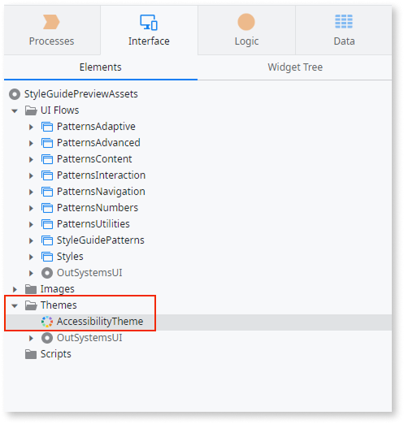

1. Add the following CSS code to **`.splide__pagination__page`** selector:

    ```css
    .splide__pagination__page {
        height: 12px;
        margin: 6px;
        width: 12px;
    }
    ```

    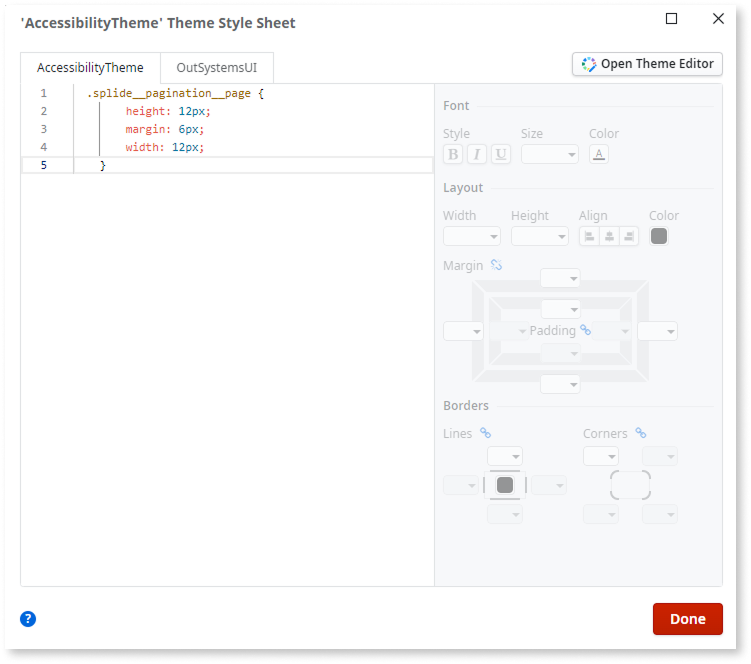

1. Adjust the values if needed to change the dot size, but make sure the clickable area is **at least 24px**.

    <div class="info" markdown="1">

    The original width and height of the dots was **8px**. In this update, the dots are enlarged to improve visibility and reduce extra spacing between them.

     </div>

1. Publish the app.

#### Remove the incorrect role from images

<div class="info" markdown="1">

This issue occurs **only when you use static images directly inside the Carousel**, such as in the example provided in the OutSystems UI Style Guide Preview. The Carousel script assigns roles to its direct child elements. By enclosing each image in a container, the image is no longer a direct child, preventing the incorrect role from being applied.

</div>

1. In **ODC Studio**, go to the **Interface** tab, and select **Widget Tree**.

1. In the **Carousel** pattern, search for the **CarouselItems** placeholder.

    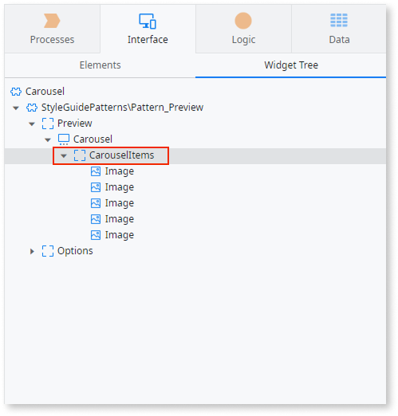

1. Right-click an **Image** widget, and select **Enclose in Container**.

    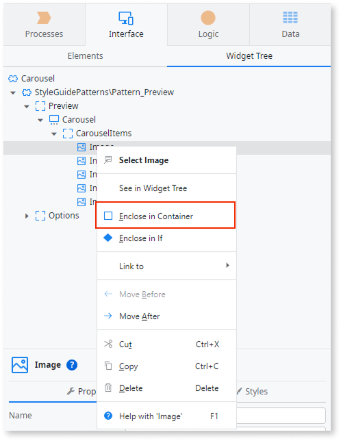

1. Repeat step 3 for every **Image** inside the Carousel.

1. Publish the app.

#### Assign list roles in the Carousel

1. In **ODC Studio**, go to the **Interface** tab, and select the **Screen/Block** where you use the Carousel with a list.

1. In the **Screen/Block** properties, select the **OnReady** event. A client action is created.

    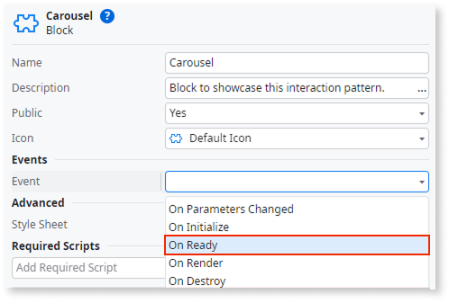

1. In the **OnReady** client action, drag a **JavaScript** node to the flow, from the left panel.

    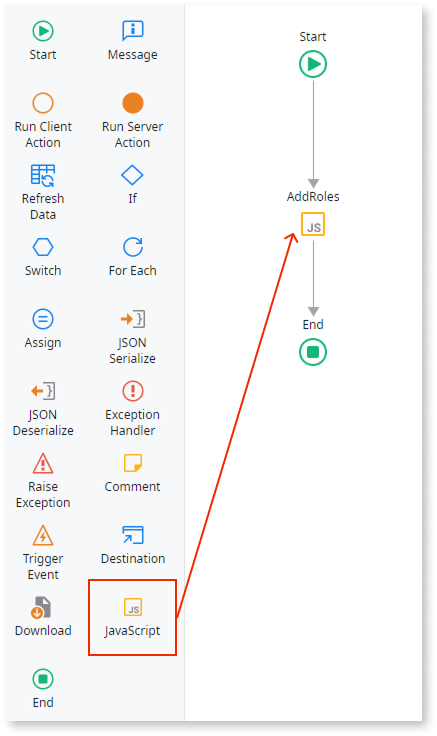

1. In the **JavaScript** node, add an input parameter named **WidgetId** (type **Text**).

    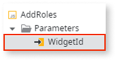

1. Set **WidgetId** to the Carousel block/widget ID (for example, `Carousel.Id`).

    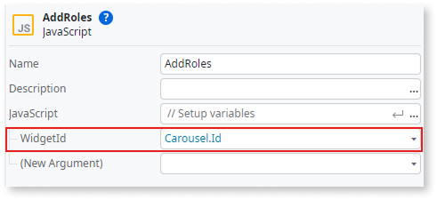

1. Add the following script to assign the correct roles:

    ```javascript
    // Setup variables
    const carouselObj = document.getElementById($parameters.WidgetId);
    if (!carouselObj) {
        return;
    }
    let listEl = carouselObj.querySelector(".osui-carousel .list");
    let retryHandle;

    function applyRoles(currListEl) {
        if (!currListEl) return;
        currListEl.setAttribute("role", "list");

        // Apply to direct children only
        const items = currListEl.querySelectorAll(":scope > *");
        items.forEach((item) => {
            item.setAttribute("role", "listitem");
        });
    }

    function waitListRender() {
        if (
            listEl &&
            !listEl.classList.contains("list-loading") &&
            listEl.children.length
        ) {
            applyRoles(listEl);
            if (retryHandle) {
                clearTimeout(retryHandle);
            }
        } else {
            retryHandle = setTimeout(waitListRender, 100);
        }
    }

    // First try the OutSystems List
    if (listEl) {
        waitListRender();
    } else {
        // Fallback to static Splide list
        listEl = carouselObj.querySelector(".osui-carousel .splide__list");
        if (listEl) {
            applyRoles(listEl);
        }
    }
    ```

1. Confirm the **List** has `disable-virtualization` set to `True`.

1. Confirm the **List** applies the `list-loading` class based on the query's `IsDataFetched` state.

    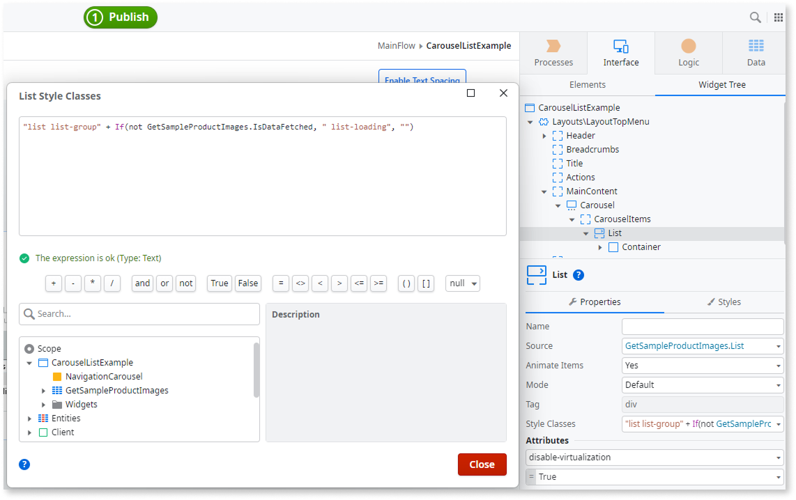

1. Click **Done**, then publish the app and test it.

#### Result

* The Carousel pagination dots now have a minimum **24px** clickable area.

* The Carousel script applies the `tabpanel` role only to containers. Images don't receive a role, as expected.

* If you use a list in the Carousel, it now has the correct roles assigned.

* Lists inside the Carousel are announced correctly by screen readers with **list** and **listitem** roles.

Test the pattern in your app to confirm the update.
