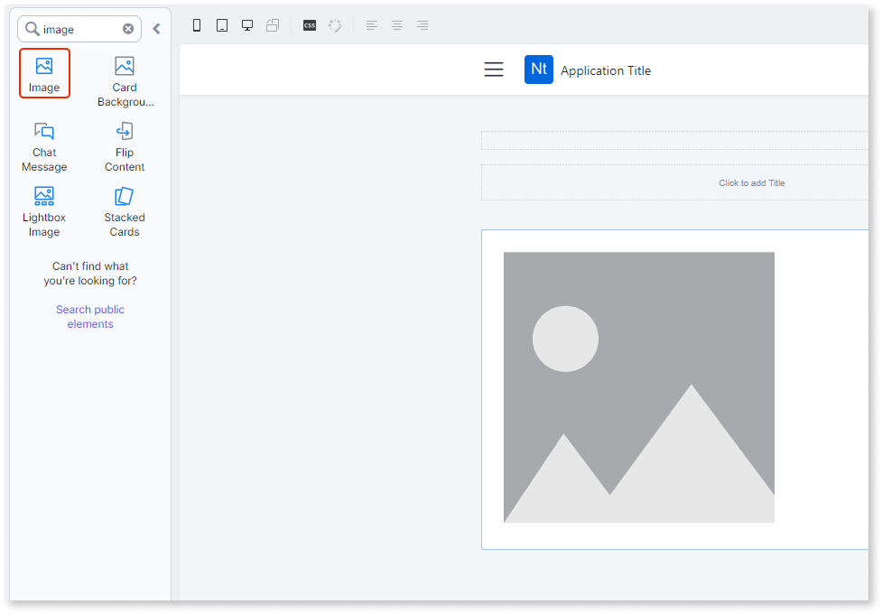
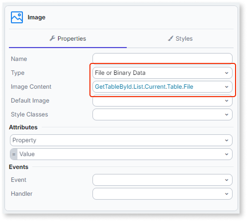

# Displaying images from cloud storage

When a screen displays images stored as **File** values, ODC serves the content from cloud storage to the browser. This article explains how to bind a **File** to the Image widget, how images load, and how to control caching behavior.

For background on the **File** type and how it differs from **BinaryData**, refer to [The File data type](../../../data/binaries/binaries-native-cloud.md).

## Binding a file to the image widget

To display an image stored as a **File** value:

1. Select the Image widget on your screen.

    

1. In the properties panel, set **Type** to **File or Binary Data**.

    

1. Bind the **File** value to the image source, for example, an attribute returned by an aggregate.

The Image widget accepts **File** attributes from entity records returned by aggregates or data actions.

The **File** value must be saved to an entity attribute before the Image widget can render it. If you bind the Image widget to a **File** value that hasn't been saved yet, for example, directly from an **Upload** widget's output before your logic saves the record, the image renders empty.

## How images load

Images load asynchronously after the aggregate or data action that returns the **File** values completes. ODC does not include image content in the aggregate result. Each image on screen loads independently when its element renders.

A screen that displays multiple images generates one request per image when the screen renders.

## Caching

### Default behavior

By default, image responses carry `Cache-Control: private, no-store`. This means:

* Images are not cached in any content delivery network (CDN) or shared cache.
* Images are not cached in the browser between sessions.
* Every page load triggers a fresh request for each image.

This default prevents images from being cached between requests or across users.

### Edge caching

To cache images at the CDN level, generate a signed URL with caching headers using the [**GetFileSignedURL**](../../../../reference/system-actions/file.md#getfilesignedurl) server action and set the **ResponseHeaders.CacheControl** input to the desired `Cache-Control` value. The **ResponseHeaders.CacheControl** value controls how long the CDN caches the content. The TTL controls how long the signed URL itself remains valid.

For details on generating signed URLs with cache-control headers, TTL defaults, limits, and safe-use rules, refer to [File access and signed URLs](../../../data/binaries/file-signed-urls.md).

**Security:** Never set a public `Cache-Control` policy for images that are scoped to individual users. A public cache policy makes content accessible to anyone who requests the same URL, regardless of who the original requester was.

## Session-specific access

The URL generated for each image is tied to the user and session that requested it:

* Opening an image URL in a different browser session or an incognito window fails.
* Sharing an image URL with another user fails.

Do not build flows that copy or share image URLs across users or sessions. Generate a fresh URL for each user interaction.
