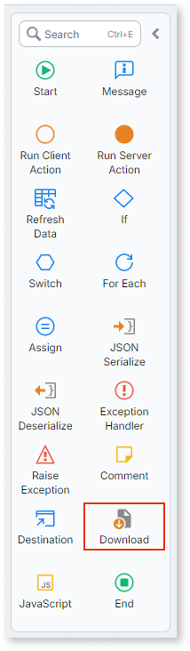
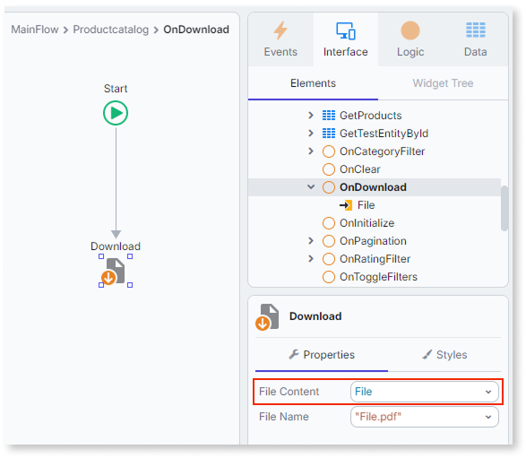

# Download files

ODC provides the **Download** node for screen actions, which lets users save files to their device. The node points the browser to the file's location in cloud storage, and the browser downloads the content directly from there, without routing it through the application server.

For background on the **File** data type and how it differs from **BinaryData**, refer to [The File data type](../../../data/binaries/binaries-native-cloud.md).

## Download a file

The **Download** node is available in screen actions. When a user triggers the action, the browser downloads the file content directly from cloud storage.

To download a file:

1. In ODC Studio, open the screen where you want to add the download.
1. Add a button or link and connect it to a screen action.
1. In the screen action, drag the **Download** node onto the flow.

    

1. In the **File** property of the **Download** node, select the **File** variable that holds the file to download.

    

The **Download** node is only available in screen actions. It is not available in client actions that run outside a screen context or in server actions.

## Authentication

Unlike uploads, downloading a file doesn't require authentication. Anonymous users can download files from screens that don't require login, mirroring how **BinaryData** already behaves.

## How the Download node handles file size

The **Download** node works with files of any size. It doesn't route file content through the application server or process it in any way: the node points the browser to the file's location in cloud storage, and the browser handles the download, including how it manages memory and disk for large files.

## Content type and download behavior

When a file arrives in the browser, the browser uses the file's MIMEType to decide how to handle it. For example, browsers that support PDF rendering open PDF files in the built-in viewer instead of saving them to disk. Browsers that do not recognize the MIMEType save the file directly to disk.

This behavior is controlled by the browser, not by ODC. The MIMEType of a file is set when the file is uploaded. For details on the **File** reference's properties, refer to the quick facts in [The File data type](../../../data/binaries/binaries-native-cloud.md).

## Related resources

An ODC OML with a working example of basic file upload and download is available for download: [Files sample OML](resources/Files_App.oml).
