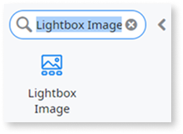
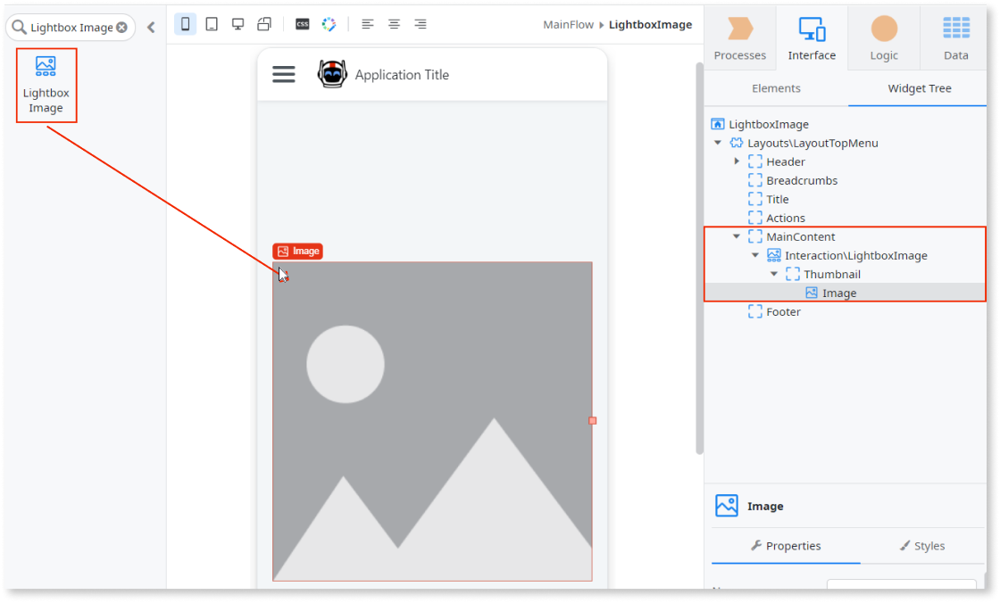
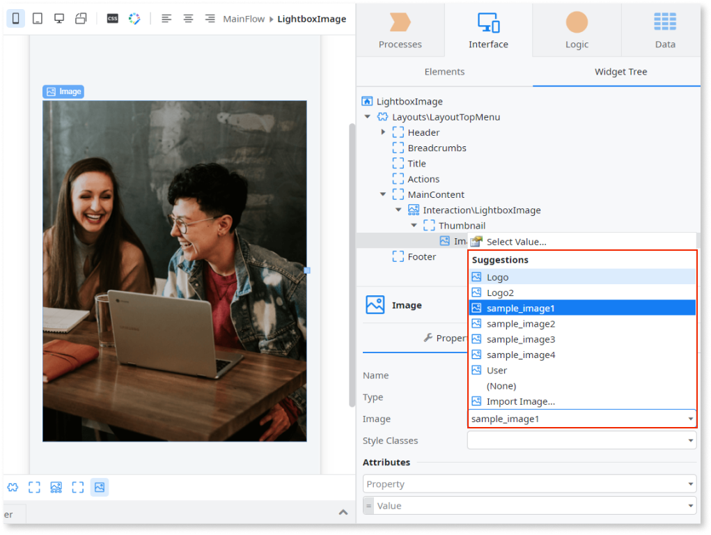

---
tags:
  - Accessibility
  - Front-End
  - OutSystems UI
  - UI
  - UI Patterns
  - Widgets
summary: Lightbox Image UI Pattern in ODC opens thumbnail images in full screen mode, with step-by-step setup, grouping, zoom, and URL properties.
locale: en-us
guid: 575c188f-fb02-4d70-8241-4b3e4518d66c
app_type: mobile apps, reactive web apps
figma: https://www.figma.com/file/6G4tyYswfWPn5uJPDlBpvp/Building-apps?type=design&node-id=3203%3A15772&t=ZwHw8hXeFhwYsO5V-1
platform-version: odc
audience:
  - Developer
  - Front-end developer
outsystems-tools:
  - odc studio
coverage-type:
  - apply
  - remember
topic:
  - lightbox-image-properties
  - use-lightbox-image-pattern
isautopublish: true
---

# Lightbox Image

Applies to the OutSystems UI framework only.

You can use the Lightbox Image UI Pattern to open smaller thumbnail images in full screen mode. This UI pattern is often used when creating an image gallery, allowing you to navigate through each of the images and view them in more detail.

## How to use the lightbox image UI pattern

1. In ODC Studio, in the Toolbox, search for `Lightbox Image`.

    The Lightbox Image widget is displayed.

    

1. From the Toolbox, drag the Lightbox Image widget into the Main Content area of your application's screen.

      

      By default, the Lightbox Image widget contains an Image placeholder. You can add as many images as required by dragging the Image widget from the Toolbox into the Lightbox Image widget.

1. Select the **Image** placeholder and on the **Properties** tab, from the **Image** drop-down, select or import the thumbnail image you want to display. In this example, we use the sample OutSystems UI Images.

    

    **Note:** In this example, the image property Type is set to **Local** image. You can also add External and Binary Data images.

1. Repeat step 3 for each of the images.

1. From the Widget Tree, select the Lightbox Image widget, and on the **Properties** tab, set the relevant (optional) properties.

## Properties

| **Property** | **Description** |
| ------------------------------- | -------------------------------------------------------------------------------------------------------------------------------------------------------------------------------------------------------------------------------------------------------------------------------------------------------------------------------------------------------------------------------------------------------------------------------------------------------------------------------------------------------------------------------------------------------------------------------------------------------------------------------------------------------------------------------------------------------------------------------- |
| Title (Text): Optional | Image title that is displayed when previewing the image in full screen mode.  Examples  <ul><li>"Image 1" - Displays Image 1 as the image title.</li></ul> |
| Group (Text): Optional | Name of the group of images. Similar to the concept of a picture album, images in the same group are displayed in a gallery. You can navigate through pictures with the same group name when viewing them in full screen mode.  Examples  <ul><li>Gallery 1 - Adds this image to the Gallery 1 group.</li></ul> |
| ImageURL (Text): Optional | URL for the image you want to show in full screen mode. If empty, a zoomed version of the thumbnail is displayed. Use this if you want to load a lower quality image as a thumbnail and display a higher quality version in full screen mode. |
| ImageZoom (Decimal): Optional | Defines the size of the image that opens in full screen mode (based on the thumbnail size). To avoid rendering problems, try to use images with the same ratio.  Examples  <ul><li>2 - A thumbnail with 100x100, and zoom 2 opens with 200x200.</li><li>0.5 - A thumbnail with 500x500, and zoom 0.5 opens with 250x250.</li></ul> |
| ExtendedClass (Text): Optional | Adds custom style classes to the Pattern. You define your custom style classes in your application using CSS.  To disable the URL feature, you must use the "disable-url" class on this parameter.  Examples  <ul><li>Blank - No custom styles are added (default value). </li><li>"myclass" - Adds the ``myclass`` style to the UI styles being applied.</li><li>"myclass1 myclass2" - Adds the ``myclass1`` and ``myclass2`` styles to the UI styles being applied.</li></ul>You can also use the classes available on the OutSystems UI. |

## Compatibility with other patterns

The Lightbox Image UI pattern can be used only with images.

## Samples

Watch how the [Product Overview sample](https://silkui.outsystems.com/Samples_Mobile.aspx#Mobile_Details-Samples_ProductOverview) uses the Lightbox Image UI Pattern:

<iframe src="https://player.vimeo.com/video/977630859" width="372" height="666" frameborder="0" allow="autoplay; fullscreen" allowfullscreen="">Video exhibiting an application using the Lightbox Image UI Pattern.</iframe>

## Accessibility – WCAG 2.2 AA compliance {#accessibility}

To ensure the **Lightbox Image** UI Pattern is fully compliant with **WCAG 2.2 AA**, you must ensure that the images displayed within the lightbox dialog are accessible.

The key requirement is:

* Each image inside the Lightbox must include an accessible name. You must use the `aria-label` attribute or an appropriate `alt` attribute when applicable. Without an accessible name, the image fails WCAG success criteria related to **Non-text Content (1.1.1)** and [Name, Role, Value (4.1.2)](https://www.w3.org/WAI/WCAG21/Understanding/name-role-value.html).

Providing a meaningful `aria-label` for every Lightbox image ensures that screen reader users can understand the image's purpose or content. This ensures compliance and improves overall accessibility.
