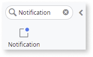
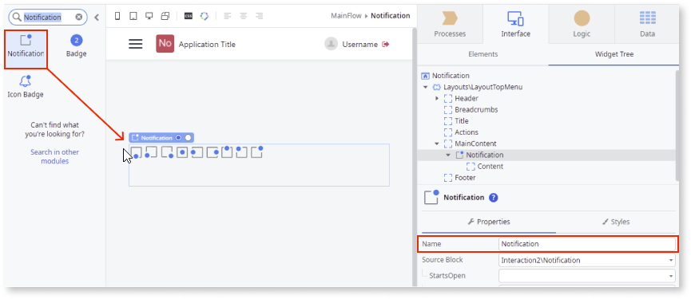
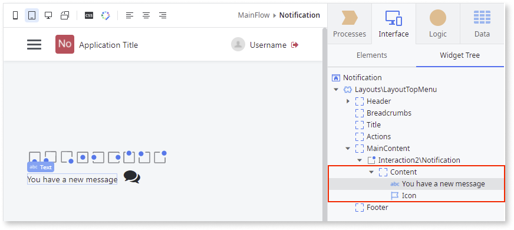
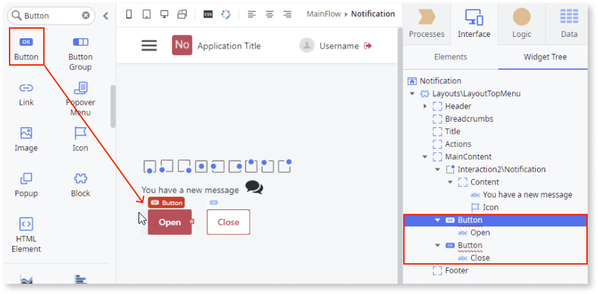
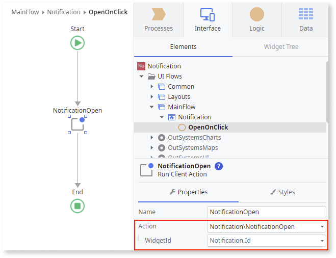
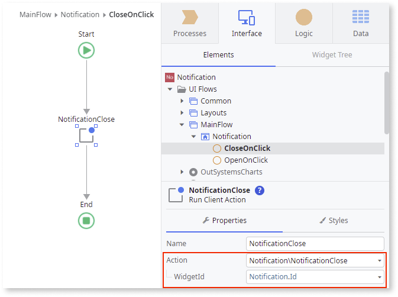
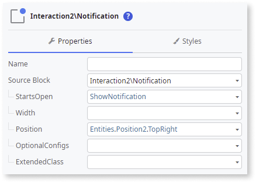
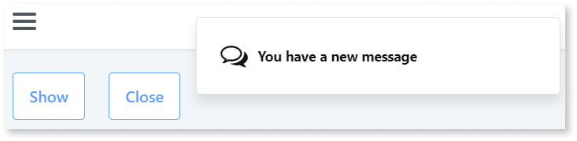
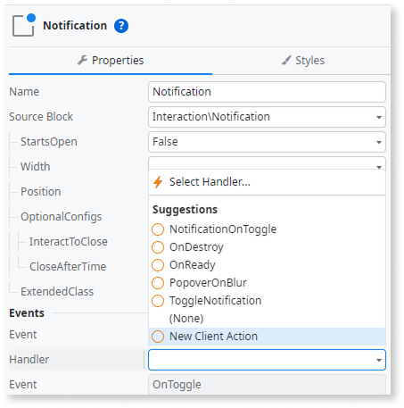
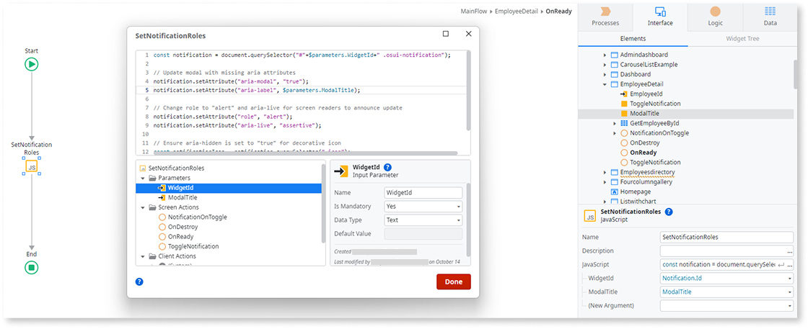

---
tags:
  - Accessibility
  - Front-End
  - JavaScript
  - Mobile app
  - OutSystems UI
  - UI Patterns
  - Widgets
summary: Notification UI Pattern in OutSystems Developer Cloud (ODC) sets open state, width, and ARIA roles for accessible alerts and dialogs.
locale: en-us
guid: b60bb989-895e-49a1-a261-76d9bb540425
app_type: mobile apps, reactive web apps
figma: https://www.figma.com/file/6G4tyYswfWPn5uJPDlBpvp/Building-apps?type=design&node-id=3203%3A16275&t=ZwHw8hXeFhwYsO5V-1
platform-version: odc
audience:
  - Developer
  - Front-end developer
outsystems-tools:
  - odc studio
coverage-type:
  - apply
  - remember
  - evaluate
topic:
  - add-widget-ui-pattern
  - notification-reference
  - use-notification-pattern
isautopublish: true
---

# Notification

<div class="info" markdown="1">

Applies to the OutSystems UI framework only.

</div>

The Notification UI Pattern is a contextual short message that provides important information to the user, such as app crashes, new updates, task reminders, and new messages.

## How to use the notification UI pattern

1. In ODC Studio, in the Toolbox, search for `Notification`.

    The Notification widget is displayed.

    

1. From the Toolbox, drag the Notification widget into the Main Content area of your application's screen and on the **Properties** tab, enter a **Name**.

    

1. Add the relevant content to the Content placeholder.

    In this example, an icon and some text are added.

    

1. From the Toolbox, drag 2 **Button** widgets into the Main Content area of your application's screen to **Open** and **Close** the Notification.

    

1. Define the actions for the buttons and set the **WidgetId** to the Notification widget.

    In this example, for the **Open** button, the **On Click** event is set to a **New Client Action** that runs the **NotificationOpen** client action. For the **Close** button, the **On Click** event is set to a **New Client Action** that runs the **NotificationClose** client action.

    

    

1. You can configure the Notification by selecting the pattern, and on the **Properties** tab, set the relevant (optional) properties. For more configurations, expand the **OptionalConfigs** property.

    

After following these steps and publishing the app, you can test the pattern in your app.



## Properties

| Property | Description |
| ---------------------------------------------------- | ---------------------------------------------------------------------------------------------------------------------------------------------------------------------------------------------------------------------------------------------------------------------------------------------------------------------------------------------------------------------------------------------------------------------------------------------------------------------------------------------------------------------------------------------------------------------------------------------------------------------------------------- |
| StartsOpen(Boolean): Optional | If True, the notification is immediately visible on screen. If False, the notification is not visible on screen. The default value is False. <br/> Use one of the following actions to change the value after the :<ul><li>NotificationOpen</li><li>NotificationClose</li></ul> |
| Width(Text): Optional | Set the Notification width. Accepts any kind of unit (for example, px, %, vw). |
| Position(Position Identifier): Optional | Set where the notification appears on the screen. The predefined options are as follows:<ul><li>Bottom</li><li>BottomLeft</li><li>BottomRight</li><li>Center</li><li>Left</li><li>Right</li><li>Top</li><li>TopLeft</li><li>TopRight</li></ul><br/>Examples<ul><li>``Entities.Position.Right`` - The notification is displayed on the right side of the screen.</li><li>``Entities.Position.Bottom`` - The notification is displayed on the bottom of the screen.</li></ul> |
| OptionalConfigs.InteractToClose(Boolean): Optional | If True, the notification closes when it's clicked. If False, the notification can't be clicked. the default value is True. |
| OptionalConfigs.CloseAfterTime(Integer): Optional | Set the delay time, in ms, to close the notification. |
| ExtendedClass (Text): Optional | Adds custom style classes to the Pattern. You define your custom style classes in your application using CSS. <p>Examples <ul><li>Blank - No custom styles are added (default value).</li><li>"myclass" - Adds the ``myclass`` style to the UI styles being applied.</li><li>"myclass1myclass2" - Adds the ``myclass1`` and ``myclass2`` styles to the UI styles being applied.</li></ul></p>You can also use the classes available on the OutSystems UI. |

## Accessibility – WCAG 2.2 AA compliance {#accessibility}

By default, the **Notification** UI pattern is accessible, but it requires small manual tweaks to fully comply with WCAG 2.2 AA guidelines.

By default, the Notification uses the role `alertdialog`. This is appropriate when the notification includes **interactive elements**, such as buttons or links that require user action.  
If the notification is **non-interactive**—for example, a short status or feedback message like “You have new messages”—you should use the role `alert` instead.

Using the correct role ensures that assistive technologies announce notifications at the right time and in the right context.

### Decision table: choose the correct role

| Criteria | `alertdialog` | `alert` |
| --- | --- | --- |
| **Purpose** | Used for **modal dialogs** that interrupt the user and require them to take action before continuing. | Used for **informational messages** that notify the user about a change in status without interrupting their workflow. |
| **Typical scenario** | A confirmation or error message that needs a response, such as “Are you sure you want to delete this record?” | A passive update, such as “Record saved successfully” or “You have new messages.” |
| **User interaction** | Contains **interactive elements**, such as buttons or links (for example, _OK_, _Cancel_, or _Retry_). | **Non-interactive** — no input or buttons required from the user. |
| **Behavior for assistive technologies (AT)** | Announced as a **modal dialog**, taking focus and preventing users from interacting with the rest of the page until they respond. | Announced immediately as an **assertive live region**, without taking focus or blocking interaction. |
| **Required attributes** | `role="alertdialog"` + `aria-modal="true"` + accessible name (`aria-labelledby` or `aria-label`). Optionally add a description (`aria-describedby`). | `role="alert"` + `aria-live="assertive"`. Hide decorative icons with `aria-hidden="true"`. |
| **Focus behavior** | Focus moves inside the dialog and is trapped there until the dialog is dismissed. | Focus stays where it is; the alert is simply announced. |
| **Examples** | “Session about to expire — **Extend** or **Sign out**.” / “Error — **Retry** or **Cancel**.” | “Profile updated successfully.” / “Connection lost.” |

<div class="warning" markdown="1">

> For simple alerts, consider using a custom-styled **Feedback Message** instead of the Notification pattern.

</div>

---

### Update Notification ARIA settings via JavaScript

If you need to adjust the HTML manually, follow the steps below to apply the correct ARIA attributes:

1. In **ODC Studio**, open the **Interface** tab.

1. Select the **Screen** or **Block** that uses **Notification**.

1. In the **Widget Tree**, search for **Notification**. Then, in **Properties**, select the **Initialized** event to create a **Client Action**.

   

1. In the **Initialized** Client Action, drag a **JavaScript** node to the flow.

   

1. In the **JavaScript** node, add an input parameter named **WidgetId** and another one named **Modal Title** (both type **Text**).

1. Set **WidgetId** parameter to the Notification block widget ID (for example, `Notification.Id`).

   

1. Add the following code, and keep only the parts relevant to your use case.

    ```javascript
    const notification = document.querySelector("#"+$parameters.WidgetId+" .osui-notification");

    // Update modal with missing aria attributes
    notification.setAttribute("aria-modal", "true");
    notification.setAttribute("aria-label", notification.innerText);

    // Change role to "alert" and aria-live for screen readers to announce update
    notification.setAttribute("role", "alert");
    notification.setAttribute("aria-live", "assertive");

    // Ensure aria-hidden is set to "true" for decorative icon
    const notificationIcon = notification.querySelector(".icon");
    if (notificationIcon) {
        notificationIcon.setAttribute("aria-hidden", "true");
    }
    ```

1. Publish the app and test your app.

### Result

After applying these adjustments, the **Notification** UI pattern is more accessible and works correctly with screen readers.

* **Non-interactive notifications** are announced immediately as alerts without disrupting focus.

* **Interactive notifications** are recognized as modal dialogs when `aria-modal="true"` is present, with proper naming and focus behavior.
