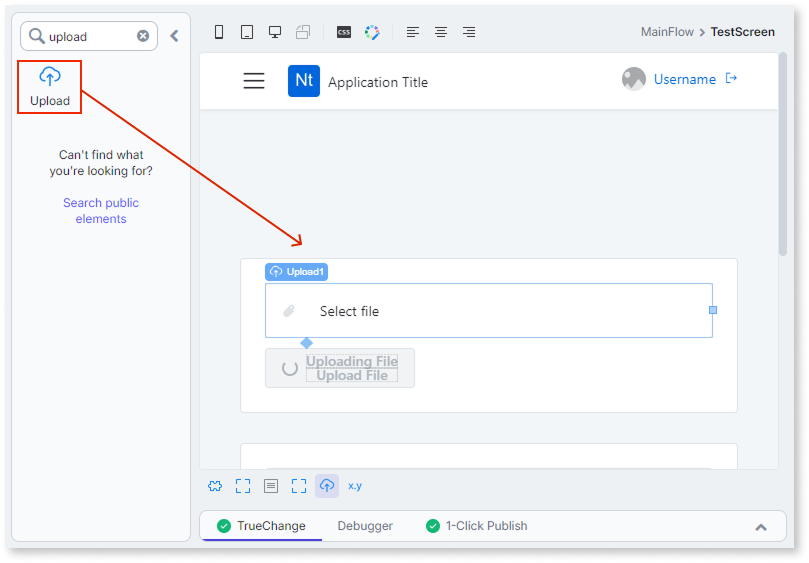
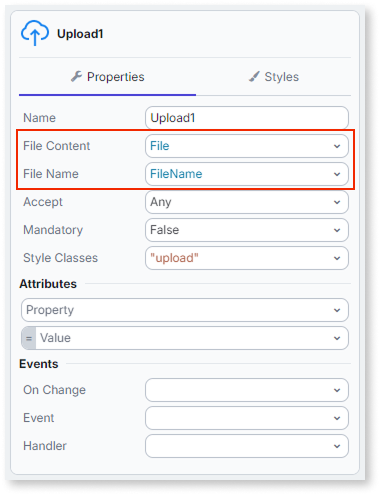
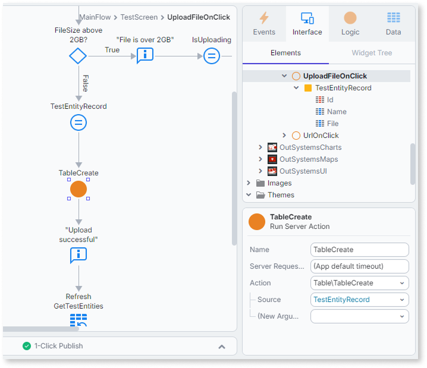
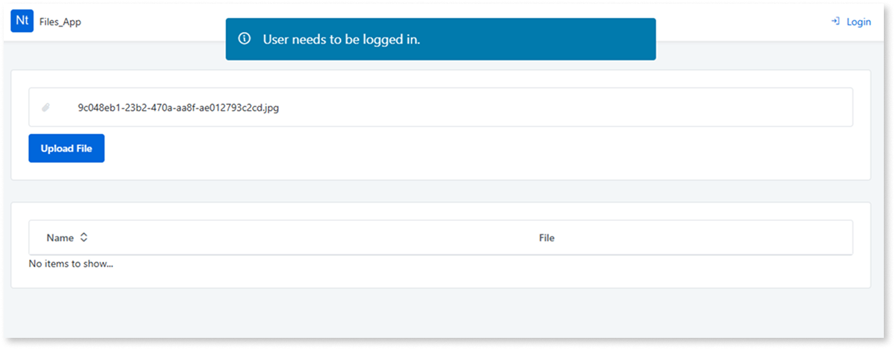
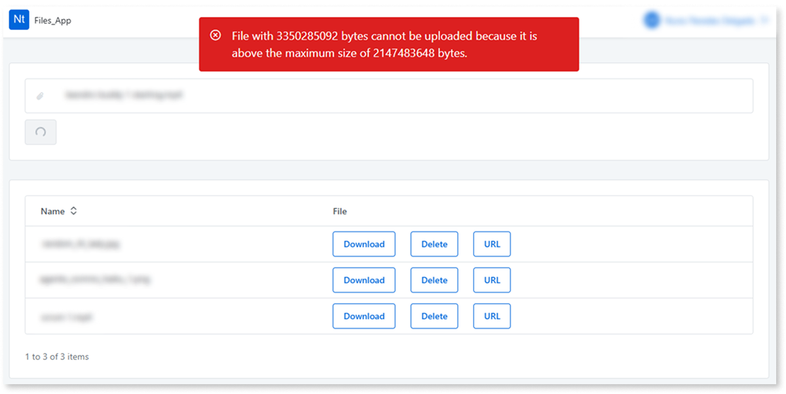

# Upload files

ODC provides the **Upload** widget for uploading files to cloud storage from the browser.

For background on the **File** data type and how it differs from **BinaryData**, refer to [The File data type](../../../data/binaries/binaries-native-cloud.md).

## Upload a file with the Upload widget

The **Upload** widget lets users select a file from their device. ODC handles file storage automatically.

To upload a file using the **Upload** widget:

1. In ODC Studio, open the screen where you want to add the upload.
1. Drag an **Upload** widget onto the screen.

    

1. Add a local variable to the screen using a **Record** data type that matches your entity's structure, including a **File** attribute.
1. In the **File Content** property, select the **File** attribute of that local variable. The property only accepts a value of type **File** or **BinaryData**. Selecting a value here doesn't save it to the entity.

    

1. Add a button to submit the form and connect it to a server action.
1. In the server action, call **CreateOrUpdate** on the entity, passing the local variable as the record to save.

    

ODC stores the file in cloud storage and saves the reference in the entity record.

Don't bind the uploaded **File** value directly to an Image widget before this save completes, it renders empty until the record is saved. Refer to [Displaying images from cloud storage](display-images.md) for details.

The **Upload** widget accepts files without a file extension. If a user uploads a file without an extension, `MIMEType()` returns an empty value for that file. Add validation to your upload flow if your app relies on the file's MIME type.

## Authentication requirement

Only authenticated users can upload files. If an anonymous user opens a screen with an **Upload** widget, the app displays a "User needs to be logged in." banner along with a **Login** link, instead of redirecting them automatically.

To require login before the screen renders, instead of relying on this default banner, set the screen's **Accessible by** property to **Authenticated users**. Refer to [Restrict access to a screen](../../../../user-management/secure-app-with-roles.md#restrict-access-to-a-screen) for the steps.

## Upload progress feedback

Large file uploads can take a significant amount of time to complete. The **Upload** widget does not include built-in progress feedback. Add custom logic to your screen to notify the user when an upload starts and when it finishes.

## File size limit

The **Upload** widget enforces the maximum **File** size. Refer to [The File data type](../../../data/binaries/binaries-native-cloud.md) for the exact limit. If a user submits a file that exceeds it, the widget displays a red warning by default, showing the raw byte counts for the file and the limit, for example, `File with 3350285092 bytes cannot be uploaded because it is above the maximum size of 2147483648 bytes.`

To show a friendlier message instead of the default, check `Size()` on the selected **File** value before the form submits, and display your own message when it exceeds your desired limit.

## File lifecycle

Files uploaded through the **Upload** widget are temporary by default. ODC deletes a file if it is not saved to an entity attribute within 24 hours.

The following table summarizes when ODC deletes file data:

| Scenario | Outcome |
| --- | --- |
| Upload aborted | Uploaded parts are deleted immediately. |
| Upload interrupted (for example, by a network failure) | ODC automatically deletes the incomplete upload. |
| File uploaded but not saved to an entity attribute | Deleted after 24 hours. |
| File saved to an entity attribute | Not deleted automatically. |

To keep a file, save its reference to an entity attribute before the 24-hour window expires. Files saved to an entity attribute follow the entity's lifecycle instead. Refer to [File lifecycle](../../../data/binaries/file-reference-lifecycle.md) for how that lifecycle works.

## Related resources

An ODC OML with a working example of file upload is available for download: [Upload files sample OML](resources/Files_App.oml). The app contains a single **Table** entity with a **File** attribute and a **TestScreen** screen with the **Upload** widget wired up as described in this article. For an example of validating the file size and handling errors before saving, refer to the **UploadFileOnClick** client action.
