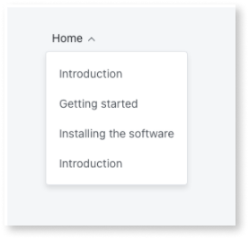
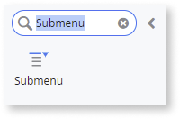
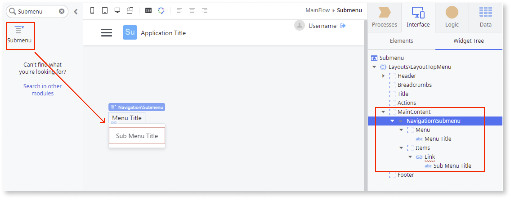
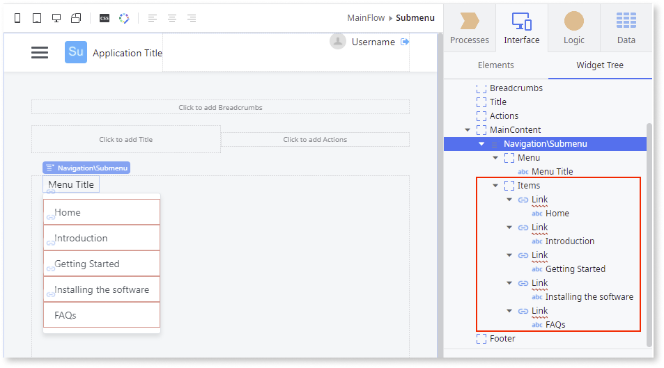

---
tags:
  - Accessibility
  - CSS
  - OutSystems UI
  - Screens
  - UI
  - UI Patterns
  - Widgets
summary: Learn how to implement a submenu within an application using the Submenu UI Pattern in OutSystems Developer Cloud (ODC).
locale: en-us
guid: 643d37e9-efa8-48a3-87ba-f409a1f04efa
app_type: mobile apps, reactive web apps
figma: https://www.figma.com/file/6G4tyYswfWPn5uJPDlBpvp/Building-apps?type=design&node-id=3208%3A18027&t=ZwHw8hXeFhwYsO5V-1
platform-version: odc
audience:
  - Developer
  - Front-end developer
outsystems-tools:
  - odc studio
coverage-type:
  - apply
  - remember
topic:
  - use-submenu-pattern
isautopublish: true
---

# Submenu

<div class="info" markdown="1">

Applies to the OutSystems UI framework only.

</div>

You can use the Submenu UI Pattern to create a menu that is contained within another menu.



## How to use the submenu UI pattern

1. In ODC Studio, in the Toolbox, search for `Submenu`.

    The Submenu widget is displayed.

    

1. From the Toolbox, drag the Submenu widget into the Main Content area of your application's screen.

    

    By default, the Submenu widget contains a Menu placeholder and an Items placeholder that contains a link. You can add as many Items placeholders as required. In this example we add 3 more.

1. Add the relevant content to the Menu and Items placeholders.

    In this example, we add text to the Menu placeholder, and set the links in the Items placeholders to navigate to different pages in the app.

    

After following these steps and publishing the app, you can test the pattern in your app.

## Properties

| Property | Description |
| -------------------------------- | -------------------------------------------------------------------------------------------------------------------------------------------------------------------------------------------------------------------------------------------------------------------------------------------------------------------------------------------------------------------------------------------------------------------------------------------------------------------------------------------------------------------------------------------------------------------------------------------------------------------------------------------------------- |
| ExtendedClass (Text): Optional | Adds custom style classes to the Pattern. You define your custom style classes in your application using CSS. <p>Examples <ul><li>Blank - No custom styles are added (default value).</li><li>"myclass" - Adds the ``myclass`` style to the UI styles being applied.</li><li>"myclass1 myclass2" - Adds the ``myclass1`` and ``myclass2`` styles to the UI styles being applied.</li></ul></p>You can also use the classes available on the OutSystems UI. |

## Accessibility – WCAG 2.2 AA compliance {#accessibility}

By default, the **Submenu** UI Pattern does not require structural or ARIA-related adjustments for accessibility compliance.

To improve usability and accessibility, the only recommended change is to increase the size of the menu. Ensuring adequate dimensions helps enhance readability, improves touch target accessibility, and provides a better overall user experience, particularly for users navigating via touch or assistive technologies.

The procedure below shows how to:

### Increase submenu header target size

By default, submenu headers may not meet the recommended **pointer target size**, which can impact usability for users with limited dexterity. You can address this with a small CSS adjustment.

1. In **ODC Studio**, go to the **Interface** tab.

1. In the **Themes** folder, double-click the **Style Sheet** of the theme used by your application.

1. Add the following CSS rule to increase the clickable area of submenu headers:

    ```css
    .osui-submenu__header {
        padding: var(--space-none) var(--space-m);
        min-height: 24px;
        min-width: 24px;
    }
    ```

1. Adjust the spacing values if needed to fit your design, but make sure the clickable area remains at least **24 px** in both height and width.

1. Publish the app.
