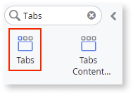
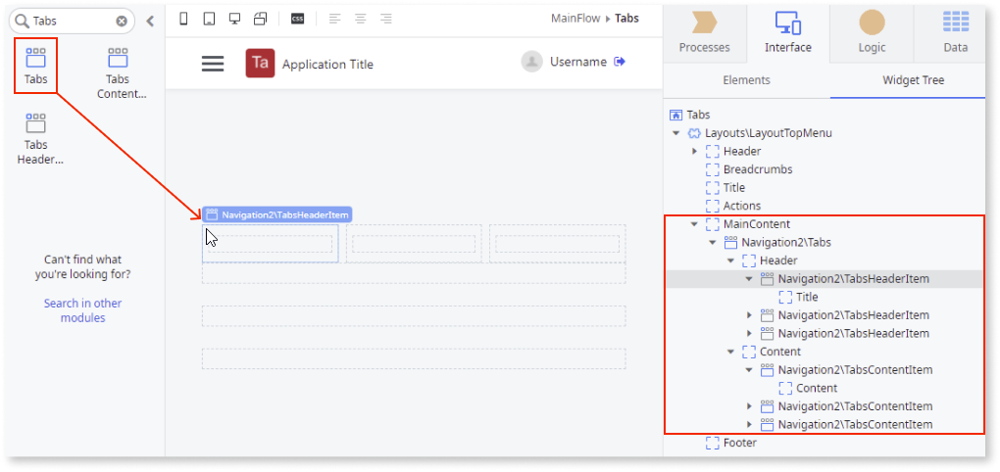
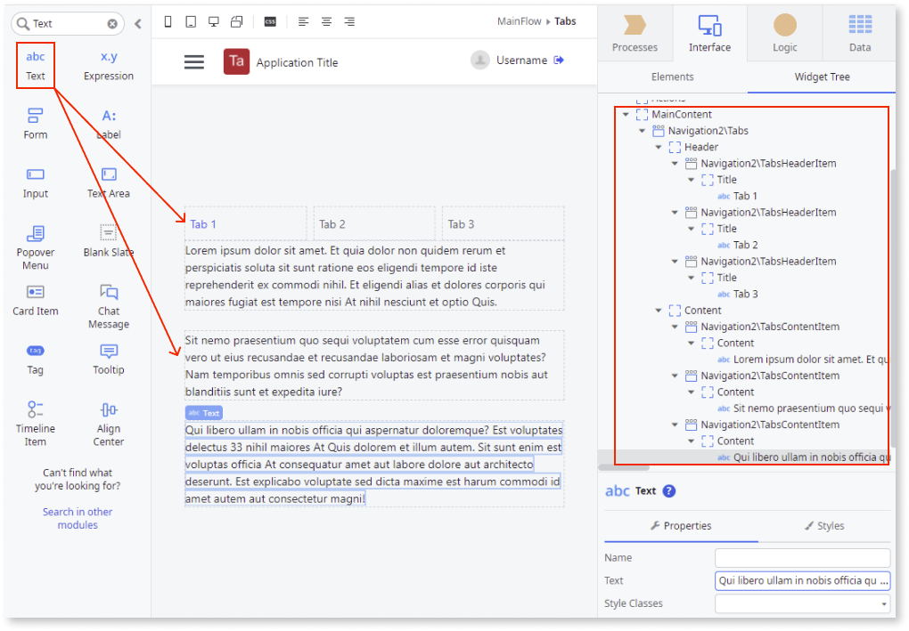
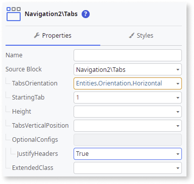
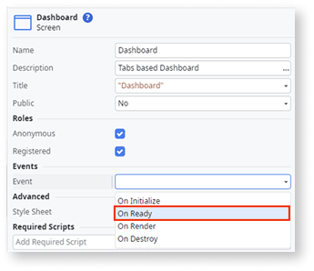
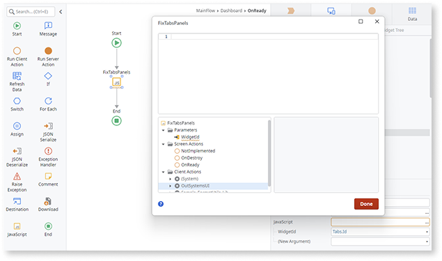
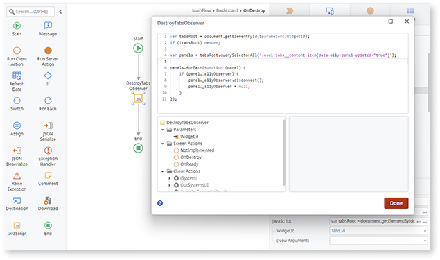

---
tags:
  - Accessibility
  - CSS
  - Front-End
  - OutSystems UI
  - UI
  - UI Patterns
  - Widgets
summary: Learn how to implement and customize the Tabs UI Pattern in OutSystems Developer Cloud (ODC) to enhance application navigation and content organization.
locale: en-us
guid: 01e14d73-1043-4401-a2d4-0903b3068a5b
app_type: mobile apps, reactive web apps
figma: https://www.figma.com/file/6G4tyYswfWPn5uJPDlBpvp/Building-apps?type=design&node-id=3208%3A18118&t=ZwHw8hXeFhwYsO5V-1
platform-version: odc
audience:
  - Developer
  - Front-end developer
outsystems-tools:
  - odc studio
coverage-type:
  - apply
  - remember
topic:
  - add-widget-ui-pattern
isautopublish: true
---

# Tabs

<div class="info" markdown="1">

Applies to the OutSystems UI framework only.

</div>

You can use the Tabs UI Pattern to divide content into meaningful sections. This pattern is useful when you want the user to be able to switch between sections within the same context while not having to not to navigate to different areas.

<iframe src="https://player.vimeo.com/video/977630907" width="750" height="300" frameborder="0" allow="autoplay; fullscreen" allowfullscreen="">Switching between different tabs in the Tabs UI Pattern.</iframe>

## How to use the Tabs UI Pattern

1. In ODC Studio, in the Toolbox, search for `Tabs`.

    The Tabs widget is displayed.

    

1. From the Toolbox, drag the Tabs widget into the Main Content area of your application's screen.

    

    By default, the Tabs widget contains 3 Header Items (tab titles) and 3 Content Items (tab content). You can add or delete as many as required.

1. Add the relevant content to the Header Item and Content Item placeholders, for example, forms, images, link, and text.

    In this example, text is added.

    

1. On the **Properties** tab, you can customize the Tabs look and feel by setting any of the optional properties, for example, which tab is displayed as the active tab when the page is rendered and whether the tabs are displayed vertically or horizontally.  

    

After following these steps and publishing the app, you can test the pattern in your app.

### Add styles to tabs and content

The following CSS code is an example of how to change the style of selected items in the tabs:

```css
.osui-tabs__header-item {
    background-color: #ebebeb;
}

.osui-tabs__header-item.osui-tabs--is-active {
    border-bottom: 3px solid #000;
    background-color: #ebebeb;
    color: #0097eb;
}

.osui-tabs__content {
    background-color: #ccc;
    padding: 20px;
    font-size: 18px;
    font-stretch: condensed;
}
```

## Properties

| Property | Description |
| ------------------------------------------------------- | ------------------------------------------------------------------------------------------------------------------------------------------------------------------------------------------------------------------------------------------------------------------------------------------------------------------------------------------------------------------------------------------------------------------------------------------------------------------------------------------------------------------------------------------------------------------------------------------------------------------------ |
| TabsOrientation (Orientation Identifier): Optional | Set the direction of the tabs. By default, the tabs are displayed horizontally. |
| StartingTab (Integer): Optional | Set the index of the currently active tab. The index begins at 0.<br/>Examples<ul><li>Blank - The 1st tab is the active tab. This is the default.</li><li>1 - The 2nd tab is the active tab.</li></ul> |
| Height (Text): Optional | Height of the tabs container. <br/>Examples<ul><li>Auto - The tab height adjusts to the content. This is the default.</li><li>400px - The height of the tab is 400px.</li></ul> |
| TabsVerticalPosition (Direction Identifier): Optional | Sets the position of the tabs. by default, the tabs appear on the left. |
| OptionalConfigs.JustifyHeaders (Boolean): Optional | If True, the Tabs are evenly distributed in the space available. |
| ExtendedClass (Text): Optional | Adds custom style classes to the Pattern. You define your custom style classes in your application using CSS. <br/>Examples <ul><li>Blank - No custom styles are added (default value).</li><li>"myclass" - Adds the ``myclass`` style to the UI styles being applied.</li><li>"myclass1" "myclass2" - Adds the ``myclass1`` and ``myclass2`` styles to the UI styles being applied.</li></ul>You can also use the classes available on the OutSystems UI. |

<div class="info" markdown="1">

To ensure predictable behavior and avoid runtime issues, the Tabs component is designed to include at least one TabsHeaderItem and one TabsContentItem.

</div>

## Events

### Tabs

| Event | Description |
| --- | --- |
| OnTabChange: Optional | Event triggered when switching Tabs. |

## Device and pattern compatibility

Avoid using the Tabs Pattern inside patterns with swipe events, such as the Stacked Cards or Carousel Patterns.

## Accessibility – WCAG 2.2 AA compliance {#accessibility}

Starting with OutSystems UI version **2.29.0**, the **Tabs** is compliant with WCAG 2.2 AA accessibility standards by default. No changes or manual work are required. If you customized the pattern, validate your implementation to ensure it still meets accessibility requirements.

<div class="info" markdown="1">

**For versions earlier than 2.29.0**: If you use an OutSystems UI version earlier than **2.29.0** and manually applied accessibility fixes as described below, remove the manual code added by following the steps in this section before updating to version **2.29.0**.

</div>

### Manual fix required (for versions before 2.29.0)

By default, the **Tabs** UI Pattern does not fully comply with the ARIA tabs specification. The `role="tabpanel"` attribute does not align with the semantic `<article>` HTML element used for tab panels. If you're using OutSystems UI version earlier than **2.29.0**, follow the steps in this section to manually fix this. Before updating to **2.29.0** or later, remove any manual code you added by following the steps in this section.

To fix this, you keep the existing `<article>` structure but move the accessibility attributes to an inner `<div>`. This approach preserves the current navigation logic, which relies on the `<article>` containers, while ensuring that assistive technologies interpret tabs and panels correctly.

#### Move the tabpanel role to the inner container

1. In **ODC Studio**, go to the **Interface** tab and select the screen or block that uses the **Tabs** UI Pattern.

1. In the screen or block **Properties**, under **Events**, set **OnReady** to a **Client Action**.

    

1. In the **OnReady** action, add a **JavaScript** node.

1. Add an input parameter **WidgetId** (`Text`) and set its value to `Tabs.Id`.

    

1. Paste the following code into the JavaScript node, publish the app, and verify the Tabs behavior with keyboard and screen readers.

    ```javascript
    var tabsRoot = document.getElementById($parameters.WidgetId);
    if (!tabsRoot) return;

    var panels = tabsRoot.querySelectorAll('.osui-tabs__content-item[role="tabpanel"]');

    panels.forEach(function (panel) {
        if (panel.getAttribute('data-a11y-panel-updated') === 'true') return;

        var inner = panel.firstElementChild;
        if (!inner) return;

        // Ensure the inner container has an id
        if (!inner.id && panel.id) {
            inner.id = panel.id + '-content';
        }

        var attrs = ['role', 'tabindex', 'aria-hidden', 'aria-labelledby'];

        attrs.forEach(function (attr) {
            var value = panel.getAttribute(attr);

            if (attr === 'role') {
                if (value === 'tabpanel') {
                    inner.setAttribute('role', 'tabpanel');
                    panel.removeAttribute('role');
                }
            } else if (value !== null) {
                inner.setAttribute(attr, value);
            }
        });

        panel.setAttribute('data-a11y-panel-updated', 'true');

        // Point the tab header to the new tabpanel element
        var tab = tabsRoot.querySelector('[aria-controls="' + panel.id + '"]');
        if (tab && inner.id) {
            tab.setAttribute('aria-controls', inner.id);
        }

        var observer = new MutationObserver(function (mutations) {
            mutations.forEach(function (mutation) {
                var name = mutation.attributeName;
                if (name === 'tabindex' || name === 'aria-hidden' || name === 'aria-labelledby') {
                    var value = panel.getAttribute(name);
                    if (value === null) {
                        inner.removeAttribute(name);
                    } else {
                        inner.setAttribute(name, value);
                    }
                }
            });
        });

        observer.observe(panel, { attributes: true });
        panel._a11yObserver = observer;
    });
    ```

1. In the same screen or block **Properties**, set **OnDestroy** to a **Client Action**.

1. In this action, add a **JavaScript** node.

1. Add an input parameter **WidgetId** (`Text`) and set its value to `Tabs.Id`.

1. Paste the following code into the JavaScript node:

    ```javascript
    var tabsRoot = document.getElementById($parameters.WidgetId);
    if (!tabsRoot) return;

    var panels = tabsRoot.querySelectorAll('.osui-tabs__content-item[data-a11y-panel-updated="true"]');

    panels.forEach(function (panel) {
        if (panel._a11yObserver) {
            panel._a11yObserver.disconnect();
            panel._a11yObserver = null;
        }
    });
    ```

    

1. Publish the app.

#### Result

After completing these steps, each tab panel exposes `role="tabpanel"` and related ARIA attributes on the inner container instead of the `<article>` element. Screen readers correctly associate tabs with their panels, keyboard navigation remains unchanged, and automated accessibility tools stop reporting invalid ARIA role usage on the Tabs pattern.
