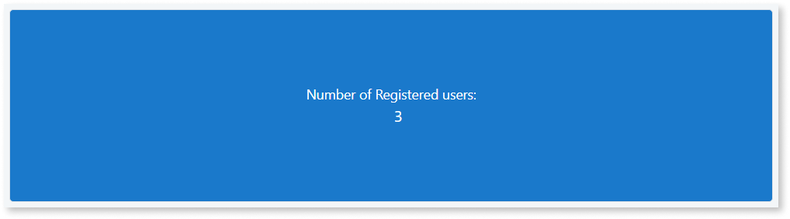
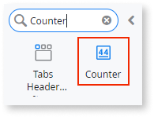
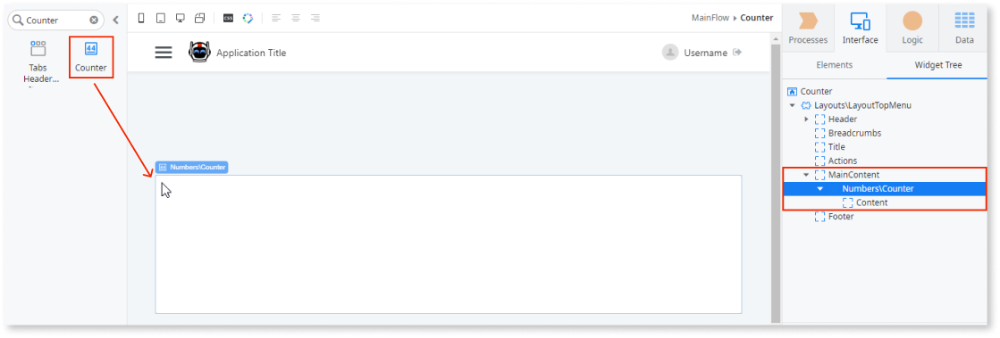
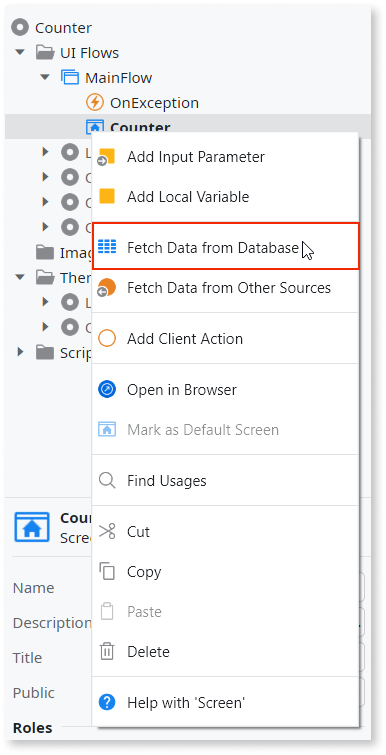
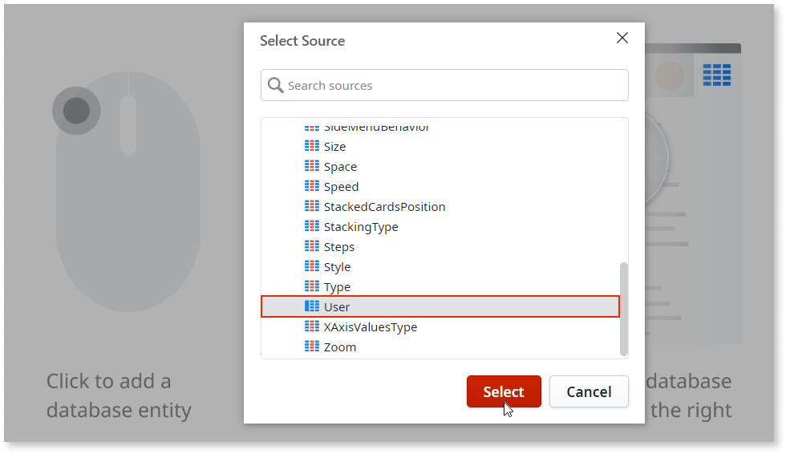
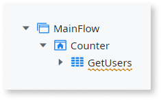
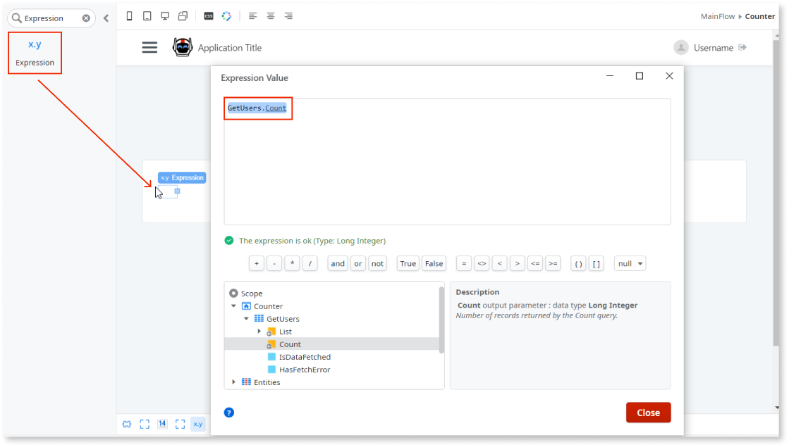
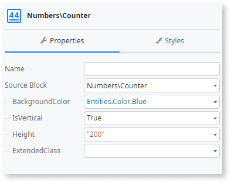
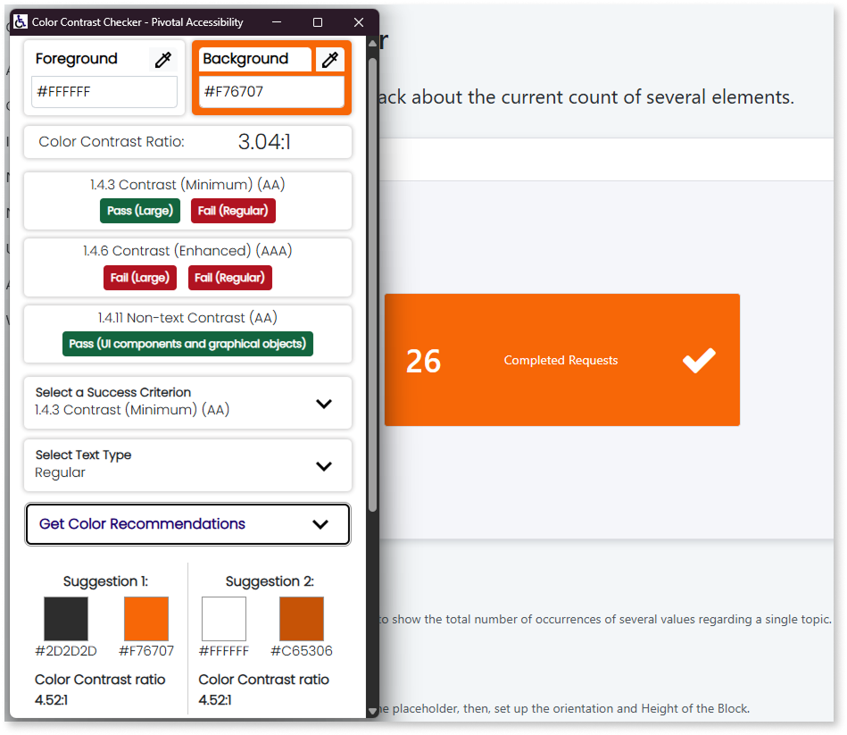

---
tags:
  - Accessibility
  - Aggregates
  - OutSystems UI
  - Themes
  - UI
  - UI Patterns
  - Widgets
summary: Counter UI Pattern in ODC lets you display numerical notifications by binding aggregates to a widget and customizing height and orientation.
locale: en-us
guid: 7b33f1cb-f293-49c5-ad4a-8c781526acb7
app_type: mobile apps, reactive web apps
figma: https://www.figma.com/file/6G4tyYswfWPn5uJPDlBpvp/Building-apps?type=design&node-id=3208%3A19354&t=ZwHw8hXeFhwYsO5V-1
platform-version: odc
audience:
  - Developer
  - Front-end developer
outsystems-tools:
  - odc studio
coverage-type:
  - apply
  - remember
topic:
  - counter-reference
  - use-counter-pattern
isautopublish: true
---

# Counter

<div class="info" markdown="1">

Applies to the OutSystems UI framework only.

</div>

You can use the Counter UI Pattern to display numerical information as a notification. For example, the Badge UI pattern is frequently used to notify users about the number of unread emails, unopened messages, or new tasks they may have.



## How to use the counter UI pattern

The following example demonstrates how you can display the number of registered users on your platform.

1. In ODC Studio, in the Toolbox, search for `Counter`.

    The Counter widget is displayed.

    

1. From the Toolbox, drag the Counter widget into the Main Content area of your application's screen.

    

    By default, the Counter widget contains a Content placeholder.

1. To create an aggregate (in this example to retrieve all the users on the platform), right-click the screen name and select **Fetch Data from Database**.

    

1. To add a database entity, click the screen, and from the **Select Source** pop-up, select the relevant entity and click **OK**. In this example, we select the **User** entity.

    

    The aggregate **GetUsers** is created.

    

1. To reopen your screen, select the **Interface** tab, and double-click on your screen.

1. From the Toolbox, drag an Expression widget into the Content placeholder, and in the **Expression Editor** enter the following expression and click **Close**.

    `GetUsers.Count`

    

   You have now created an expression that displays the Count property of the Aggregate you created earlier, which gets and displays the number of users on your platform.

1. On the **Properties** tab, you can customize the Counter's look and feel by setting any of the optional properties, for example, the height and orientation.

    

After following these steps and publishing the module, you can test the pattern in your app.

## Properties

| Property | Description |
| ---------------------------------------------- | ------------------------------------------------------------------------------------------------------------------------------------------------------------------------------------------------------------------------------------------------------------------------------------------------------------------------------------------------------------------------------------------------------------------------------------------------------------------------------------------------------------------------------------------------------------------------------------------------------------------------ |
| BackgroundColor (Color Identifier): Optional | The counter's background color. Red, orange, yellow, lime, green, blue, violet, and pink are just some of predefined colors available for the badge. <p>Examples <ul><li>_Blank_ - No background color is applied to the counter. This is the default.</li><li>Entities.Color.Red - Displays a red counter.</li></ul></p> |
| IsVertical (Boolean): Optional | If True, the content is displayed vertically. If False, the content is displayed horizontally. This is the default. |
| Height (Text): Optional | The counter's height (in pixels units). By default the counter height is 100 (pixel units). |
| ExtendedClass (Text): Optional | Adds custom style classes to the Pattern. You define your custom style classes in your application using CSS. <p>Examples <ul><li>Blank - No custom styles are added (default value).</li><li>"myclass" - Adds the ``myclass`` style to the UI styles being applied.</li><li>"myclass1 myclass2" - Adds the ``myclass1`` and ``myclass2`` styles to the UI styles being applied.</li></ul></p>You can also use the classes available on the OutSystems UI. |

## Accessibility – WCAG 2.2 AA compliance {#accessibility}

By default, the **Counter** UI Pattern uses color combinations that might not meet the minimum contrast ratio required for WCAG 2.2 AA compliance. This happens because the **OutSystems UI** color palette was designed to provide broad coverage across many projects, similar to other design systems.

With so many available colors, it's easy to create combinations that don't provide enough contrast. Some of these combinations are also part of the default Counter configuration, which wasn't specifically optimized for accessibility. However, these combinations only pose an issue when they're used or become available through dynamic settings.

In most cases, customizing the palette to match your brand styles or adjusting individual color tokens might resolve the contrast problems—or, if done without testing, make them worse.

### OutSystems UI colors with low contrast combinations

<div class="info" markdown="1">

Some colors in the **OutSystems UI** palette don't meet the minimum recommended contrast ratio **(4.5:1 for normal text or 3:1 for large text)** when used together as text and background colors. The following colors, for example, may create low-contrast combinations when applied to text, icons, or interactive elements such as buttons and links:

* orange

* yellow

* lime

* green

* transparent

* neutral-6

</div>

You can still use these colors for decorative or non-textual purposes, as long as they don't affect readability or information perception.

If your application relies on these color tokens, update the related CSS variables to improve contrast across all components. When applying custom or brand colors, always validate the contrast between text and background to ensure WCAG 2.2 AA compliance.

Use a contrast checking tool such as:

* [Color Contrast Checker by Pivotal Accessibility](https://chromewebstore.google.com/detail/color-contrast-checker/gbfgefkhkofclanlcgnhlbmfgjjomock)

* [Accessible Color Picker](https://chromewebstore.google.com/detail/accessible-color-picker/bgfhbflmeekopanooidljpnmnljdihld)

* [WebAIM Contrast Checker](https://webaim.org/resources/contrastchecker/)

* [Contrast Ratio by Lea Verou](https://contrast-ratio.com/)

  

### Update CSS variables to improve contrast

Update the theme color tokens so text and background combinations meet WCAG 2.2 AA. Replace each placeholder value with your brand colors (hex or rgba) and publish.

1. In **ODC Studio**, go to the **Elements** tab.

1. Select your **Theme** in **Themes**.

1. In the theme's CSS, add or update the needed variables.

1. Replace the placeholder values with new accessible colors and **Publish** the app.

<div class="info" markdown="1">

The following code block lists all root color variables for quick reference. You don't need to include all of them in your theme — only the ones you intend to update.

For readability, the examples use a black hex value (`#000000`), but you can replace it with any valid CSS color format, such as `rgb()`, `rgba()`, `hsl()`, or `oklch()`.

</div>

```css
:root {
    /* ── Color > Brand ───────────────────────────────────── */
    --color-primary:          [#000000 /* replace */];
    --color-secondary:        [#000000 /* replace */];
    --color-primary-hover:    [#000000 /* replace */];
    --color-primary-selected: [#000000 /* replace */];
    --color-primary-lightest: [#000000 /* replace */];

    /* ── Color > Focus ───────────────────────────────────── */
    --color-focus-outer:      [#000000 /* replace */];
    --color-focus-inner:      [#000000 /* replace */];

    /* ── Color > Extended (Reds) ─────────────────────────── */
    --color-red-lightest:     [#000000 /* replace */];
    --color-red-lighter:      [#000000 /* replace */];
    --color-red-light:        [#000000 /* replace */];
    --color-red:              [#000000 /* replace */];
    --color-red-dark:         [#000000 /* replace */];
    --color-red-darker:       [#000000 /* replace */];
    --color-red-darkest:      [#000000 /* replace */];

    /* ── Color > Extended (Oranges) ──────────────────────── */
    --color-orange-lightest:  [#000000 /* replace */];
    --color-orange-lighter:   [#000000 /* replace */];
    --color-orange-light:     [#000000 /* replace */];
    --color-orange:           [#000000 /* replace */];
    --color-orange-dark:      [#000000 /* replace */];
    --color-orange-darker:    [#000000 /* replace */];
    --color-orange-darkest:   [#000000 /* replace */];

    /* ── Color > Extended (Yellows) ──────────────────────── */
    --color-yellow-lightest:  [#000000 /* replace */];
    --color-yellow-lighter:   [#000000 /* replace */];
    --color-yellow-light:     [#000000 /* replace */];
    --color-yellow:           [#000000 /* replace */];
    --color-yellow-dark:      [#000000 /* replace */];
    --color-yellow-darker:    [#000000 /* replace */];
    --color-yellow-darkest:   [#000000 /* replace */];

    /* ── Color > Extended (Limes) ────────────────────────── */
    --color-lime-lightest:    [#000000 /* replace */];
    --color-lime-lighter:     [#000000 /* replace */];
    --color-lime-light:       [#000000 /* replace */];
    --color-lime:             [#000000 /* replace */];
    --color-lime-dark:        [#000000 /* replace */];
    --color-lime-darker:      [#000000 /* replace */];
    --color-lime-darkest:     [#000000 /* replace */];

    /* ── Color > Extended (Greens) ───────────────────────── */
    --color-green-lightest:   [#000000 /* replace */];
    --color-green-lighter:    [#000000 /* replace */];
    --color-green-light:      [#000000 /* replace */];
    --color-green:            [#000000 /* replace */];
    --color-green-dark:       [#000000 /* replace */];
    --color-green-darker:     [#000000 /* replace */];
    --color-green-darkest:    [#000000 /* replace */];

    /* ── Color > Extended (Teals) ────────────────────────── */
    --color-teal-lightest:    [#000000 /* replace */];
    --color-teal-lighter:     [#000000 /* replace */];
    --color-teal-light:       [#000000 /* replace */];
    --color-teal:             [#000000 /* replace */];
    --color-teal-dark:        [#000000 /* replace */];
    --color-teal-darker:      [#000000 /* replace */];
    --color-teal-darkest:     [#000000 /* replace */];

    /* ── Color > Extended (Cyans) ────────────────────────── */
    --color-cyan-lightest:    [#000000 /* replace */];
    --color-cyan-lighter:     [#000000 /* replace */];
    --color-cyan-light:       [#000000 /* replace */];
    --color-cyan:             [#000000 /* replace */];
    --color-cyan-dark:        [#000000 /* replace */];
    --color-cyan-darker:      [#000000 /* replace */];
    --color-cyan-darkest:     [#000000 /* replace */];

    /* ── Color > Extended (Blues) ────────────────────────── */
    --color-blue-lightest:    [#000000 /* replace */];
    --color-blue-lighter:     [#000000 /* replace */];
    --color-blue-light:       [#000000 /* replace */];
    --color-blue:             [#000000 /* replace */];
    --color-blue-dark:        [#000000 /* replace */];
    --color-blue-darker:      [#000000 /* replace */];
    --color-blue-darkest:     [#000000 /* replace */];

    /* ── Color > Extended (Indigos) ──────────────────────── */
    --color-indigo-lightest:  [#000000 /* replace */];
    --color-indigo-lighter:   [#000000 /* replace */];
    --color-indigo-light:     [#000000 /* replace */];
    --color-indigo:           [#000000 /* replace */];
    --color-indigo-dark:      [#000000 /* replace */];
    --color-indigo-darker:    [#000000 /* replace */];
    --color-indigo-darkest:   [#000000 /* replace */];

    /* ── Color > Extended (Violets) ──────────────────────── */
    --color-violet-lightest:  [#000000 /* replace */];
    --color-violet-lighter:   [#000000 /* replace */];
    --color-violet-light:     [#000000 /* replace */];
    --color-violet:           [#000000 /* replace */];
    --color-violet-dark:      [#000000 /* replace */];
    --color-violet-darker:    [#000000 /* replace */];
    --color-violet-darkest:   [#000000 /* replace */];

    /* ── Color > Extended (Grapes) ───────────────────────── */
    --color-grape-lightest:   [#000000 /* replace */];
    --color-grape-lighter:    [#000000 /* replace */];
    --color-grape-light:      [#000000 /* replace */];
    --color-grape:            [#000000 /* replace */];
    --color-grape-dark:       [#000000 /* replace */];
    --color-grape-darker:     [#000000 /* replace */];
    --color-grape-darkest:    [#000000 /* replace */];

    /* ── Color > Extended (Pinks) ────────────────────────── */
    --color-pink-lightest:    [#000000 /* replace */];
    --color-pink-lighter:     [#000000 /* replace */];
    --color-pink-light:       [#000000 /* replace */];
    --color-pink:             [#000000 /* replace */];
    --color-pink-dark:        [#000000 /* replace */];
    --color-pink-darker:      [#000000 /* replace */];
    --color-pink-darkest:     [#000000 /* replace */];

    /* ── Color > Neutral ─────────────────────────────────── */
    --color-neutral-0:        [#000000 /* replace */];
    --color-neutral-1:        [#000000 /* replace */];
    --color-neutral-2:        [#000000 /* replace */];
    --color-neutral-3:        [#000000 /* replace */];
    --color-neutral-4:        [#000000 /* replace */];
    --color-neutral-5:        [#000000 /* replace */];
    --color-neutral-6:        [#000000 /* replace */];
    --color-neutral-7:        [#000000 /* replace */];
    --color-neutral-8:        [#000000 /* replace */];
    --color-neutral-9:        [#000000 /* replace */];
    --color-neutral-10:       [#000000 /* replace */];

    /* ── Color > Semantic ────────────────────────────────── */
    --color-error-light:      [#000000 /* replace */];
    --color-error:            [#000000 /* replace */];
    --color-warning-light:    [#000000 /* replace */];
    --color-warning:          [#000000 /* replace */];
    --color-success-light:    [#000000 /* replace */];
    --color-success:          [#000000 /* replace */];
    --color-info-light:       [#000000 /* replace */];
    --color-info:             [#000000 /* replace */];
}
```

### Result

After you update the theme color variables with accessible values, validate that each combination of background and text colors used in the **Counter** meets the WCAG 2.2 AA contrast requirements.

When validating in a Style Guide or Design System context, make sure to check both the default state and the **IsLight** variant, which inverts background and text colors.
