---
tags:
  - Accessibility
  - Front-End
  - Mobile app
  - OutSystems UI
  - UI
  - UI Patterns
  - Widgets
summary: Explore how to implement and customize the Progress Circle UI Pattern in OutSystems Developer Cloud (ODC) to visually represent operation flow progress.
locale: en-us
guid: 58229e1f-1b30-4d29-8c94-d709d5428012
app_type: mobile apps, reactive web apps
figma: https://www.figma.com/file/6G4tyYswfWPn5uJPDlBpvp/Building-apps?type=design&node-id=3208%3A19985&t=ZwHw8hXeFhwYsO5V-1
platform-version: odc
audience:
  - Developer
  - Front-end developer
outsystems-tools:
  - odc studio
coverage-type:
  - apply
  - remember
topic:
  - use-progress-circle-pattern
isautopublish: true
---

# Progress Circle

Applies to the OutSystems UI framework only.

You can use the Progress Circle UI Pattern to show the current progress of an operation flow. The progress is incremented in fractions of the circular badge.

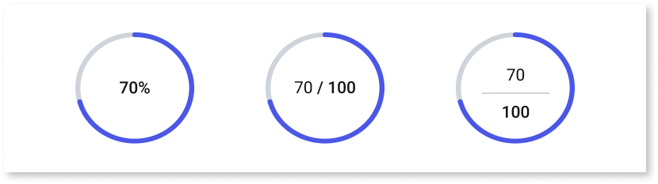

## How to use the progress circle UI pattern

In this example, we create a button that increments the progress circle each time it's clicked and displays the progress as a fraction.

1. In ODC Studio, in the Toolbox, search for `Progress Circle`.

    The Progress Circle widget is displayed.

    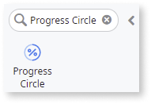

1. From the Toolbox, drag the Progress Circle widget into the Main Content area of your application's screen.

    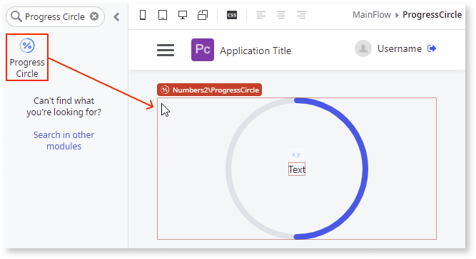

1. Right-click your screen name, select **Add Local Variable**, and enter a name. for example, `Count`.

    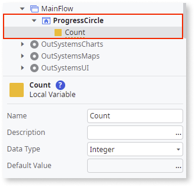

1. Select the Progress Circle widget, and on the **Properties** tab, in the **Progress** property, enter the **Count** variable.

    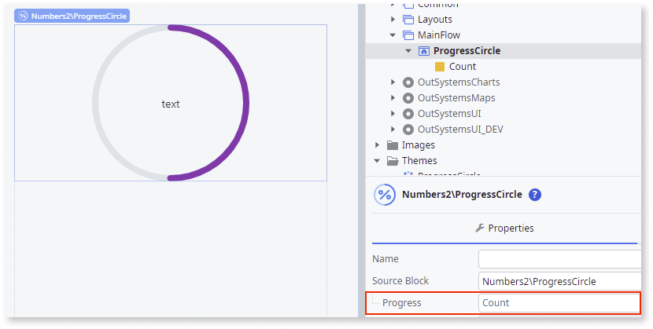

1. Select the **Expression** widget inside the Progress Circle, and on the **Properties** tab, in the **Value** property, enter the relevant logic for the progress. In this example, enter the local variable **Count**.

    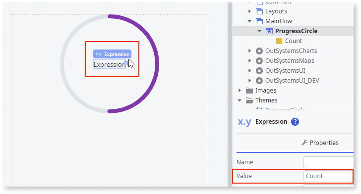

1. From the Toolbox, drag the **Separator** widget into the Progress Circle.

    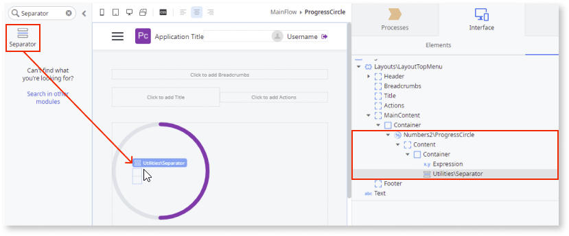

1. From the Toolbox, drag an **Expression** widget under the **Separator** widget and enter the relevant logic for the denominator. In this example, enter ``"100"``.

    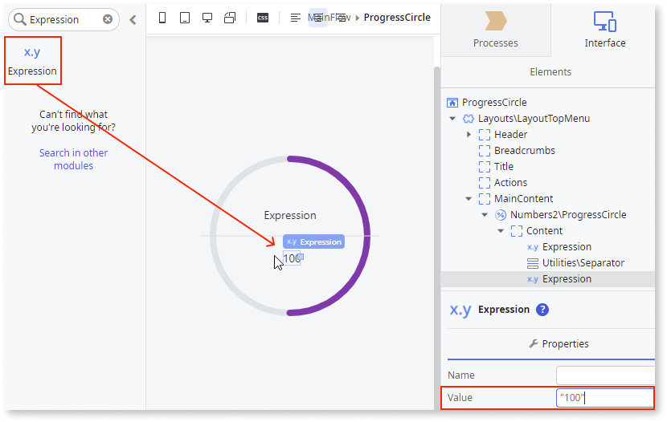

1. From the Toolbox, drag the Button widget into the Main Content area of your application's screen.

    In this example, we call the button **Increment** and set the **On Click** event to a  **New Client Action** that assigns the **Count** variable to `Count + 1`.

    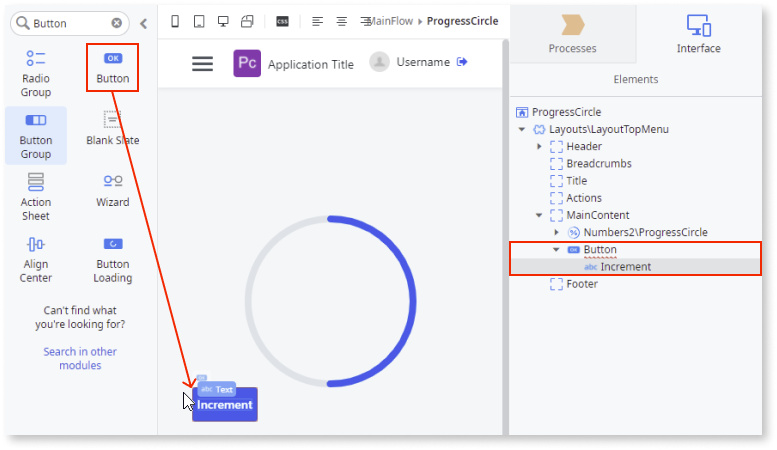

    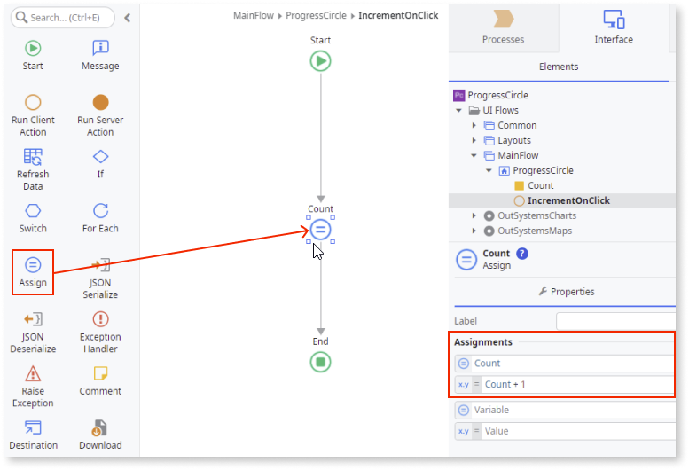

1. Select the Progress Circle widget, and on the **Properties** tab, you can change the Progress Circle's look and feel by setting the (optional) properties, for example, the color settings.

    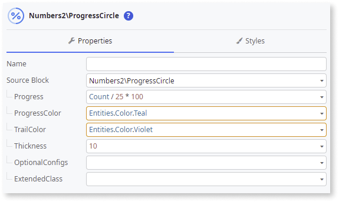

After following these steps and publishing the app, you can test the pattern in your app. The result of this example should look something like the following:

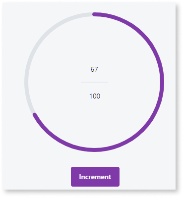

## Properties

| Property | Description |
| ------------------------------- | --------------------------------------------------------------------------------------------------------- |
| Progress (Integer): Mandatory | Progress percentage. Usually a number between 0 and 100. You can also use functions or local variables. |
| ProgressColor (Color Identifier): Optional | The color that fills the circle, as progress goes up, using the OutSystems UI Color palette. |
| TrailColor (Text): Optional | The color of the empty part of the progress circle, using the OutSystems UI Color palette. |
| Thickness (Integer): Optional | The thickness of the circle that marks the progress. |
| OptionalConfigs.Shape (Shape Identifier): Optional | Set the progress circle shape. |
| OptionalConfigs.AnimateInitialProgress (Boolean): Optional | If True, the progress from zero to the progress value is animated. This is the default. |
| ExtendedClass (Text): Optional | Adds custom style classes to the Pattern. You define your custom style classes in your application using CSS.  Examples <ul><li>Blank - No custom styles are added (default value).</li><li>"myclass" - Adds the ``myclass`` style to the UI styles being applied.</li><li>"myclass1 myclass2" - Adds the ``myclass1`` and ``myclass2`` styles to the UI styles being applied.</li></ul>You can also use the classes available on the OutSystems UI. |

## Accessibility – WCAG 2.2 AA compliance {#accessibility}

Out of the box, the **Progress Circle** UI pattern may not be correctly announced by screen readers, as it's primarily a decorative element that doesn't expose meaningful information. To make it accessible, hide the decorative circle and add a descriptive text alternative so users of assistive technologies can understand the progress status.

### Hide progress circle from Screen Readers

1. In **ODC Studio**, go to the **Interface** tab, and select the **Screen/Block** where you use the **Progress Circle**.

1. In the **Widget Tree**, find the **Progress Circle**, right-click it, and select **Enclose in Container**.

    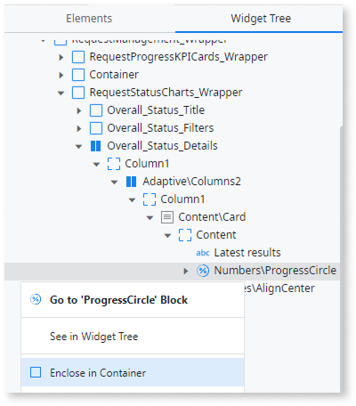

1. In **Container Properties**, under **Attributes**, add `aria-hidden="true"`.

   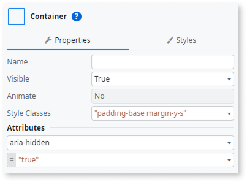

1. Drag and drop an **Expression** to the **Widget Tree**, below the container (be careful not to place it inside).

   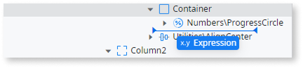

1. In the **Expression Properties**, set a descriptive text value. For example:  
   `"Decorative progress circle bar that shows 15 of 30 results have been achieved."`  
   Then, add the CSS class `wcag-hide-text` so that it's hidden visually but announced by screen readers.

   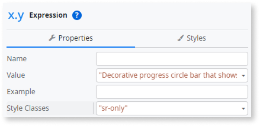

    

    If the progress value updates dynamically, make sure to notify users of changes using an appropriate ARIA live region or focus management technique.

    

1. Publish the app.

### Result

After completing these steps:

* The decorative **Progress Circle** is hidden from assistive technologies.

* Screen readers announce an accurate, descriptive text alternative instead.

* Users relying on screen readers receive meaningful progress feedback.

Test the pattern in your app to confirm the update.
