# Compare workflow revisions

As you and your team make changes over time, a workflow accumulates multiple revisions. Comparing revisions helps you maintain the integrity of your application and track changes effectively.

ODC lets you compare different revisions of a workflow side by side. Use this to identify changes, understand how your workflow evolved, and confirm you're working with the correct revision. You compare revisions in three ways:

* **In the revision history**. Compare any previous revision with your current work or the latest published revision.
* **When opening a workflow**. Whenever you have unpublished changes that aren't based on the latest published revision, you compare both revisions before choosing which one to continue with.
* **When publishing a workflow**. If another user published a newer revision since you started editing, you compare your changes with that revision before publishing.

When the two revisions have no conflicts, you can also merge them into one. For more information, refer to [Merge revisions](#merge-revisions).

## Compare in the revision history

As long as your workflow has more than one revision, you can compare a previous revision with your current working state directly from the revision history panel. To do this:

1. Open the workflow in the Workflow Editor.

1. To open the revision history panel, click **More options** > **Open revisions history** in the upper-right corner of the editor.

1. Select a previous revision from the revisions list.

1. Depending on your current working state, you see one of the following options:

    * **Compare with autosaved**. Available when you have unpublished changes. Compares the selected revision with your unpublished work.
    * **Compare with the latest**. Available when you have no unpublished changes. Compares the selected revision with the latest published revision.

    

    The latest published revision doesn't show a compare option because there's nothing newer to compare it with.

    

    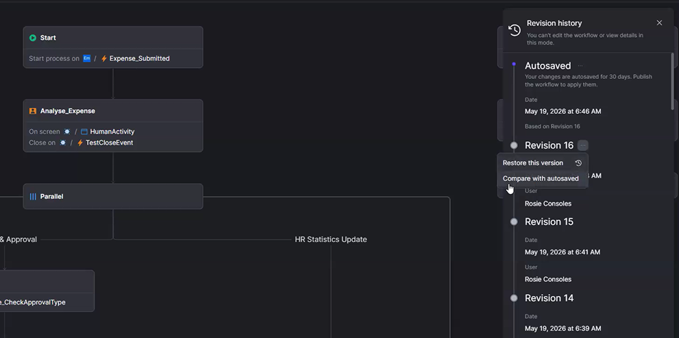

1. Click the **Compare with ...** option. The comparison view opens.

    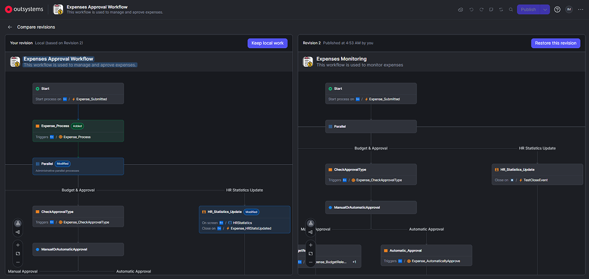

1. Review the differences between the two revisions. For more information, refer to [Comparison view](#understanding-the-comparison-view).

1. Choose one of the available actions:

    * **Keep local work**. Closes the comparison view and returns you to editing your current version.
    * **Restore this revision**. Restores the selected revision, replacing your current working state.
    * **Merge both versions**. Combines the changes from both revisions when they have no conflicts, and opens the merged workflow in the editor. For more information, refer to [Merge revisions](#merge-revisions).

## Compare revisions when opening a workflow

When you open a workflow with unpublished changes not based on the latest published revision, the editor shows a dialog. For example, a colleague published a new revision while you had unsaved work. The dialog asks you to choose which revision to use.

The dialog appears only when you have unpublished changes that build on an older revision than the latest published one. If your unpublished changes build on the latest published revision, the workflow opens normally.

To compare the revisions when opening a workflow, do the following:

1. Open the workflow from the ODC Portal. If the workflow has unpublished changes that aren't based on the latest published revision, the **Recover unpublished work?** dialog appears. This dialog shows your autosaved work and the latest published revision.

1. To open the comparison view, click **Compare revisions**.

    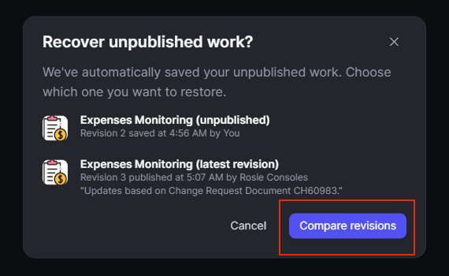

1. Review the differences between your autosaved work (left) and the latest published revision (right).

1. Choose one of the following actions:

    * To continue editing your autosaved work, click **Keep local work** above the left canvas.
    * To open the latest published revision, click **Restore this revision** above the right canvas. This discards your unpublished changes.
    * To combine both revisions when they have no conflicts, click **Merge both versions**. The merged workflow opens in the editor. For more information, refer to [Merge revisions](#merge-revisions).

    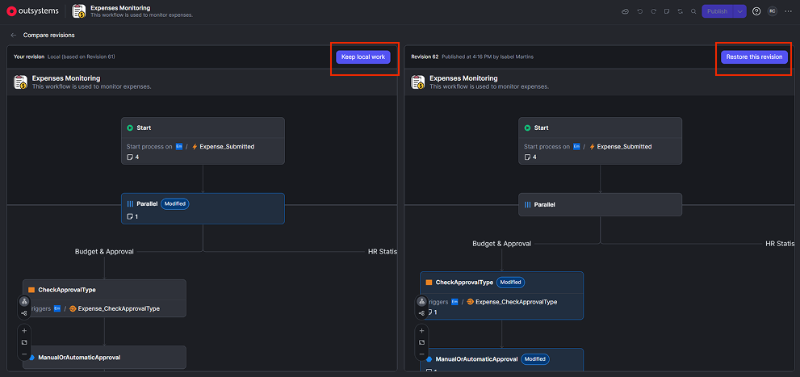

## Compare revisions when publishing

When you try to publish a workflow and another user published a newer revision since you started editing, the publish dialog includes a **Compare both versions** option. This option lets you review the differences before you decide how to proceed.

The **Compare both versions** option appears only when your working session builds on an older revision than the latest published one.

To compare the revisions when publishing a workflow, do the following:

1. Click **Publish** in the Workflow Editor.

1. If ODC detects a publish conflict, a dialog appears with the following options:

    * **Cancel**. Closes the dialog and returns you to editing your current version.
    * **Override with my version**. Publishes your current work, replacing the latest published revision.
    * **Compare both versions**. Opens the comparison view.

    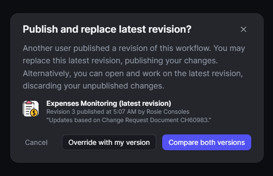

1. Click **Compare both versions**. The comparison view opens.

1. Review the differences between your version (left) and the latest published revision (right). For more information, refer to [Comparison view](#understanding-the-comparison-view).

1. Choose one of the following actions:

    * **Publish your work**. Publishes your version and returns you to the editor.
    * **Restore revision**. Discards your changes and restores the latest published revision.
    * **Merge both versions and publish**. Combines the changes from both revisions when they have no conflicts, and publishes the result as a new revision. For more information, refer to [Merge revisions](#merge-revisions).

    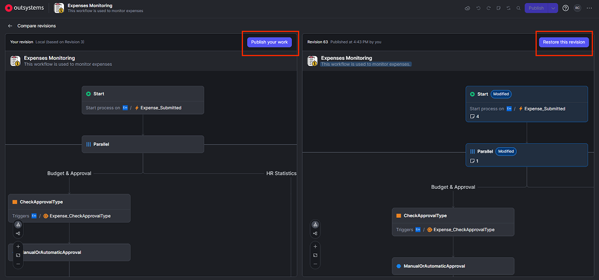

## Comparison view {#understanding-the-comparison-view}

The comparison view shows two workflow canvases side by side:

* **Left canvas**. Shows your current work. This is your autosaved work or, if you have no unpublished changes, the latest published revision.
* **Right canvas**. Shows the revision that you compare your work with. This is the revision you selected in the revision history or the latest published revision.

The left canvas header identifies your local version and the revision it's based on. The right canvas header displays the revision label, the publication date, and the name of the person who published it.

If workflow metadata (title, icon, or description) differs between revisions, the header highlights those differences.

### Color coding {#color-coding}

Color coding highlights changes on nodes, connectors, and property values:

|Color|Meaning|
|--|--|
|Green|Added|
|Red|In Conflict|
|Blue|Modified/Deleted|

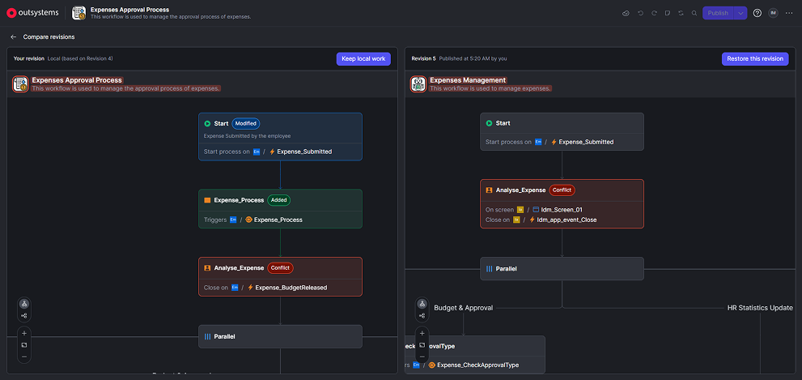

### Property-level changes {#inspecting-property-level-changes}

To see property-level differences, click a highlighted node. The properties pane opens as follows:

* For **modified nodes**, the properties pane highlights the changed properties.
* For **added nodes**, the properties pane opens only on the side where the node exists.
* For **deleted nodes**, the properties pane opens only on the side where the node still appears.

In the following example, the **Start** node appears in blue because it changed between revisions. When you click the node, the properties pane opens and highlights the changed properties in green.

In this case, the modifications added a description and an Instance label, even though the node already existed in the previous revision.

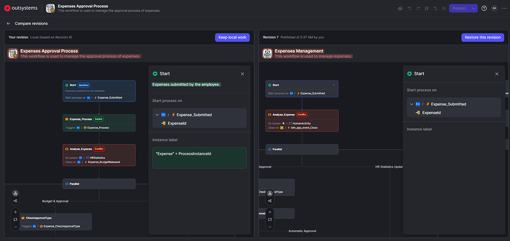

In the following example, the Human Activity “Analyse_Expense” appears in red. There's a conflict because the Destination Screen and Close on Event properties are different in both revisions.

The same happens to the header, since the icon, name, and description of the workflow are different as well.

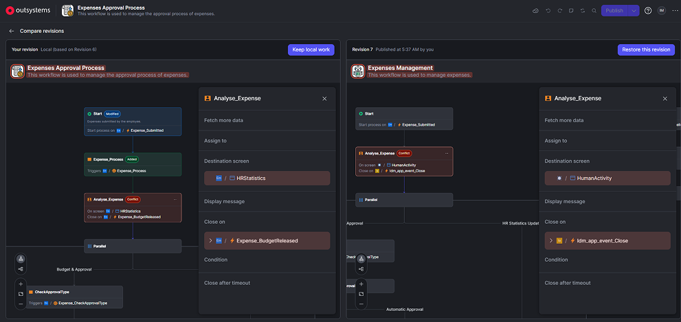

In the following example, the Automatic Activity “Expense_Process” appears in green on the left side because it’s an added node. When you open the properties pane, all properties appear in green because the activity only exists in the left canvas.

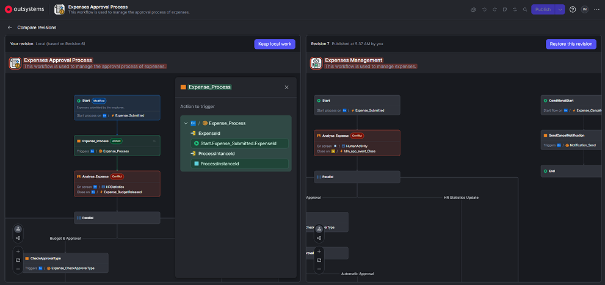

When you delete a node, the comparison view highlights its connector in blue. The deleted node itself disappears from the canvas.

In the following example, the Parallel Activity after “Analyse_Expense” no longer exists on the left canvas. Its connector appears in blue to mark the deletion. On the right canvas, the activity and its connector remain unchanged.

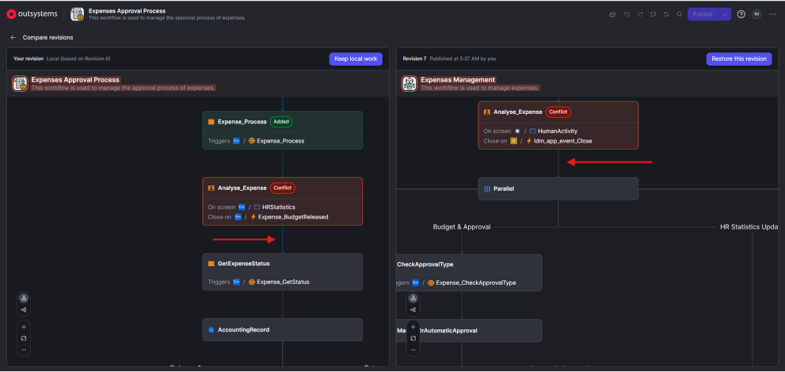

### Navigation

Both canvases are read-only. You can't edit, add, or delete nodes while in the comparison view.

Both canvases synchronize pan and zoom. When you scroll or zoom on one side, the other side moves in sync, making it easier to compare corresponding parts of the workflow.

## Merge revisions {#merge-revisions}

When you and a colleague change the same workflow, you can combine both sets of changes instead of keeping one revision and discarding the other.

Merge is available when the two revisions have no conflicts. In that case, the bottom of the comparison view shows the message "No conflicts, you can merge these two versions." and a merge button. The button is **Merge both versions** or, when you open the comparison view while publishing, **Merge both versions and publish**. The following image shows the message and the button below the two canvases.

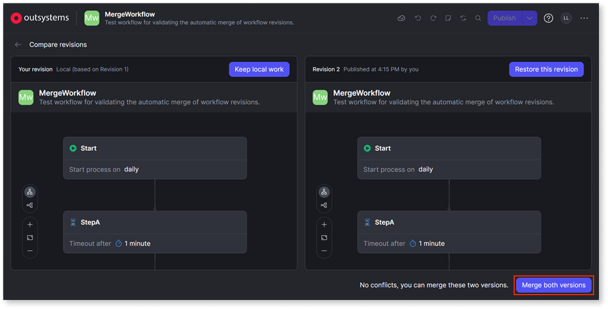

To merge two revisions, do these steps:

1. Open the comparison view in one of the following ways:

    * In the revision history, click **Compare with autosaved**.
    * When you open a workflow, click **Compare revisions** in the **Recover unpublished work?** dialog.
    * When you publish a workflow, click **Compare both versions** in the publish conflict dialog.

1. Review the differences between the two revisions. For more information, refer to [Comparison view](#understanding-the-comparison-view).

1. Click the merge button. What happens next depends on the button:

    * **Merge both versions**. ODC merges the two revisions, opens the merged workflow in the editor, and shows the message "Versions merged". To create a revision from the merged result, click **Publish**.
    * **Merge both versions and publish**. Available only when you open the comparison view from the publish conflict dialog, because your intention is to publish. ODC merges the two revisions and publishes a new revision that contains the changes from both.

### Conflicts that prevent a merge

A conflict exists when both revisions changed the same element, or when one revision changed an element that the other revision deleted. Changes to different properties of the same node also count as a conflict.

When the revisions have a conflict, the merge button is disabled, and the conflicting elements appear in red. For more information, refer to [Color coding](#color-coding).

To continue without merging, keep one of the revisions. Depending on how you opened the comparison view, click **Keep local work**, **Restore this revision**, **Publish your work**, or **Restore revision**.
