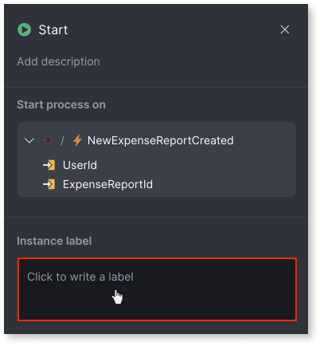
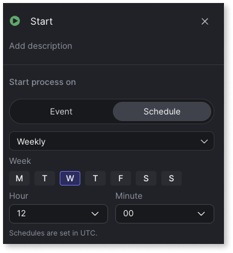
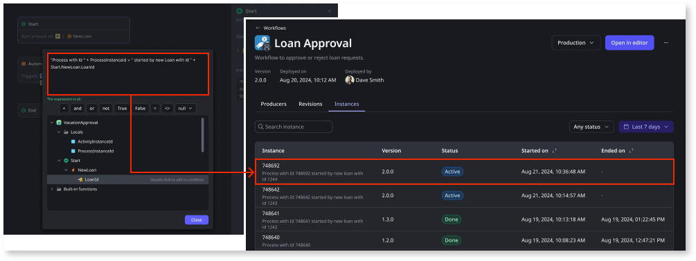

# Start a workflow

Every workflow in the Workflow editor begins with a **Start** node. The **Start** node defines what triggers the workflow, and each time the trigger occurs, ODC creates a new workflow instance. A **Start** node has one of the following trigger types:

* **Event**: An event from an ODC app triggers the workflow. Use an event when a user action or a change in your app must start a business process.
* **Schedule**: A recurring time that you define triggers the workflow. Use a schedule for routine processes that don't depend on an app action, such as a month-end report or a daily inventory reconciliation.

Using events to trigger workflows follows an [**event-driven architecture**](../events/intro.md) where user actions translate into business process events. For example, when a user submits a loan application through your app's form, it triggers a `LoanApplicationSubmitted` event. The **Start** node receives this event along with all the relevant data (user information, loan amount, documents) and passes it to the subsequent workflow activities for processing.

For detailed information about creating and handling events in ODC, refer to [Implement events](../events/implement-events.md).

You can also use [conditional starts](add-conditional-start.md) to handle other events that might occur while your main workflow is running. For example, in a loan approval workflow, you might add a conditional start that triggers a cancellation process if the user decides to cancel their loan application while it's being reviewed.

## How to start a workflow

To trigger the workflow execution, follow these steps:

1. Select the **Start** node. In **Start process on**, select how the workflow starts:

    * **Event**: Assign the event that triggers the workflow. When this event is triggered, the workflow begins.
    * **Schedule**: Set the frequency and the time at which the workflow starts. For more information, refer to [Schedule trigger](#schedule-trigger).

    <div class="info" markdown="1">

    In a multi-portfolio organization, only events, screens, roles, and service actions from apps in the same portfolio are available.

    </div>

1. (Optional) Add an [Instance label](#instance-label).

    An instance label uniquely identifies an instance, making it useful when troubleshooting workflow instances and in workflow logs.

    

## Schedule trigger {#schedule-trigger}

Use a schedule trigger to start a workflow at recurring times without an app event. The following screenshot shows the **Start** panel with **Schedule** selected.



Select a daily, weekly, or monthly frequency, and then set the time. For a weekly schedule, select one or more days of the week. For a monthly schedule, select one or more days of the month. The **Start** node on the canvas shows the frequency, for example, **Start process on** daily.

### Schedule time zone

Schedules use Coordinated Universal Time (UTC), and the **Start** panel shows the message "Schedules are set in UTC." To run a workflow at a specific local time, convert that time to UTC. For example, to run a workflow at 14:00 in a UTC+2 time zone, set **Hour** to `12` and **Minute** to `00`.

UTC doesn't change with daylight saving time. If your time zone changes its UTC offset, the local time of the run changes with it.

### Change the trigger type

Switching the **Start** node between **Event** and **Schedule** and publishing the workflow creates a new revision. Each workflow instance runs on the revision that created it, so instances that are already running continue on their current revision. The new trigger type applies to instances created on the new revision. For more information, refer to [Multiple revisions of a workflow](../../deploying-apps/deploy-apps.md#workflow-revisions).

## Instance label {#instance-label}

When working with workflows, technical IDs such as ``Process_12345`` don't provide much information. Instance labels allow you to create meaningful names such as ``Loan 67890 - John Smith`` that make it easy to identify specific workflow instances.

You can define an **Instance label** in the **Start** node. The instance label assigns a custom identifier to each workflow instance. Each time a workflow is triggered, a new instance is created, and the instance label helps you uniquely identify that specific instance.

Instance labels help you:

* **Identify workflows**: Use user-friendly names instead of technical IDs

* **Troubleshoot issues**: Quickly find specific workflow instances in logs

* **Track progress**: Monitor and distinguish between workflow instances in the Portal

When creating instance labels, keep the following in mind:

* **What you can use**: The instance label is a dynamic expression that accepts values such as the start event's input parameters, runtime properties, and built-in functions. It has access to the ``ActivityInstanceId``, ``ProcessInstanceId``, and any values from the **Start** node.

* **How to write it**: Create an expression using text, variables, and functions

* **Character limit**: Maximum 100 characters (longer expressions are truncated at runtime)

The following is an example of how to structure an instance label:

For a loan request approval, you might want a custom label that describes the instance ID and the ID of the loan that triggered that workflow. This way, when troubleshooting multiple instances, you can easily identify which instance corresponds to a certain loan request.

```
"Process with Id" + ProcessInstanceId + "started by a new loan with ID" + Start.NewLoan.LoanId
```



## Next steps

* [Add human activity](add-human-activity.md)

* [Add automatic activity](add-automatic-activity.md)

* [Add decisions](add-decisions.md)

* [Add wait](add-wait.md)

## Related resources

* [Start a workflow based on specific conditions](add-conditional-start.md)

* [Troubleshooting workflows](troubleshooting-workflows.md)

* [Deploy workflows](../../deploying-apps/deploy-apps.md)
