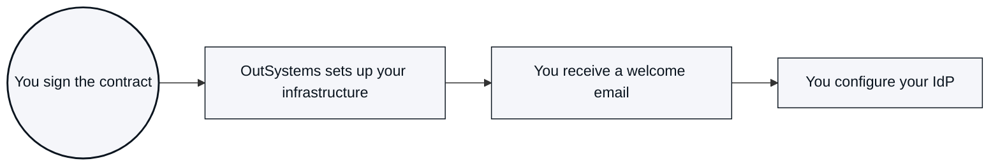
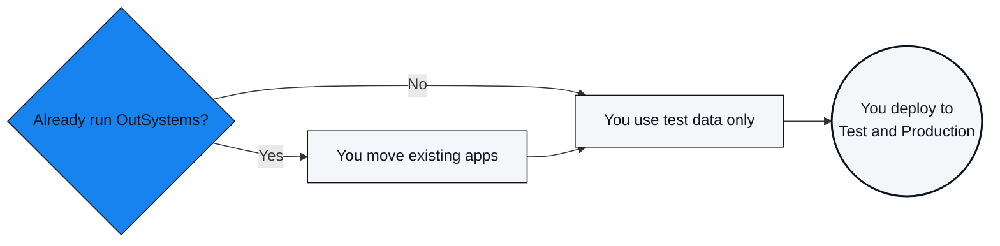

# Getting started with ODC EU Sovereign Cloud

To start building on ODC EU Sovereign Cloud, you sign a contract, OutSystems sets up your environment, and you configure an identity provider for each stage. This article describes these tasks in order, so you know what to prepare and what to expect.

## Prerequisites

Before you start, make sure you have:

* A contract for ODC EU Sovereign Cloud
* An external OpenID Connect (OIDC) identity provider for each stage
* Named technical contacts for your organization

ODC EU Sovereign Cloud doesn't include an identity provider. Only your named technical contacts can open and manage support tickets. For how to register them, refer to [Getting support for ODC EU Sovereign Cloud](esc-getting-support.md).

## High-level process

OutSystems sets up the environment, and you bring the identity provider. Getting started involves the following tasks:

1. [Get access to your environment](#get-access)
1. [Configure your identity provider](#configure-idp)
1. [Move your existing apps](#move-existing-apps), if your organization already runs OutSystems
1. [Use the Development stage with test data only](#development-stage)

The following diagrams show the tasks in order, and whether you or OutSystems performs each one. First, you sign the contract and configure your identity provider:

Then, whether you move existing apps depends on whether your organization already runs OutSystems:

## Get access to your environment {#get-access}

After you sign the contract, OutSystems sets up your ODC organization and the infrastructure for your Test and Production stages, based on the capacity you contracted. The Test and Production stages run on EU-owned infrastructure that OutSystems operates, so you don't provide or manage any infrastructure.

When the stages are installed and registered with your ODC organization, you receive a welcome email with an invitation to the ODC Portal.

## Configure your identity provider {#configure-idp}

ODC EU Sovereign Cloud requires an external OIDC identity provider for every stage, including Development. In the ODC Portal, the setup of each stage includes an identity provider step.

ODC EU Sovereign Cloud follows the same identity provider model as self-hosted ODC. When you add a connector, select **For Cloud** for the Development stage, and **For self-hosted** for the Test and Production stages.

For instructions, refer to [Configuring authentication with external identity providers](../external-idps/intro.md) and [Add an OpenID Connect identity provider](../external-idps/configure-openid-connect.md).

## Move your existing apps {#move-existing-apps}

If your organization already runs OutSystems, you can't move to ODC EU Sovereign Cloud through an in-place migration. Export your apps from your current environment and import them into ODC EU Sovereign Cloud. Business data, end users, settings, and secrets don't move with your apps.

## Use the Development stage with test data only {#development-stage}

The Development stage runs in ODC Cloud, outside the EU-owned infrastructure that hosts your Test and Production stages. In the Development stage, use only test data and test identities.

## Next steps

Refer to the following articles to understand your responsibilities, get support, and review what isn't available:

* [Shared responsibility model for ODC EU Sovereign Cloud](esc-shared-responsibility.md)
* [Getting support for ODC EU Sovereign Cloud](esc-getting-support.md)
* [ODC EU Sovereign Cloud limitations](esc-limitations.md)
