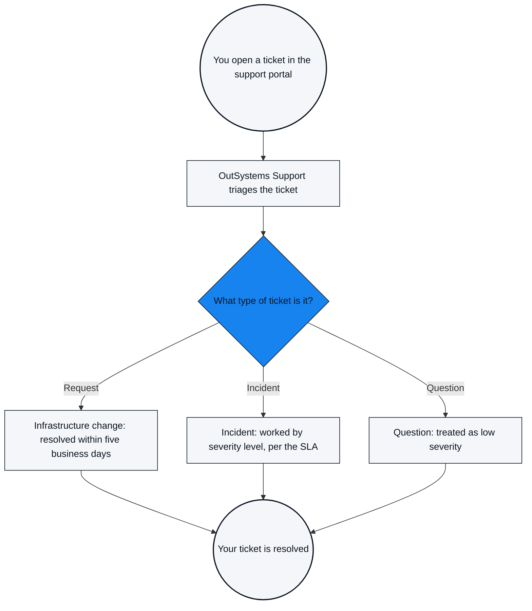

# Getting support for ODC EU Sovereign Cloud

ODC EU Sovereign Cloud handles support differently from standard ODC Cloud, to keep every support interaction inside the EU. The **Support** entry in the ODC Portal doesn't cover your ODC EU Sovereign Cloud portfolios. Instead, OutSystems Support handles your request end to end, through a dedicated sovereign channel, so every interaction stays inside the EU.

## Support channels for ODC EU Sovereign Cloud

ODC EU Sovereign Cloud doesn't use the ODC Portal's **Support** entry or the standard OutSystems Support Portal. Instead, you use a dedicated EU Sovereign Cloud support portal, and you can also reach support by phone through a dedicated EU phone line.

This keeps every ODC EU Sovereign Cloud support request inside the OutSystems sovereign support channel, consistent with the EU-only guarantees described in [ODC EU Sovereign Cloud](esc-overview.md).

## Submit a support request

OutSystems Support triages and resolves your request, escalating infrastructure-specific work internally as needed.

Submit and track your requests through the [ODC EU Sovereign Cloud support portal](https://odc.vsti.cloud/portal/). Only the technical contacts registered for your organization can submit or update tickets. To register a technical contact, open a support case with their name and email address.

The following diagram shows how a ticket moves from submission to resolution, based on its type:

To change the infrastructure of your Test and Production stages, refer to [Infrastructure change requests](#infrastructure-change-requests).

For severity levels, service level agreement details, and the dedicated phone number, refer to [Support terms and service level agreements (SLA)](https://www.outsystems.com/legal/success/support-terms-and-service-level-agreements-sla-of-the-outsystems-software).

OutSystems keeps an internal record of your ticket for workload tracking and escalation coordination.

## Infrastructure change requests {#infrastructure-change-requests}

Some changes to your Test and Production stages need work on the infrastructure that OutSystems operates for you. Submit these changes as change requests, the same way you submit support requests. Each change request has a target delivery of five business days.

The following table lists the changes you can request:

| Category | Change request |
| --- | --- |
| Manage subscription | Change compute instances and compute add-ons |
| Manage subscription | Resize database compute capacity |
| Manage subscription | Extend database storage |
| Provisioning | Add non-production stages or portfolios |
| Provisioning | Delete non-production stages or portfolios |
| Provisioning | Delete your ODC tenant |
| Security | Run load and penetration tests |
| Network and access | Allow-list entries, certificates, and VPN |

## Related resources

Refer to the following resources for related concepts:

* [ODC EU Sovereign Cloud](esc-overview.md)
* [Shared responsibility model for ODC EU Sovereign Cloud](esc-shared-responsibility.md)
