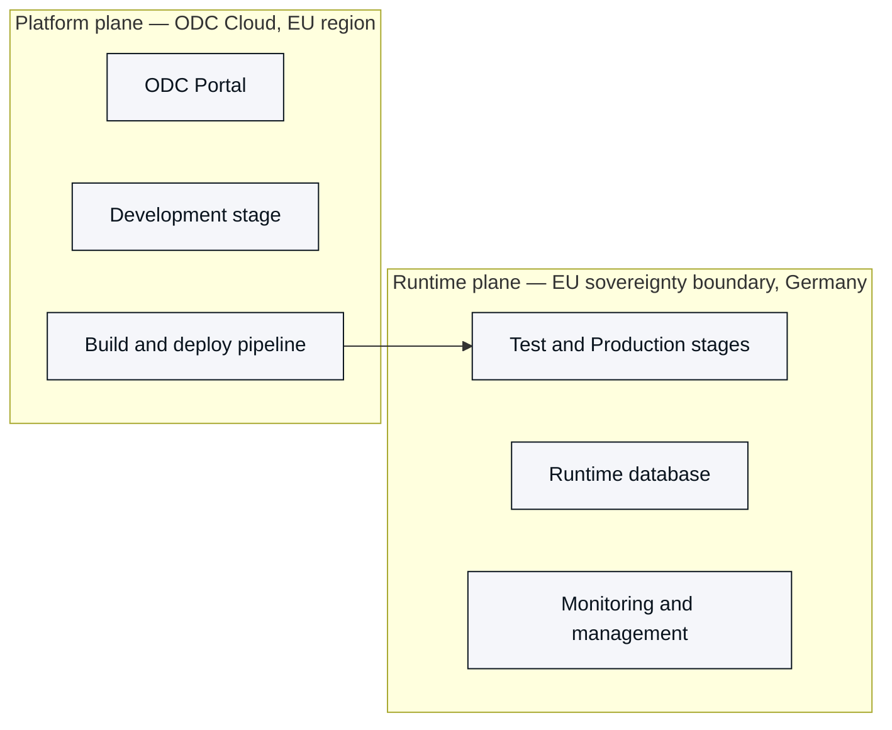

# Shared responsibility model for ODC EU Sovereign Cloud

ODC EU Sovereign Cloud splits responsibility between you and OutSystems. OutSystems is accountable for the entire managed offering, including the infrastructure and operations that keep your runtime inside the EU sovereignty boundary. Knowing this split clarifies what remains your responsibility as the customer, and which data actually stays on EU-owned infrastructure.

You don't operate any part of the infrastructure yourself. OutSystems manages it for you, end to end.

## Platform and runtime

ODC EU Sovereign Cloud runs on two planes: a platform plane and a runtime plane, and OutSystems is accountable for both.

* **The platform plane** includes the ODC Portal, the Development stage, and the build and deployment pipeline. OutSystems operates this plane directly, in ODC Cloud — which runs on AWS — in an EU region.
* **The runtime plane** includes your Test and Production stages, your runtime database, and the day-to-day monitoring and management of that environment. OutSystems delivers this plane on EU-owned infrastructure in Germany.

The following diagram shows how the two planes split, and which one sits inside the EU sovereignty boundary:

For example, when you publish a new app version from ODC Studio, OutSystems builds it on the platform plane and deploys it to your Test or Production stage on the runtime plane.

For a shorter summary of these roles, refer to [Who operates ODC EU Sovereign Cloud](esc-overview.md#who-operates).

## Where your data lives

The platform plane and the runtime plane each store different kinds of data.

The platform plane, hosted by OutSystems, stores your application's source code, metadata, and deployment history. You set configuration values and secrets in the ODC Portal. The platform plane passes them to the runtime plane, where your apps use them.

The runtime plane, hosted on EU-owned infrastructure and operated on your behalf by OutSystems, stores everything your running applications generate and use:

* Your application's business data, in a database provisioned and operated on your behalf.
* Your application's logs, traces, and performance metrics, produced while your applications run.
* Your application's secrets and credentials, and the credentials for any external systems your applications connect to.

OutSystems cannot access your application's business data, logs, traces, or secrets. Any access to your runtime environment happens only when you open a support ticket that authorizes it. Aggregate usage metrics are sent to OutSystems for license validation only.

## OutSystems responsibilities

OutSystems is responsible for the following:

* Running the ODC Portal, the platform services, and the Development stage
* Provisioning, patching, backing up, and monitoring the runtime
* Applying change requests
* Providing support

## Your responsibilities

Even though OutSystems operates the runtime infrastructure for you, you remain responsible for:

* **Your applications and data:** You develop, test, and deploy your applications, and you're responsible for the business data they create and process, regardless of which infrastructure stores it.
* **Your identity provider:** You bring your own identity provider. ODC EU Sovereign Cloud requires an external OIDC identity provider for every stage, and doesn't include one by default. For setup steps, refer to [Configure your identity provider](esc-get-started.md#configure-idp). For general IdP configuration instructions, refer to [Configuring authentication with external identity providers](../external-idps/intro.md).
* **Your Development stage:** You use only test data and test identities in the Development stage, which runs in ODC Cloud outside the EU-owned infrastructure.
* **Credentials for your external integrations:** You manage the credentials your applications use to connect to external systems, APIs, and third-party services. For example, if your app calls a third-party payment API, you manage the API key it uses.

## Use case

Use this model to:

* Confirm that a specific type of data in your Test and Production stages, such as your application's business data, stays on EU-owned infrastructure.
* Confirm data residency for your organization's compliance reviews, since this model maps directly to where each type of data lives.
* Evaluate ODC EU Sovereign Cloud against your organization's regulatory requirements, since each party's responsibilities determine which compliance controls apply to them.
* Know what to expect when you open a support ticket: OutSystems is always your point of contact, regardless of whether the issue turns out to be a platform, runtime, or infrastructure problem.

## Related resources

Refer to the following resources for related concepts:

* [ODC EU Sovereign Cloud](esc-overview.md)
* [Getting started with ODC EU Sovereign Cloud](esc-get-started.md)
* [ODC EU Sovereign Cloud limitations](esc-limitations.md)
