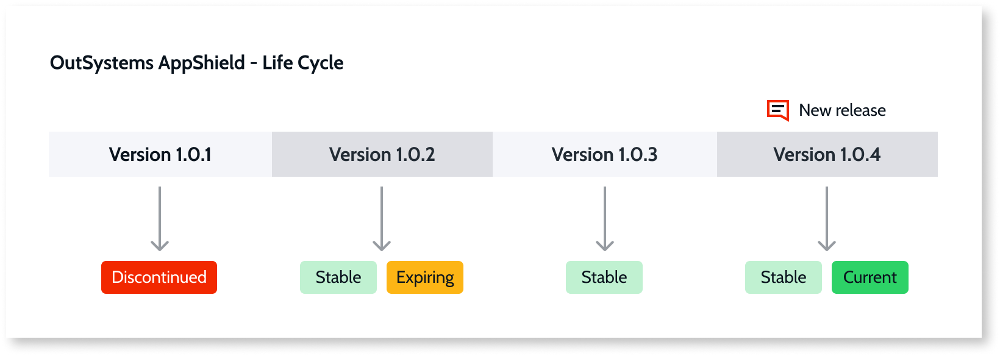
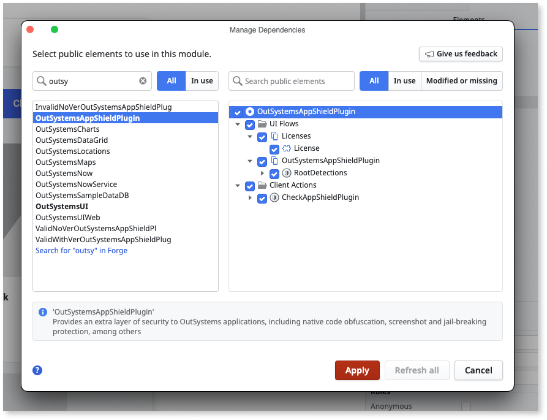
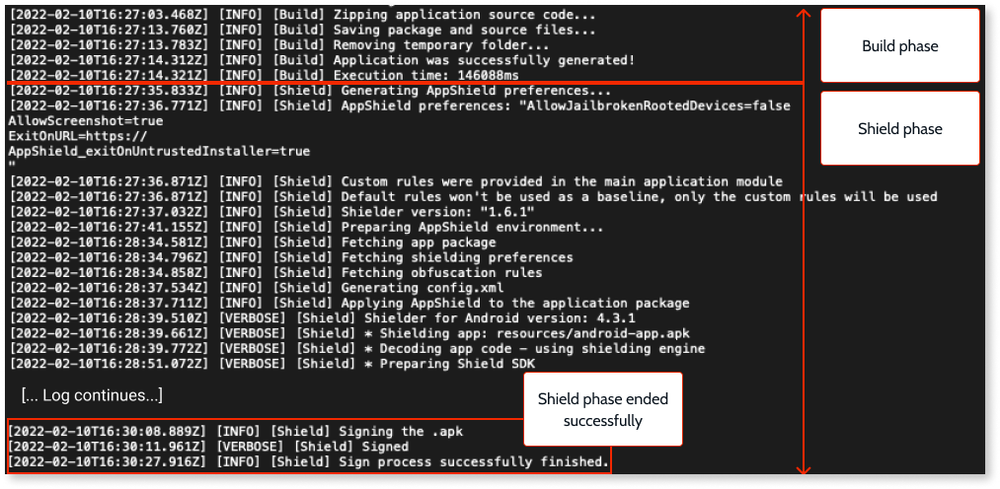

# Harden the protection of mobile apps with AppShield

<div class="info" markdown="1">

Applies only to Mobile Apps.

</div>

**OutSystems AppShield** is a licensed plugin available from the **Forge**. **AppShield** lets you harden the protection of your native Android and iOS apps. **AppShield** integrates with the Mobile Apps Build Service (MABS version 9.0 or later), adding app protection at runtime and rest.

<div class="info" markdown="1">

To use **OutSystems AppShield**, you must have a [license](../../manage-platform-app-lifecycle/subscription-console.md). If you still need to get a license, contact the sales team.

</div>

**AppShield** prevents code injection, screenshots of app data, and data hijacking.

When the user launches a hardened app, the app performs multiple checks. These checks include root and repackaging detection, and they increase the app launch time, especially the first time the app starts. The start time varies depending on multiple factors, such as device hardware and app complexity.

To ensure your app users have protection against the latest security vulnerabilities, **OutSystems** provides continuous updates to **AppShield**.

## Understanding the AppShield life cycle

Before you install and use **AppShield**, it's important to understand the release cycle and how it improves security. For example, suppose you have a mobile banking application and your app data must always be secure, but your version of **AppShield** needs to be updated. OutSystems regularly updates **AppShield** and strongly recommends always installing the latest version of **AppShield** in your environment. Then, release a new version of your app to your users.

To identify the **AppShield** plugin releases, OutSystems uses the following tags:

* Stable
* Current
* Expiring
* Discontinued

The following list describes the tags:

* **Stable and Current** - This is the active version and has up-to-date protection. OutSystems **supports** this version and highly recommends that you install and use this version.
* **Stable** - You can use this version, but the protection isn't current. OutSystems **doesn't support** this version. You can build an app, but you get a warning message when you try to build the app.
* **Stable and Expiring** - This version becomes discontinued in three months. OutSystems **doesn't support** this version, but you can build an app with it. If you use this version, a warning message displays advising you to update to the most current version before the expiration date. Once this version **discontinues**, you won't be able to build your app with it.
* **Discontinued** - This plugin version is out of date. OutSystems security mechanisms prevent you from creating a new build for your users. OutSystems **doesn't support** this version.

The following diagram shows how release versions work in **AppShield**.



<div class="warning" markdown="1">

To keep your apps and data secure, OutSystems recommends that you always use the current version of the **AppShield** plugin. Go to the Versions tab of the plugin Forge page to get the current version.

</div>

## Prerequisites

To ensure the integrity and protection of your apps with **AppShield**, you must meet the following requirements:

* You have a license for **AppShield**.

* You're using MABS 9.0 or later.

    For more information about the supported operating systems, refer to [MABS and mobile operating systems life cycles](https://success.outsystems.com/Support/Release_Notes/Mobile_Apps_Build_Service_Versions).

## Enable AppShield on your mobile apps

To protect your mobile app using the AppShield plugin, follow these steps:

1. **Install the AppShield** plugin in your environment.

    To download the plugin, go to [OutSystems AppShield](https://www.outsystems.com/forge/list?q=shield) in Forge, and click install.

1. **Add the dependencies for AppShield** plugin on each mobile app you want to protect.

    

1. **Generate and distribute a new mobile package** protected with AppShield.

Note the following:

* AppShield enables all capabilities by default, except [Screen reader](protection-features-description.md#android-screen-reader), [Keylogger](protection-features-description.md#keylogger-protection), [Tapjacking](protection-features-description.md#tapjacking-protection), and [Private space](protection-features-description.md#private-space-detection) detection.
* You can set additional configuration in the [Configuration](#configuration) section.
* Hardening increases the app file size.
* Hardening increases the time MABS takes to create a build.

<div class="info" markdown="1">

For more information about adding mobile plugins to your app, refer to [Adding plugins](../../integration-with-systems/mobile-plugins/intro.md).

</div>

## Supported features

These are the features you can use with the current release of the **AppShield** plugin.

### Android

AppShield provides the following protections for Android builds:

* Root detection
* Repackaging detection
* Code obfuscation
* Code injection protection
* Debugger protection
* Emulator detection
* Key logger protection
* Screen reader detection
* Untrusted keyboard detection
* Screenshot protection
* Task hijacking protection
* Tapjacking protection
* Private space and work profile security enforcement

### iOS

AppShield provides the following protections for iOS builds:

* Jailbreak detection
* Repackaging detection
* Code injection protection
* Debugger protection
* Screen mirroring detection
* Screenshot protection

## Configuration

**AppShield** is on by default when you install the plugin. You can turn it off in one or more environments for testing purposes.

### Recommended method to set AppShield options

OutSystems recommends that you set **AppShield** options as extensibility settings in **ODC Portal**. You set the value for each environment, so the same app can behave differently in development and production.

Extensibility settings are available for options that have **Yes** in the **Extensibility setting** column of the [Configuration reference](#configuration-ref). For these options, use extensibility settings. For more information about editing extensibility settings in ODC Portal, refer to [Extensibility settings](../../building-apps/mobile/configuring-mobile-apps.md#configure-extensibility-settings).

You can also define preferences in the extensibility configuration of your app. A preference takes precedence over the extensibility setting with the same name, and the preference value applies to every environment. If your app already defines such a preference, remove it so that the extensibility setting applies. Define a preference only for the options that have no extensibility setting: `AddTrustedKeyboardSigner`, `AddTrustedScreenReaderSigner`, `ApplicationSignerCertificate`, and `AppShieldObfuscationRules`. If you use a plugin version that doesn't support extensibility settings, also define a preference.

### Turn off AppShield in an environment

To turn off **AppShield** in one or more environments, edit the **DisableAppShielding** extensibility setting in **ODC Portal** for the environment. For example, turning off the plugin in the development environment lets you run the app in emulators or debug the app.

### Extensibility configuration

Use the extensibility configuration for the options that have no extensibility setting. The following example whitelists a third-party keyboard and a third-party screen reader for Android. Preferences in the `android` section apply only to Android, and preferences in the `ios` section apply only to iOS.

```javascript
{
    "appConfigurations": {
        "cordova": {
            "preferences": {
                "android": {
                    "AddTrustedKeyboardSigner": "KEYBOARD_SIGNER",
                    "AddTrustedScreenReaderSigner": "SCREEN_READER_SIGNER"
                }
            }
        }
    }
}
```

Replace the following:

* `KEYBOARD_SIGNER`: The signer of the third-party keyboard that you want to whitelist
* `SCREEN_READER_SIGNER`: The signer of the third-party screen reader that you want to whitelist

The `AddTrustedKeyboardSigner` and `AddTrustedScreenReaderSigner` options apply only when the `BlockUntrustedKeyboards` and `BlockUntrustedScreenreaders` extensibility settings are set to true.

### AppShield obfuscation rules

To configure your own obfuscation rules for Android, you must set the `AppShieldObfuscationRules` preference in the extensibility configuration of your app, because this option has no extensibility setting. For more information, refer to [Creating custom obfuscation rules](obfuscate-custom-rules.md).

### Configuration reference {#configuration-ref}

The following table lists the values available in the **AppShield** configuration JSON. The **Extensibility setting** column shows whether the plugin also defines the value as an extensibility setting that you can edit in **ODC Portal**.

| Configuration | Type | Default value | OS | Extensibility setting | Description |
| ------------------------------- | ------------ | ------------- | ------------ | ------- | ------------------------------------------------------------------------------------------------- |
| `AddTrustedKeyboardSigner` | Text | | Android | No | If `BlockUntrustedKeyboards` is set to `true`, this option can whitelist a third-party keyboard. Add this option for each keyboard software that you want to add to the whitelist. |
| `AddTrustedScreenReaderSigner` | Text | | Android | No | If `BlockUntrustedScreenreaders` is set to `true`, this option can whitelist a third-party screen reader. Add this option for each screen reader software that you want to add to the whitelist. |
| `AllowJailbrokenRootedDevices` | Boolean | `false` | iOS, Android | Yes | If set to `true`, users can run the app on the jailbroken devices. |
| `AllowPrivateSpace` | Boolean | `true` | Android | Yes | If set to `false`, the application is blocked from running if the application was started from a private space or a work profile. |
| `AllowScreenshot` | Boolean | `false` | iOS, Android | Yes | If set to `true`, users can take screenshots of the app. |
| `AllowTapjacking` | Boolean | `true` | Android | Yes | If set to `false`, the application detects tapjacking attempts and remove the malicious overlay entirely for apps running on Android 12 and above or block inputs to the overlay for versions below Android 12. |
| `AllowIOSAppOnMacOSX` | Boolean | `false` | iOS | Yes | If set to `true`, the application is allowed to run on macOS via Catalyst or as an iPhone app on Mac. When set to `false` (default), the application exits when it detects it is running on macOS. You can configure an exit URL to redirect users when the app exits. For more information about configuring an exit URL, refer to [Configuring an exit URL for a blocked app](ExitOnUrl.md). macOS provides greater access to debugging and reverse engineering tools than a standard iOS device. Enable only if your app is designed to support macOS and your target audience requires it. |
| `ApplicationSignerCertificate` | Text(Base64) | | iOS, Android | No | Adds the given certificate to the accepted signers whitelist of the final package. To add more than one certificate, separate the values with a semicolon. |
| `AppShieldDebugMode` | Boolean | `false` | iOS, Android | Yes | If set to `true`, the shielding process is applied in debug mode, keeping debugging options used in Debug and Development builds. Used for extended developer troubleshooting. Builds with this option can't be uploaded to the Store, and, on Android, they need to be installed using `adb install` with the `-t` option. |
| `AppShieldObfuscationRules` | Text(base64) | | Android | No | Custom rules for obfuscation. For more information, refer to [Creating custom obfuscation rules](obfuscate-custom-rules.md). |
| `BlockDeveloperMode` | Boolean | `false` | iOS, Android | Yes | If set to `true`, the application is blocked from running on iOS devices that have Developer Mode enabled and Android devices with Developer Options unlocked. |
| `BlockUntrustedKeyboards` | Boolean | `false` | Android | Yes | If set to `true`, untrusted keyboards are detected and blocked. |
| `BlockUntrustedScreenreaders` | Boolean | `false` | Android | Yes | If set to `true`, untrusted screen readers are detected and blocked. Screen readers that come preinstalled on the device as system apps, such as TalkBack, are always trusted and are not blocked. Screen readers installed from an app store or other sources are checked and blocked if untrusted. |
| `BlockMemoryScan` | Boolean | `true` | Android | Yes | If set to `true`, the application shuts down when it detects unauthorized memory scanning or dumping activity. This protects sensitive data stored in memory, such as encryption keys or session tokens, from being extracted or manipulated by attackers. |
| `BlockUnlockedBootloader` | Boolean | `true` | Android | Yes | If set to `true`, the application exits when it detects that the device bootloader is unlocked. An unlocked bootloader indicates that the device can run a custom OS. You can optionally configure an exit URL to redirect users when the app exits. For more information about configuring an exit URL, refer to [Configuring an exit URL for a blocked app](ExitOnUrl.md). |
| `BlockCodeTraceDetection` | Boolean | `true` | Android | Yes | If set to `true`, the application terminates when it detects runtime code tracing activity. Code tracers follow application threads at runtime to capture native instructions, and are commonly used to reverse engineer apps and extract business logic. |
| `BlockNonSystemOverlays` | Boolean | `true` | Android | Yes | If set to `true`, the application prevents non-system overlays from appearing over it and removes any existing non-system overlays while the app is in use. This protects against tapjacking attacks, where malicious overlays trick users into interacting with hidden content. |
| `BlockEmulator` | Boolean | `true` | iOS, Android | Yes | If set to `true`, the application exits when it detects it is running in an emulator or simulator.  You can optionally configure an exit URL to redirect users when the app exits. For more information about configuring an exit URL, refer to [Configuring an exit URL for a blocked app](ExitOnUrl.md). Developers and testers commonly use emulators and simulators during development. Enable this in production builds where emulator access is not expected or permitted. |
| `BlockEmulatedInput` | Boolean | `false` | Android | Yes | If set to `true`, the application blocks inputs injected to the screen by emulated or automated sources. You can also configure the app to exit when emulated input is detected by setting an exit URL. For more information about configuring an exit URL, refer to [Configuring an exit URL for a blocked app](ExitOnUrl.md). Some accessibility tools, such as switch access or assistive input devices, rely on emulated input methods and can be blocked incorrectly when this setting is enabled. Enable this only if your target audience does not rely on such tools. |
| `BlockScreenMirroring` | Boolean | `false` | Android | Yes | If set to `true`, the application detects when the device screen is being mirrored to an external display and blocks it by drawing a blank view on secondary displays. Users who legitimately cast their screen, such as for presentations or streaming to a TV via Chromecast or MiraCast, have their mirrored display go blank while the app is in use. Enable this only if your app handles sensitive data that must be prevented from appearing on external displays. |
| `BlockVPN` | Boolean | `false` | iOS, Android | Yes | If set to `true`, the application exits when it detects that a VPN is active on the device. You can optionally configure an exit URL to redirect users when the app exits. For more information about configuring an exit URL, refer to [Configuring an exit URL for a blocked app](ExitOnUrl.md). Enterprise users or users who rely on VPNs for privacy can be blocked unexpectedly. Enable this only if your app operates in environments where VPN usage is not permitted. |
| `BlockHiddenSEPolicyArtifacts` | Boolean | `false` | Android | Yes | If set to `true`, the application verifies the device's SELinux policy artifacts. If hidden artifacts indicating a tampered or compromised security policy are detected, the app closes. This covers advanced rooting and root-hiding techniques, including Magisk and KernelSU setups with modules such as TrickyStore. All LineageOS devices ship with a modified SELinux policy. When this setting is enabled, end users on LineageOS devices are blocked, including on unrooted devices. |
| `DisableAppShielding` | Boolean | `false` | iOS, Android | Yes | Activates or deactivates AppShield. |
| `ExitOnURL` | URL value | | iOS, Android | Yes | If an app feature is blocked due to a configured policy of the **AppShield** plugin, the default browser opens the URL where the problem is explained. For more information, refer to [ExitOnURL](ExitOnUrl.md). |
| `RemoveQueryAllPackagesPermission` | Boolean | `true` (`false` for versions below 1.5.1) | Android | Yes | If set to `true`, AppShield removes the app's ability to check other installed applications. For more information, refer to [Manage the `QUERY_ALL_PACKAGES` permission for Google Play compliance](query-all-packages.md). |
| `android` | JSON value | | Android | | The key denoting values that apply to Android devices. |
| `ios` | JSON value | | iOS | | The key denoting values that apply to iOS devices. |

## Check that an app with AppShield builds successfully {#check-app-builds}

To ensure that your build passes the shield phase, check your [app’s build logs](../../building-apps/mobile/creating-mobile-package.md#download-mobile-app-build-logs--download-mobile-app-build-logs).

When you trigger a build with AppShield enabled and correctly configured, MABS includes a **shield phase** while generating the app's mobile package.

The shield phase occurs after the build phase, and a message at the end of the log file lets you know if the shield phase is successful.



## Obfuscation

Obfuscation has the following limitations:

* Obfuscation applies only to the supported **OutSystems** mobile plugins.
* Obfuscation of JavaScript files isn't supported.
* Obfuscation of native iOS bitcode isn't supported.
* Deobfuscation of the native Android logs that the plugin obfuscates in ODC Portal requires an external tool.
* Access to the mapping files requires contacting Support.

### String binding {#string-binding}

On Android apps, bindings are created between AppShield and the app so that the presence of AppShield is required for the app to execute normally. The binding process modifies classes by extracting and removing values, that is, constants, from the application code. When the app launches, AppShield provides these values to the app only if the configured Shield security policy is satisfied.

The strength of the binding depends on the number of constants removed from the app and the distribution of removed constants across the code base. AppShield adds the removed constants to the encrypted runtime data.

By default, Android apps have the binding active. For more information about configuring string binding, refer to [Creating custom obfuscation rules](obfuscate-custom-rules.md).

## Whitelist signing certificates

If you re-sign your app with a different certificate after you build it, **AppShield** repackaging detection treats the app as repackaged. The app then crashes on startup with a repackaging exception. To prevent this, whitelist the certificate that re-signs the app.

Repackaging detection is one of the security features of **AppShield**. It flags packages signed with an unrecognized certificate. For example, Google Play App Signing re-signs the app with a different certificate when you upload an `.aab` file to the Google Play Store. **AppShield** whitelists the certificate of the keystore provided to MABS automatically. Whitelist only the certificates that re-sign the app afterward.

When you whitelist a certificate, **AppShield** considers packages signed with that certificate safe during the repackaging analysis.

### Obtain the signing certificate {#obtain-the-signing-certificate}

To get the certificate value, export the certificate to a `certificate.pem` file, and then copy the certificate text from that file. The export steps depend on the platform and on where the certificate is stored.

#### Export the certificate for iOS

If you have the PKCS12 file, do the following:

1. Export the certificate to a `certificate.pem` file by running the following command:

    ```
    keytool -storetype PKCS12 -keystore PKCS12_FILE -storepass STORE_PASSWORD -alias ALIAS -exportcert -rfc > certificate.pem
    ```

    Replace the following:

    * `PKCS12_FILE`: The path to the PKCS12 file
    * `STORE_PASSWORD`: The password of the PKCS12 file
    * `ALIAS`: The alias of the certificate in the PKCS12 file

1. Optional. To use `openssl` instead of `keytool`, run the following command:

    ```
    openssl pkcs12 -in PKCS12_FILE -nokeys -password pass:STORE_PASSWORD -out certificate.pem
    ```

    Some certificates and openssl versions require the `-legacy` option.

Continue with [Copy the certificate value](#copy-the-certificate-value).

#### Export the certificate for Android

If you have the keystore file, do the following:

1. Export the certificate to a `certificate.pem` file by running the following command:

    ```
    keytool -keystore KEYSTORE_FILE -storepass STORE_PASSWORD -alias ALIAS -exportcert -rfc > certificate.pem
    ```

    Replace the following:

    * `KEYSTORE_FILE`: The path to the keystore file
    * `STORE_PASSWORD`: The password of the keystore file
    * `ALIAS`: The alias of the certificate in the keystore file

If the certificate is the **App Signing Certificate** from the Google Play App Signing feature, do the following:

1. In Google Play Console, download the **App Signing Certificate** from the **App Signing** section. The downloaded file has the `.der` extension.

1. Convert the downloaded file to a `certificate.pem` file by running the following command:

    ```
    openssl x509 -inform der -in DER_FILE -out certificate.pem
    ```

    Replace `DER_FILE` with the path to the downloaded `.der` file.

Continue with [Copy the certificate value](#copy-the-certificate-value).

#### Copy the certificate value {#copy-the-certificate-value}

The `certificate.pem` file contains the certificate between a `-----BEGIN CERTIFICATE-----` line and a `-----END CERTIFICATE-----` line. To get the value for the `ApplicationSignerCertificate` preference, do the following:

1. Open the `certificate.pem` file in a text editor.

1. Copy the text between the `-----BEGIN CERTIFICATE-----` and `-----END CERTIFICATE-----` lines. Don't include these two lines.

1. Remove the line breaks so the copied text is a single line.

### Whitelist the signing certificate

You can whitelist signing certificates using the `ApplicationSignerCertificate` preference. This option has no extensibility setting, so you set it as a preference in the extensibility configuration. Set the value of the preference to the certificate value that you get by following the steps in the [Obtain the signing certificate](#obtain-the-signing-certificate) section.

To whitelist more than one certificate for a platform, separate the certificate values with a semicolon (`;`) in the value of the `ApplicationSignerCertificate` preference. **AppShield** treats applications signed with any of those certificates as secure.

**AppShield** whitelists the certificate of the keystore provided to MABS automatically. You can install the app retrieved from MABS directly on any device.

In the [app extensibility configurations JSON](../../building-apps/mobile/extensibility-configurations/extensibility-app-reference.md), add the preference to `appConfigurations.cordova.preferences`. To whitelist a certificate for a single platform, add the preference to the `android` section for an Android certificate, or to the `ios` section for an iOS certificate. Set the preference name to `ApplicationSignerCertificate` and its value to the certificate value. For more information about where to edit the extensibility configuration, refer to [Configuration](#configuration).

The following example whitelists two certificates for Android and three for iOS. Each platform has a single value, and semicolons separate the certificates:

```javascript
{
    "appConfigurations": {
        "cordova": {
            "preferences": {
                "android": {
                    "ApplicationSignerCertificate": "ANDROID_CERTIFICATE_VALUE_1;ANDROID_CERTIFICATE_VALUE_2"
                },
                "ios": {
                    "ApplicationSignerCertificate": "IOS_CERTIFICATE_VALUE_1;IOS_CERTIFICATE_VALUE_2;IOS_CERTIFICATE_VALUE_3"
                }
            }
        }
    }
}
```

Replace the following:

* `ANDROID_CERTIFICATE_VALUE_1` and `ANDROID_CERTIFICATE_VALUE_2`: The certificate values of the two Android certificates
* `IOS_CERTIFICATE_VALUE_1`, `IOS_CERTIFICATE_VALUE_2`, and `IOS_CERTIFICATE_VALUE_3`: The certificate values of the three iOS certificates

After you update the extensibility configuration, generate a new build of your mobile app.

## Limitations {#limitations}

**AppShield** isn't compatible with the Automatic Protection service of Google Play. The service injects additional code into the app, which makes **AppShield** trigger a repackaging exception. Disable Automatic Protection in Google Play for apps that use **AppShield**.

## Related resources {#related}

* [Best practices for mobile app security](../../building-apps/mobile/best-practices/best-practices-security.md)
