# Create and manage teams

To manage teams, you need the **Manage teams** permission in your organization role.

This article describes how to manage [teams](teams.md) in your organization through the ODC Portal, at **Management** > **Govern** > **Teams**. You can:

* [View teams](#view) and their members and assets.
* [Create a team](#create).
* [Add members](#add-members), [change their role](#change-role), or [remove them](#remove-member) from the team.
* [Add assets](#add-assets), or [remove them](#remove-asset) from the team.
* [Update the details of a team](#edit), or [delete a team](#delete).

To manage team lifecycle, membership, and asset ownership programmatically, use the [User and access management API](../../reference/apis/identity-v1.md).

ODC logs every operation performed on teams to the audit trail. For more information, refer to [Audit trail](../../monitor-and-troubleshoot/audit-trail/audit-trail.md).

## View teams {#view}

Follow these steps to view the teams within your organization:

1. In ODC Portal, go to **Management** > **Govern** > **Teams**.

    The page lists every team with its description, number of assets, and members.

1. To find a team, enter its name in the **Search by team name** box, or filter the list by member or by asset.

    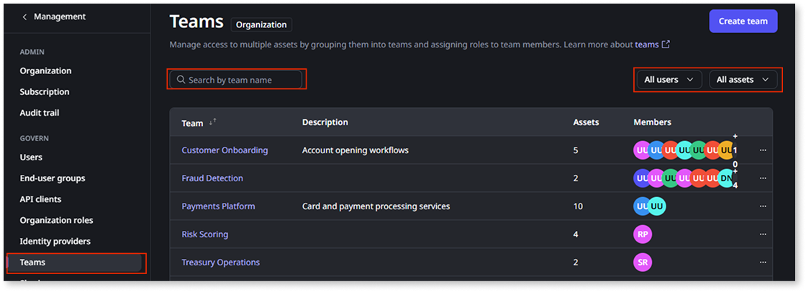

1. Click the team's name to open the team's detail page.

## Create a team {#create}

Follow these steps to create a new team:

1. In ODC Portal, go to **Management** > **Govern** > **Teams**.

1. Click **Create team**.

1. Enter a **Name** for the team.

    The name must be unique in your organization.

1. Optionally, enter a **Description** of the team.

1. Click **Save**.

    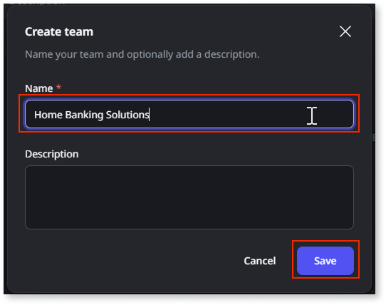

After the team is created, you automatically navigate to the team's edition screen, where you can start [adding members](#add-members) and [adding assets](#add-assets).

## Add members to a team {#add-members}

Adding members (IT-users) to a team gives them the team's role on every asset the team owns. A member's role in a team adds to their [organization-scope and asset-scope roles](teams.md#benefits). Follow these steps:

1. On the detail page of the team, go to the **Members** tab.

1. Click **Add members**. If the team already has members, click **Edit** instead.

    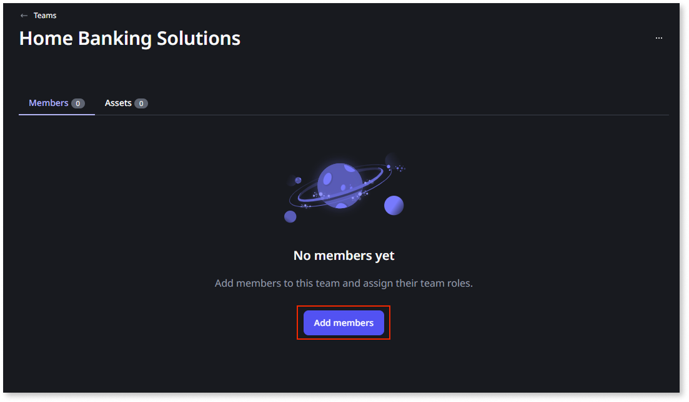

1. Find the members you want to add to the team using the **Search users** box.

1. For each member to add, select their **Role** within the team.

    The member is automatically selected. If you don't want to add them to the team, remove the checkbox selection. The **Save** button stays disabled until every selected member has a role.

1. Click **Save**.

    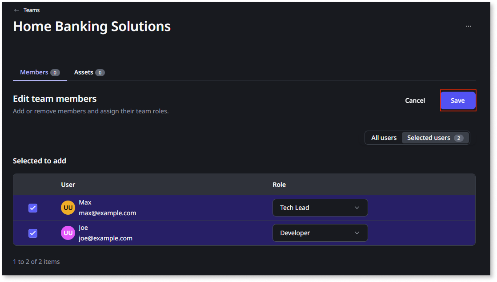

You can also add a member to a team when [inviting them to your organization](../create-deactivate-and-delete-users.md#create-new-members).

## Add assets to a team {#add-assets}

Adding an asset to a team gives every member the team's role on that asset. You can add an asset to a team in the following ways:

* Add an existing asset to a team through the **ODC Portal**.

* Add the asset to a team when you create it in **ODC Studio**, such as an app or a library - it also requires the **Manage teams** permission in the organization role.

Follow these steps to add an asset to a Team through the **ODC Portal**:

1. On the detail page of the team, go to the **Assets** tab.

1. Click **Add assets**. If the team already has assets, click **Edit** instead.

1. Find the assets you want to add to the team using the **Search assets** box.

    You can filter by asset type, or portfolio.

1. Use their checkbox to select the assets.

    An asset already owned by another team shows that team's name in the **Team** column, and you can't select it directly.

1. Click **Save**.

    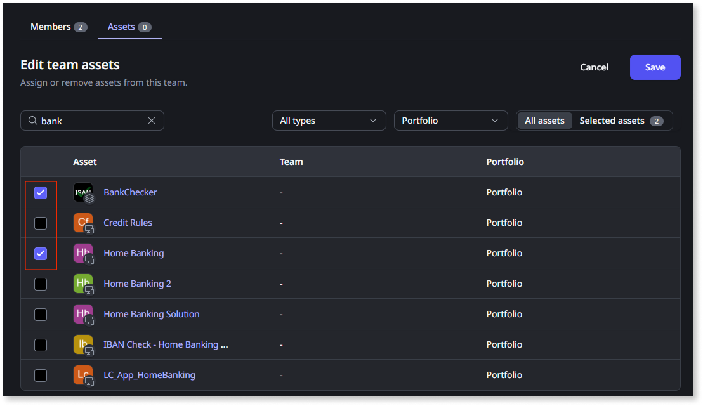

An asset belongs to at most one team. To add an asset that's already owned by another team, [remove it from that team](#remove-asset) first, and then add the asset to the new team.

## Change the role of a team member {#change-role}

You can change a member's role in a team to update the permissions the team grants them on its assets. Follow these steps:

1. On the detail page of the team, go to the **Members** tab.

1. Click the **More actions** icon (**...**) in the row of the member you want to change.

1. Select **Manage role**.

    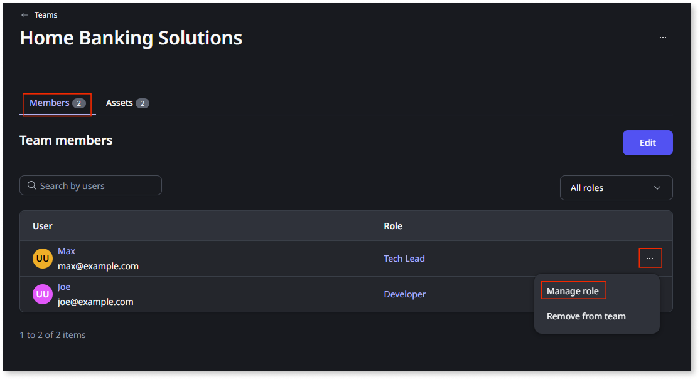

1. Select the **Role** you want to assign.

    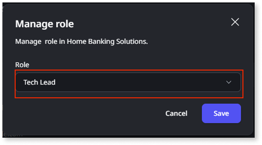

1. Click **Save**.

ODC applies the new role immediately.

## Remove a member from a team {#remove-member}

You can remove a member from a team to revoke the permissions their team role granted them. The member keeps the permissions of their organization-scope and asset-scope roles. Follow these steps:

1. On the detail page of the team, go to the **Members** tab.

1. Click the **More actions** icon (**...**) in the row of the member you want to remove.

1. Select **Remove from team**.

1. In the confirmation window, click **Remove from team** to confirm the operation.

    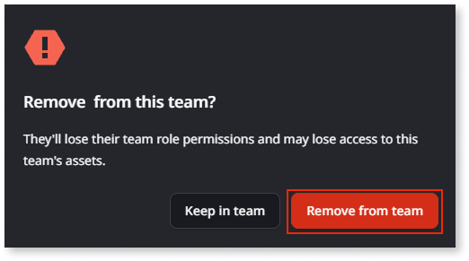

ODC revokes the access immediately.

## Remove an asset from a team {#remove-asset}

Removing an asset from a team means the team's roles no longer apply to it, and the asset stays in your organization without an owning team.

Follow these steps:

1. On the detail page of the team, go to the **Assets** tab.

1. Click the **More actions** icon (**...**) in the row of the asset you want to remove.

1. Select **Remove from team**.

1. In the confirmation window, click **Remove from team** to confirm the operation.

ODC revokes the team's roles on the asset immediately.

## Update the details of a team {#edit}

You can update a team's name and description to keep them accurate as your organization changes. Follow these steps:

1. On the detail page of the team, click the **More actions** icon (**...**) next to the team name.

1. Select **Edit Details**.

    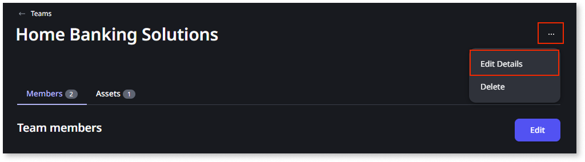

1. Update the **Name**, the **Description**, or both. The name is required.

1. Click **Save**.

## Delete a team {#delete}

You can delete a team your organization no longer uses, even if it still has members or assets.

You can't undo the deletion of a team.

Follow these steps:

1. On the detail page of the team, click the **More actions** icon (**...**) next to the team name.

1. Select **Delete**.

    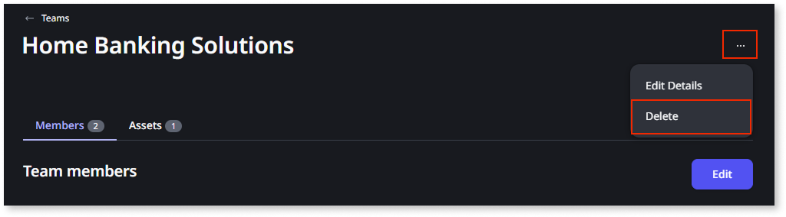

1. In the confirmation window, enter the name of the team to confirm the operation.

    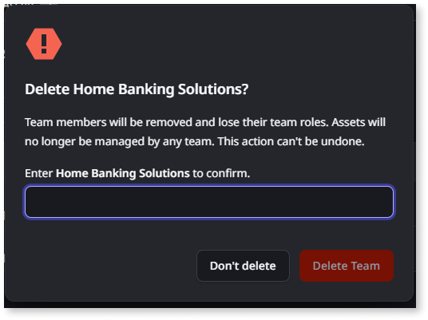

1. Click **Delete Team**.

Deleting a team is immediate. Its members lose the permissions their team roles granted, and its assets stay in your organization without an owning team.

## Related resources {#related}

* [Teams and asset ownership](teams.md)
* [Roles and permissions for members (IT-users)](../roles.md)
* [Create, activate, deactivate, and delete users](../create-deactivate-and-delete-users.md)
* [Grant and revoke user roles](../grant-and-revoke-user-roles.md)
* [Audit trail](../../monitor-and-troubleshoot/audit-trail/audit-trail.md)
* [User and access management API](../../reference/apis/identity-v1.md)
