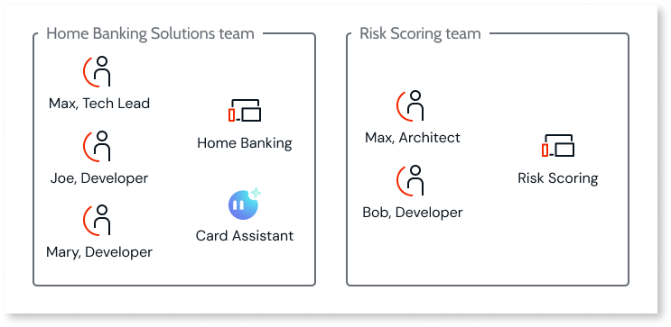

# Teams and asset ownership

A team in OutSystems Developer Cloud (ODC) is a group of members (IT-users) that owns a set of assets, such as apps, libraries, and agentic apps. As your organization grows, teams help you track who's responsible for each asset, and effectively manage access for the whole group of assets in one place.

Here's how teams work:

* [Create a team](manage-teams.md#create) to group, for example, a product team or a business unit.
* [Add assets](manage-teams.md#add-assets) to the team. An asset belongs to at most one team.
* [Add members](manage-teams.md#add-members) to the team. A user can belong to several teams, each with a different organization role. Each member holds the team's role on every asset the team owns.

For more information about how permissions from the organization, team, and asset scopes combine, refer to [Effective permissions calculation](../roles.md#effective-permissions-calculation).

## Benefits of teams {#benefits}

Here are some key benefits of using teams to manage asset ownership and access within your ODC organization:

* **Simplified bulk access management:** Add an asset to a team, and every member immediately gets their team role on it, instead of assigning roles one by one. Add a member to a team, and they immediately get the team's role on every asset the team already owns.

    For example, the Home Banking Solutions team owns the Home Banking app, the Accounts Lib library, and the Card Assistant agentic app. Max has the **Tech Lead** role in the team, and Joe and Mary have the **Developer** role. Adding a fourth asset to the team immediately gives all three of them their team role on it, without an asset-by-asset assignment.

    <!-- TODO: insert a diagram showing the Home Banking Solutions team, its three members (Max as Tech Lead, Joe and Mary as Developer), and the three assets it owns, to illustrate that adding an asset or a member updates access for the whole team at once. -->

* **Flexible access through roles that add up:** Assign a least-privilege role at the organization scope, and grant a member more access through a team role or an asset role instead of raising their organization role for everyone.

    For example, Max holds the **Developer** role at the organization scope. He's also the **Tech Lead** in the Home Banking Solutions team, so he has **Developer** plus **Tech Lead** permissions on the Home Banking app, the Accounts Lib library, and the Card Assistant agentic app. He additionally holds the **Architect** role directly on the Risk Scoring app, which the team doesn't own, so there he has **Developer** plus **Architect**. On any other asset in the organization, he only has his organization-scope **Developer** permissions.

    <!-- TODO: insert a diagram showing Max's access at each scope: Developer at the organization scope, Developer plus Tech Lead on the Home Banking Solutions team's assets, and Developer plus Architect on the Risk Scoring app, to illustrate how a team role adds up with the organization-scope and asset-scope roles. -->

* **Clear ownership across portfolios:** A team can own assets from more than one [portfolio](../../manage-platform-app-lifecycle/portfolios/portfolios-overview.md), so you can see and manage who's responsible for a group of assets regardless of which portfolio each one is in.

## Related resources {#related}

* [Grant and revoke user roles](../grant-and-revoke-user-roles.md)
